# Slice 0: what the QC pass saw, in pictures

**For Michal.** Paullus, 2026-11-11. This is the pairwise engine's half. Varro's half, for the
field engine, is added when his list is in.

You asked for a close look at the frames, because there might be more that you had not
noticed. There is, and this page shows it.

- **This page:** one picture for each kind of thing that looks wrong.
- **[pairwise.md](pairwise.md):** all 75 flags I looked at, each with its four-panel picture,
  its bin and the reason.
- **[qc-results.md](../qc-results.md):** the counts and the list in full. The rules of the
  pass are in [qc-pass.md](../qc-pass.md).

## In short

- **No defect.** In the 75 moments I looked at, the code never contradicts its own text. The
  step back of a whole rank that you saw is gone.
- **Thirteen things look wrong although the code does what it says.** You have seen two of
  them (C and D), and a larger form of a third (A). Ten are new.
- **None of them is changed before the new batch.** The rule Varro and I wrote fixes only a
  defect. A thing that looks wrong but is what the code says is the model's own behaviour,
  and the batch is there to measure that. All thirteen are candidates for the second round.
- **Look at A first.** It is the nearest to what you saw. Varro and I come back to you about
  it once he has read this list.

## How to read a picture

Each picture is a piece of one battle, seen from above. The Romans start on the left and face
right. A whole panel is 30 m across; the caption says when a picture is a part of one. These
are battles of the nominal set, which is never scored.

- **Blue** is a Roman and **orange** a Gaul. The short line on a man shows which way he
  faces.
- **A plain dot** is a steady man. **A black ring:** he has stepped forward to fight.
  **A pale dot with a ring:** he is giving ground. **A red dotted ring:** he is in flight.
  **A cross (×):** he is down.
- **A plus (+)** is a man's slot in his formation, drawn for the body the flag is about. A
  dotted line joins a man to his slot when he is away from it.
- **A small white square** is the standard.
- **A black circle with a number** marks the man the flag is about. The number is his number
  in the viewer.

**The links** open the live viewer at that battle, a few seconds before the moment, with the
man picked out. They work on the Mac only: the viewer runs there now, built from the fixed
code. On the phone they do nothing.

## The thirteen

| | What looks wrong | How often, in 160 battles | New to you? |
|---|---|---|---|
| [A](#a-a-century-steps-back-as-one-when-its-standard-bearer-gives-ground) | A century steps back as one when its standard-bearer gives ground | 420 times | A smaller form of what you saw |
| [B](#b-the-standard-bearer-fights-in-the-front-rank) | The standard-bearer fights in the front rank | 239 times, in 121 battles | New |
| [C](#c-a-man-in-flight-cannot-get-out-of-the-front-rank) | A man in flight cannot get out of the front rank | 1,279 times, in 151 battles | Your second fault |
| [D](#d-a-man-runs-half-a-second-after-he-was-steady) | A man runs half a second after he was steady | 17,674 times, in 152 battles | Your third fault |
| [E](#e-a-runner-runs-behind-his-pursuer) | A runner runs behind his pursuer, who ignores him | Its detector fired 2,101 times, in 130 battles | New |
| [F](#f-runners-keep-their-file-lines) | Runners keep their file lines | Not counted | New |
| [G](#g-pursuit-never-ends) | Pursuit never ends | Not counted | New |
| [H](#h-the-two-fronts-pack-into-one-dense-band) | The two fronts pack into one dense band | Not counted; seen in two battles | New |
| [I](#i-a-strike-passes-through-a-comrade) | A strike passes through a comrade | 549 times, in 53 battles | New |
| [J](#j-men-attacked-from-behind-rarely-face-about) | Men attacked from behind rarely face about | Counted in one battle | New |
| [K](#k-and-l-a-lost-file-is-never-closed-from-the-side-and-two-bodies-stand-corner-to-corner) | A lost file is never closed from the side | 111 times an empty place on a man's left | New |
| [L](#k-and-l-a-lost-file-is-never-closed-from-the-side-and-two-bodies-stand-corner-to-corner) | Two bodies stand corner to corner to the end | Not counted; seen once | New |
| [M](#m-a-body-halts-before-a-single-man) | A body halts before a single man | Seen once | New |

The field engine's counts are close to these for B, D and E, and lower for C (354) and I
(240). What its pictures show is Varro's list.

## A. A century steps back as one when its standard-bearer gives ground

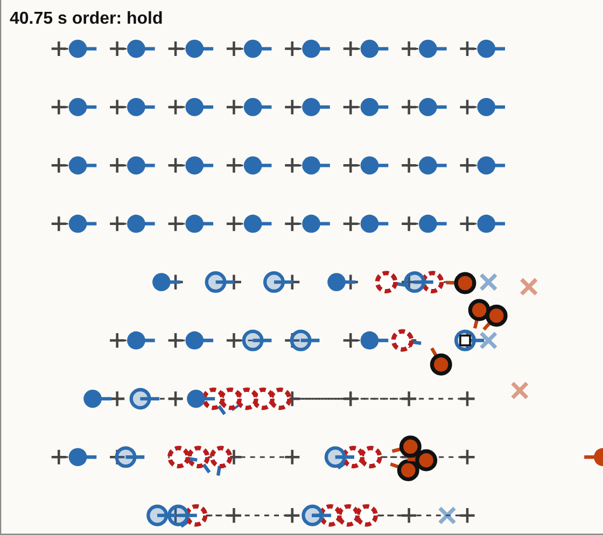

*`base`, seed 1, at 40.75 s. Part of a panel, 19 m across.*

- **Look at the four rear ranks.** Every man has his slot (+) 0.65 m behind him. None of
  them is fighting. Half a second later all of them stand on their slots again: the century
  has stepped back as one.
- **Why.** The formation is anchored on its standard-bearer. He is the man with the white
  square, now in the front rank, and he has just given ground. When he is more than 0.6 m
  from his place, the code moves the whole formation to him. Its own text says so: "A halted
  frame stays put until he is out of his place in it."
- **What the fix changed.** What you saw at 29 s was a step back of a whole rank, 1.8 m,
  when a file closed up. That is gone: at 29.25 s the standard-bearer now walks up and the
  formation stays. This smaller step remains.
- **In the viewer:** [the step back at 40.75 s](http://127.0.0.1:8377/?engine=pairwise&rung=0&variant=base&seed=1&t=38&man=15),
  [the moment you saw, at 29.25 s](http://127.0.0.1:8377/?engine=pairwise&rung=0&variant=base&seed=1&t=27&man=15).

**The same rule has two more faces.**

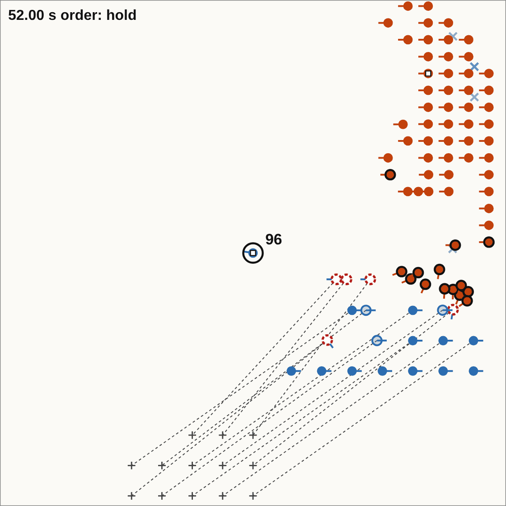

*`base`, seed 1, at 52 s. A whole panel.*

- **A formation re-forms where its standard-bearer stops.** Man 96 carries the second
  century's standard. He fled 5 m, stopped and stood again. The formation went with him: the
  dotted lines run from each man still in the line to his new slot, more than 10 m away.
  The twelve who still stand then walk 16 m out of the line to it.
- **A halted warband's slots jump forward.** When its standard-bearer steps out to fight,
  all 158 slots move 1.3 m, twice in two seconds (42.5 s, the same battle; no picture here).
- **In the viewer:** [man 96 from 49 s](http://127.0.0.1:8377/?engine=pairwise&rung=0&variant=base&seed=1&t=49&man=96).

## B. The standard-bearer fights in the front rank

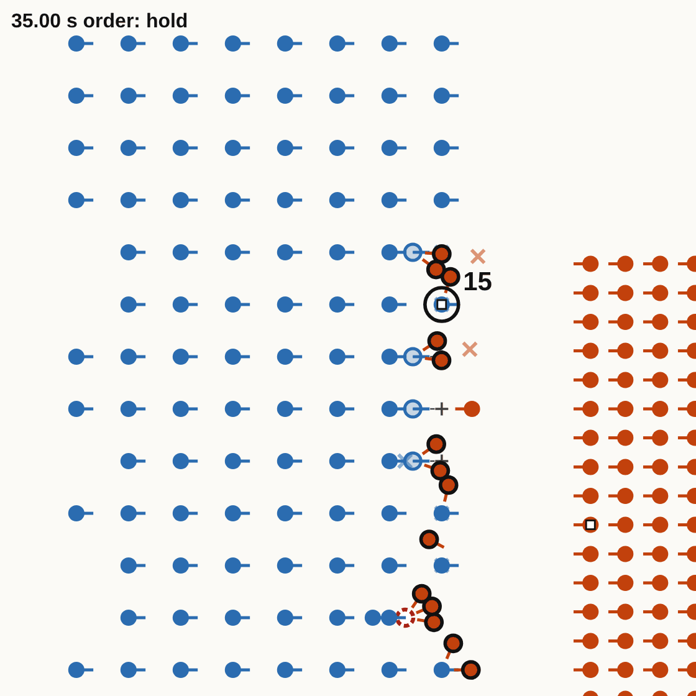

*`base`, seed 1, at 35 s. Part of a panel, 24 m across.*

- **Look at man 15.** He carries the first century's standard and started in the second
  rank. The man ahead of him fell, the file closed up, and he is now a front-rank fighter
  with Gauls on him. He stays there for 11.5 s.
- **Why.** Files close forward over the fallen, and the standard-bearer is a man of his file
  like any other.
- **A starts here.** Once he is in the front rank he is attacked and gives ground, and the
  century follows him.
- **In the viewer:** [man 15 from 27 s](http://127.0.0.1:8377/?engine=pairwise&rung=0&variant=base&seed=1&t=27&man=15).

## C. A man in flight cannot get out of the front rank

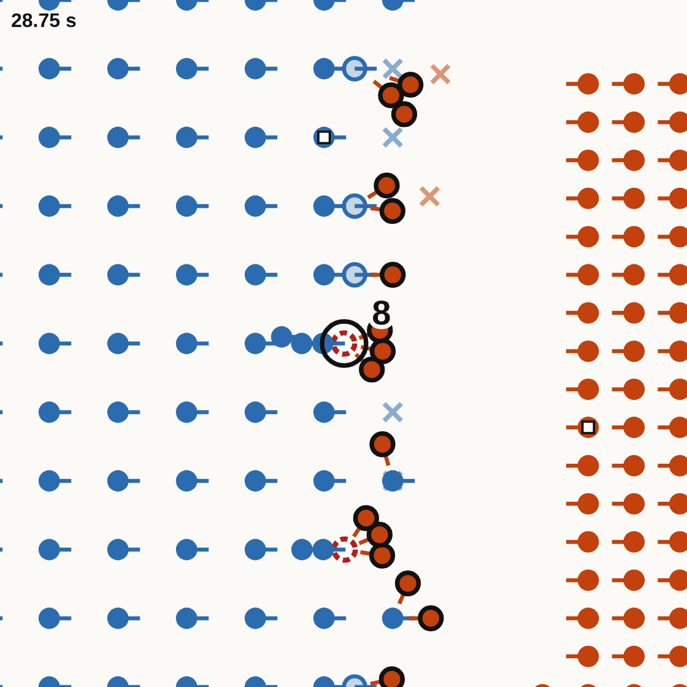

*`base`, seed 1, at 28.75 s. Part of a panel, 18 m across.*

- **Look at man 8.** He has been in flight for more than 15 s and is still in the front
  rank, with three Gauls on him. He cannot pass through his own files. The men bunched
  behind him stand a rank short of their slots, because he is in the way.
- **Your second fault.** The longest I saw lasted 21 s.
- **In the viewer:** [man 8 from 12 s](http://127.0.0.1:8377/?engine=pairwise&rung=0&variant=base&seed=1&t=12&man=8).

## D. A man runs half a second after he was steady

No picture: a still cannot show it.

- **Man 82** is steady at 18.5 s, giving ground at 18.75 s and in flight at 19 s.
- **Your third fault.** It is as common on the field engine: 16,876 times.
- **In the viewer:** [man 82 from 17 s](http://127.0.0.1:8377/?engine=pairwise&rung=0&variant=base&seed=1&t=17&man=82).

## E. A runner runs behind his pursuer

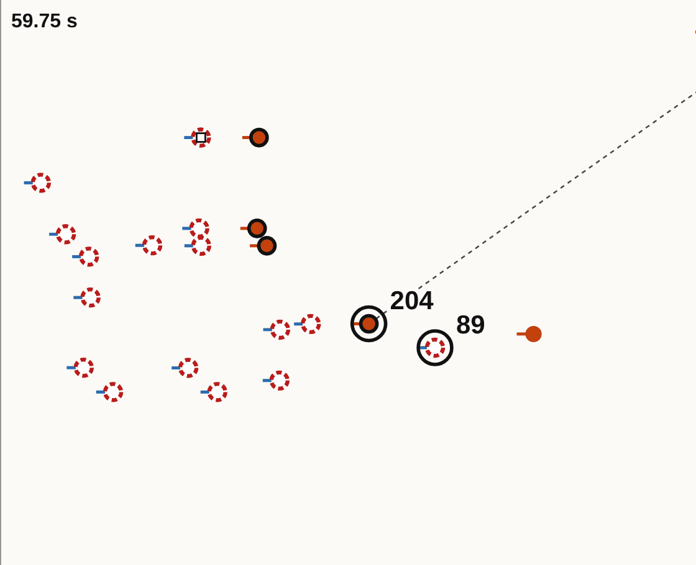

*`base`, seed 1, at 59.75 s. Part of a panel, 24 m across. Everyone here is moving to the
left, away from the field.*

- **Look at 89 and 204.** Roman 89 is in flight. Gaul 204 chases other Romans, 2.4 m ahead
  of him. They run like this for 82 s, at the same pace.
- **Why.** A man in flight runs straight to the rear and does not read where the enemy is. A
  pursuer strikes only at what is ahead of him.
- **In the viewer:** [man 89 from 58 s](http://127.0.0.1:8377/?engine=pairwise&rung=0&variant=base&seed=1&t=58&man=89).

## F. Runners keep their file lines

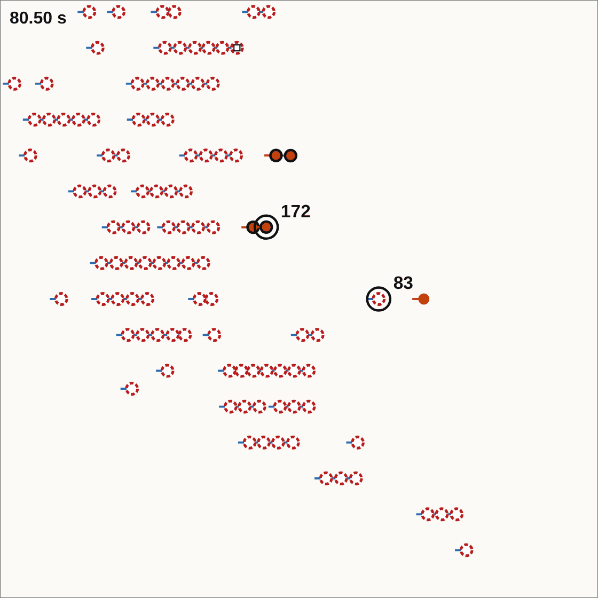

*`base`, seed 1, at 80.5 s. A whole panel.*

- **Look at the rows.** A broken century runs off in rows of five to nine men, nose to tail
  at half a metre. It is still in rows 100 s later.
- **Why.** All of them run the same way at the same pace, and bodies are solid, so nobody
  overtakes.
- **In the viewer:** [from 80 s](http://127.0.0.1:8377/?engine=pairwise&rung=0&variant=base&seed=1&t=80&man=83).

## G. Pursuit never ends

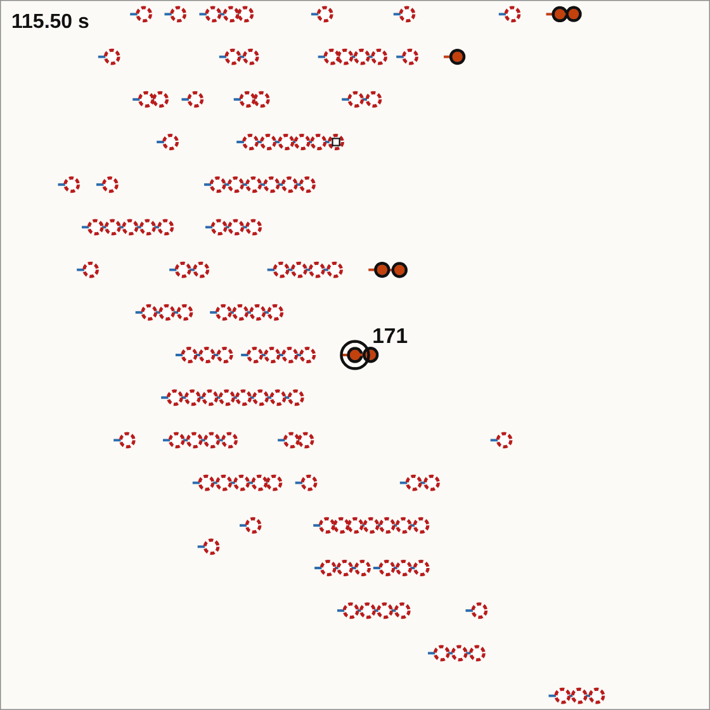

*`base`, seed 1, at 115.5 s, 300 m from where the lines met. A whole panel.*

- **Look at the Gauls with black rings.** They are pursuers, still among the runners. Man
  171 is still there 105 s later. Pursuers and runners move at the same 4 m/s, so nobody is
  caught and nobody gives up.
- **Why.** No rule ends a pursuit. The scored runs stop when the rout ends, so no score
  sees this.
- **In the viewer:** [man 171 from 114 s](http://127.0.0.1:8377/?engine=pairwise&rung=0&variant=base&seed=1&t=114&man=171).

## H. The two fronts pack into one dense band

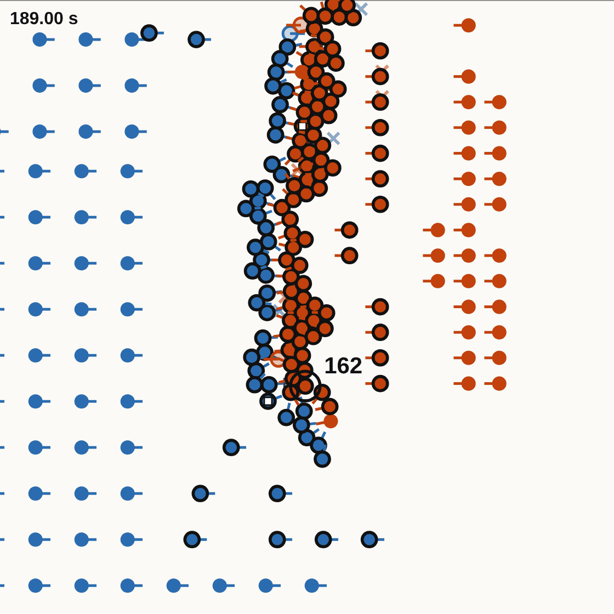

*`veterans`, seed 2, at 189 s. Part of a panel, 24 m across.*

- **Look at the band in the middle.** After three minutes each side's front ranks have gone
  forward and stand two or three deep, at about half a metre a man, along 25 m. The Romans'
  fighting room of 1.8 m a man is gone. Behind the band their rear ranks still stand in
  open order.
- **Why.** Any man may step forward to fight, and nothing keeps room between the fighters.
  No detector fires, because the density stays under its line of 6 men to a square metre.
- **In the viewer:** [from 187 s](http://127.0.0.1:8377/?engine=pairwise&rung=0&variant=veterans&seed=2&t=187&man=162).

## I. A strike passes through a comrade

No picture: the three men overlap in the drawing.

- **At 50 s** in `base`, seed 1, Gaul 184 and Roman 97 fight a bout over 1.46 m, with Gaul
  183 standing 0.18 m from the line between them.
- **Why.** A man fights the nearest enemy within reach who is not behind him. Nothing asks
  whether the way is clear. Half of the 549 are in the band of H.
- **In the viewer:** [man 184 from 48 s](http://127.0.0.1:8377/?engine=pairwise&rung=0&variant=base&seed=1&t=48&man=184).

## J. Men attacked from behind rarely face about

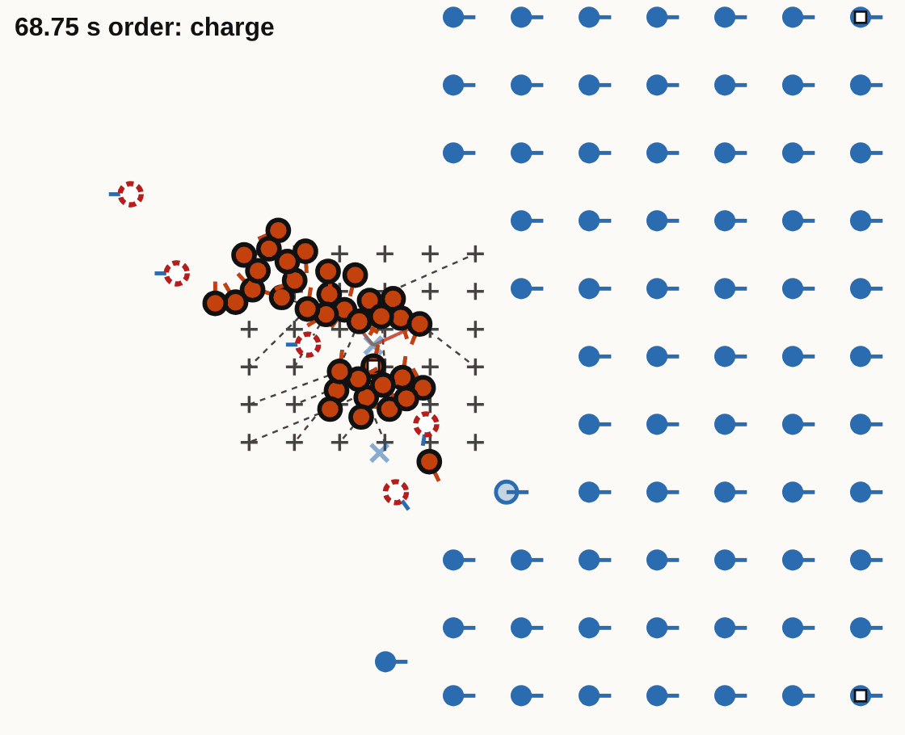

*`shock`, seed 1, at 68.75 s. Part of a panel, 24 m across. The band has charged into the
back of the Roman line from the left.*

- **Look at the Romans beside the band.** They are steady and still face the front: their
  short lines point right.
- **Counted 25 s after the band arrives,** in this battle: 29 Romans are within 3 m of a
  man of the band. 20 are in flight. Of the 9 who stand, 7 have their backs or sides to
  him.
- **Why.** A man picks his opponent among the enemies in front of him, so one behind him is
  no opponent. I have not traced what made the two turn.
- **In the viewer:** [from 64 s](http://127.0.0.1:8377/?engine=pairwise&rung=0&variant=shock&seed=1&t=64&man=331).

## K and L. A lost file is never closed from the side, and two bodies stand corner to corner

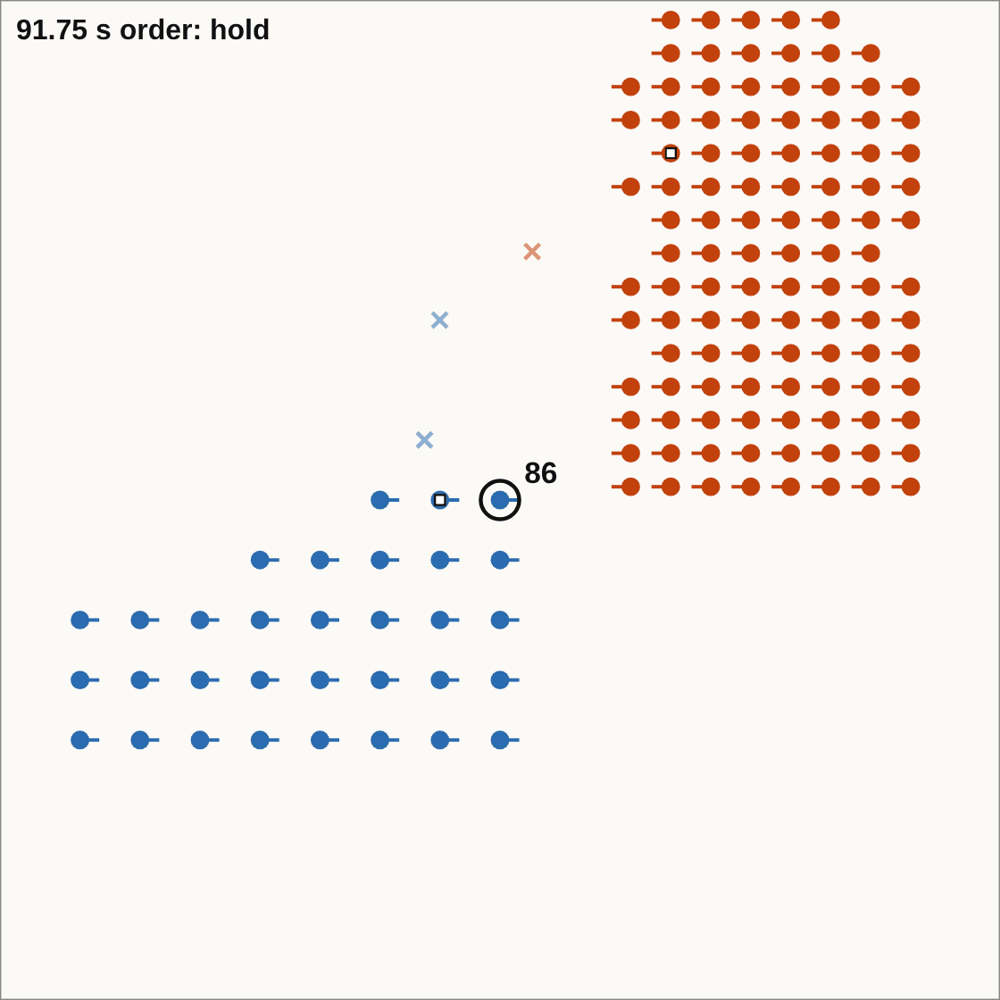

*`base`, seed 3, at 91.75 s. A whole panel.*

- **K: look at the Romans' staircase.** These are the 30 men left of the second century. Its
  upper files are gone or short, and nobody moves across to fill them. In another battle one
  survivor stands alone at his slot for nine minutes.
- **Why.** Files close forward only.
- **L: look at the two bodies.** The first century has broken and gone. The warband and
  this century stand corner to corner, both steady, until the ten minutes end. Neither
  turns on the other.
- **Why.** Slice 0 has no command above the body, and a man steps forward only at what is
  ahead of him.
- **In the viewer:** [man 86 from 60 s](http://127.0.0.1:8377/?engine=pairwise&rung=0&variant=base&seed=3&t=60&man=86).

## M. A body halts before a single man

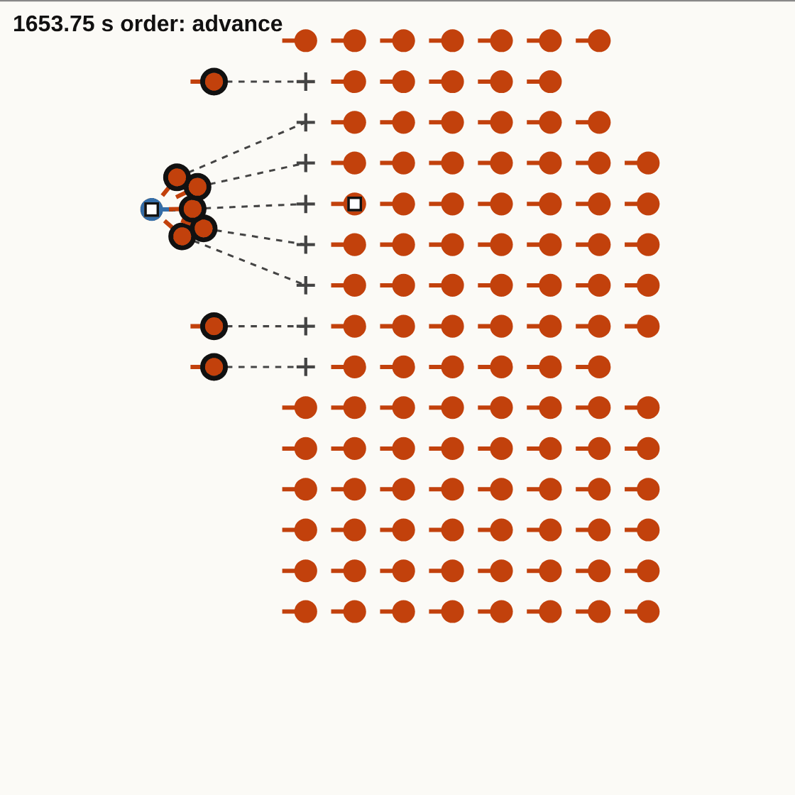

*`backed`, seed 2, at 1,653.75 s. Part of a panel, 19.5 m across.*

- **Look at the one blue man.** He is a Roman standard-bearer who stands alone. The warband
  has the order to advance. Its 138 men wait at their standoff, 4 m from him, and send out a
  few at a time.
- **Why.** A body halts at its standoff from the nearest enemy who stands within its
  frontage, however few they are.
- **In the viewer:** [from 1,646 s](http://127.0.0.1:8377/?engine=pairwise&rung=0&variant=backed&seed=2&t=1646).
  The viewer needs a moment to run that far.

## How the pictures were made

The pass's tool drew four panels for each flag, on the Raspberry Pi
([`tools/qc-render.py`](../../../tools/qc-render.py)); those are in
[pairwise.md](pairwise.md). Each picture here is one of those panels, or a part of one, cut
out without drawing anything again ([`tools/qc-crop.py`](../../../tools/qc-crop.py), from the
list in [cuts.txt](cuts.txt)).
