# Slice 0, QC pass: every field flag looked at

The 95 flags the rule picks on the field engine, each with its picture, what the detector
measured, the bin it went into and why, and the link that opens the live viewer a few
seconds before it (on the Mac only, while the viewer runs there).

- **Bins:** 4 of a defect, 41 fine, 50 gaps. The letters are explained in
  [qc-results-field.md](../qc-results-field.md), and the page that shows one picture for each kind of
  thing found is [README.md](README.md).
- **A picture** has four panels of 30 m by 30 m: the moments around the flag. A
  drawing shown once already is not repeated: 84 pictures for 95 flags.
- **Made by** [`tools/qc-page.py`](../../../tools/qc-page.py) from the table in
  qc-results-field.md and the pictures of [`tools/qc-render.py`](../../../tools/qc-render.py).
  Nothing here is written by hand.

### 01-slot-jump-field-by-the-lead-1

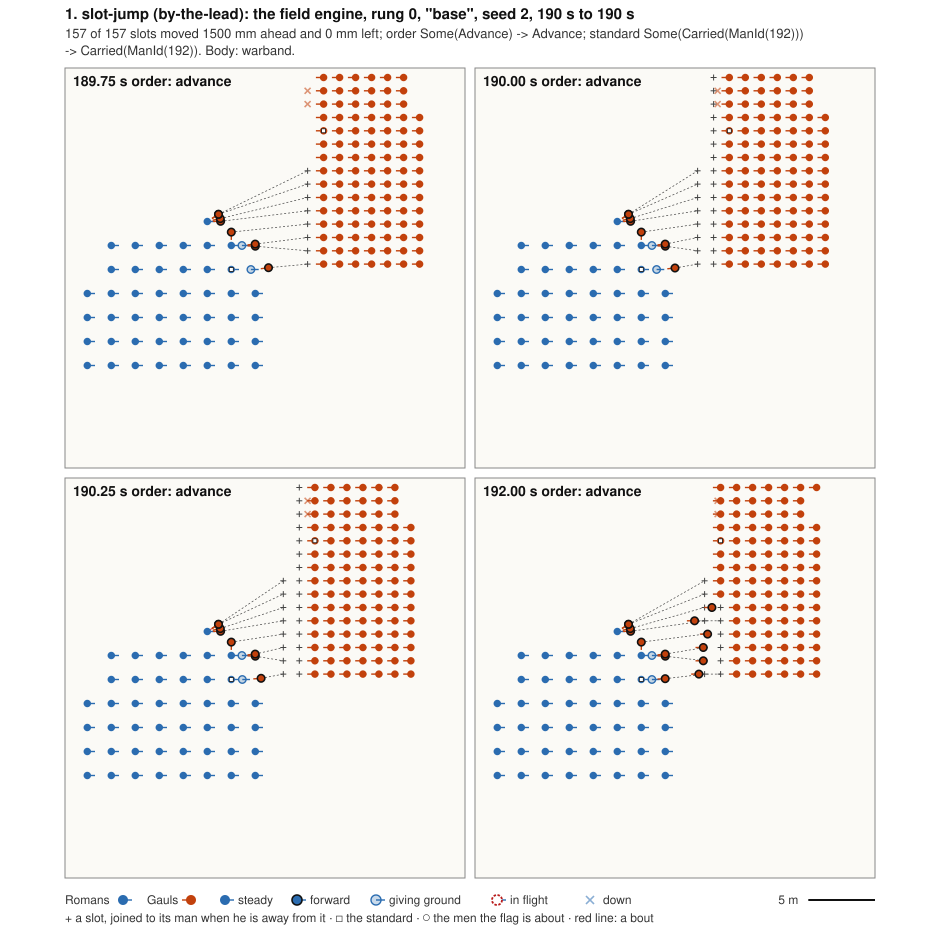

- **Where:** the field engine, rung 0, `base`, seed 2, at 190 s.
- **Measured:** 157 of 157 slots moved 1500 mm ahead and 0 mm left; order Some(Advance) -> Advance; standard Some(Carried(ManId(192))) -> Carried(ManId(192)). Kind: by-the-lead. One of 503 of this kind on this engine.
- **Bin:** fine. The warband's lead comes on as the century ahead gives way.
- **In the viewer:** http://127.0.0.1:8377/?engine=field&rung=0&variant=base&seed=2&t=187

### 01-slot-jump-field-by-the-lead-2

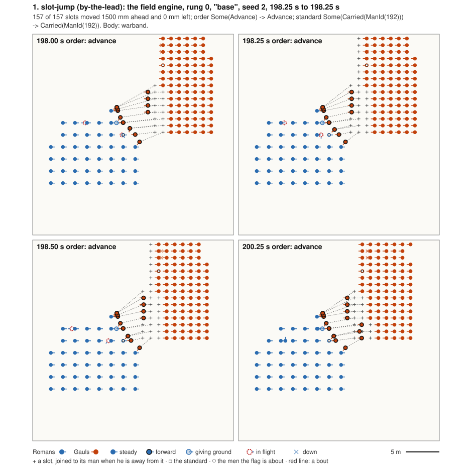

- **Where:** the field engine, rung 0, `base`, seed 2, at 198.25 s.
- **Measured:** 157 of 157 slots moved 1500 mm ahead and 0 mm left; order Some(Advance) -> Advance; standard Some(Carried(ManId(192))) -> Carried(ManId(192)). Kind: by-the-lead. One of 503 of this kind on this engine.
- **Bin:** fine. The warband's lead comes on as the century ahead gives way.
- **In the viewer:** http://127.0.0.1:8377/?engine=field&rung=0&variant=base&seed=2&t=195

### 01-slot-jump-field-by-the-lead-3

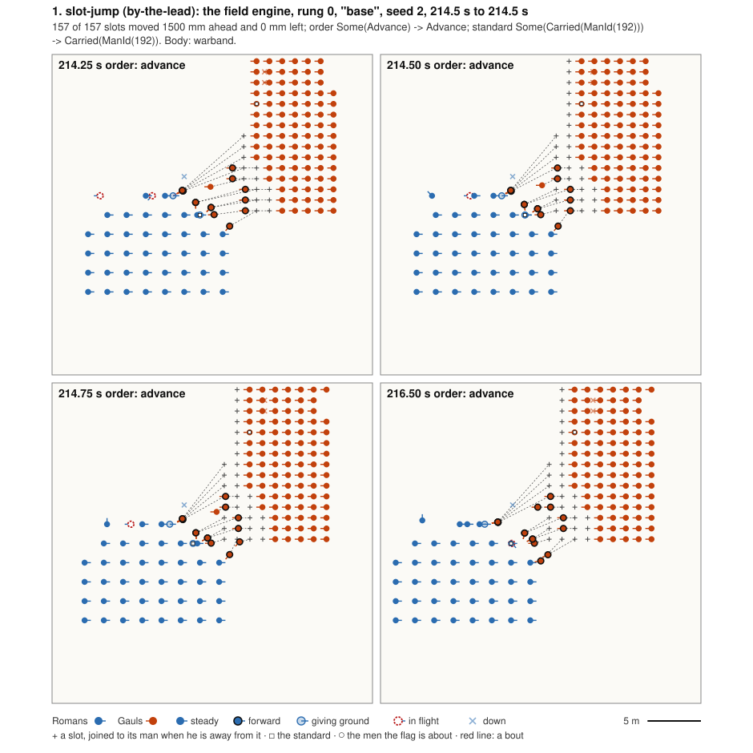

- **Where:** the field engine, rung 0, `base`, seed 2, at 214.5 s.
- **Measured:** 157 of 157 slots moved 1500 mm ahead and 0 mm left; order Some(Advance) -> Advance; standard Some(Carried(ManId(192))) -> Carried(ManId(192)). Kind: by-the-lead. One of 503 of this kind on this engine.
- **Bin:** fine. The warband's lead comes on as the century ahead gives way.
- **In the viewer:** http://127.0.0.1:8377/?engine=field&rung=0&variant=base&seed=2&t=211

### 01-slot-jump-field-by-the-lead-4

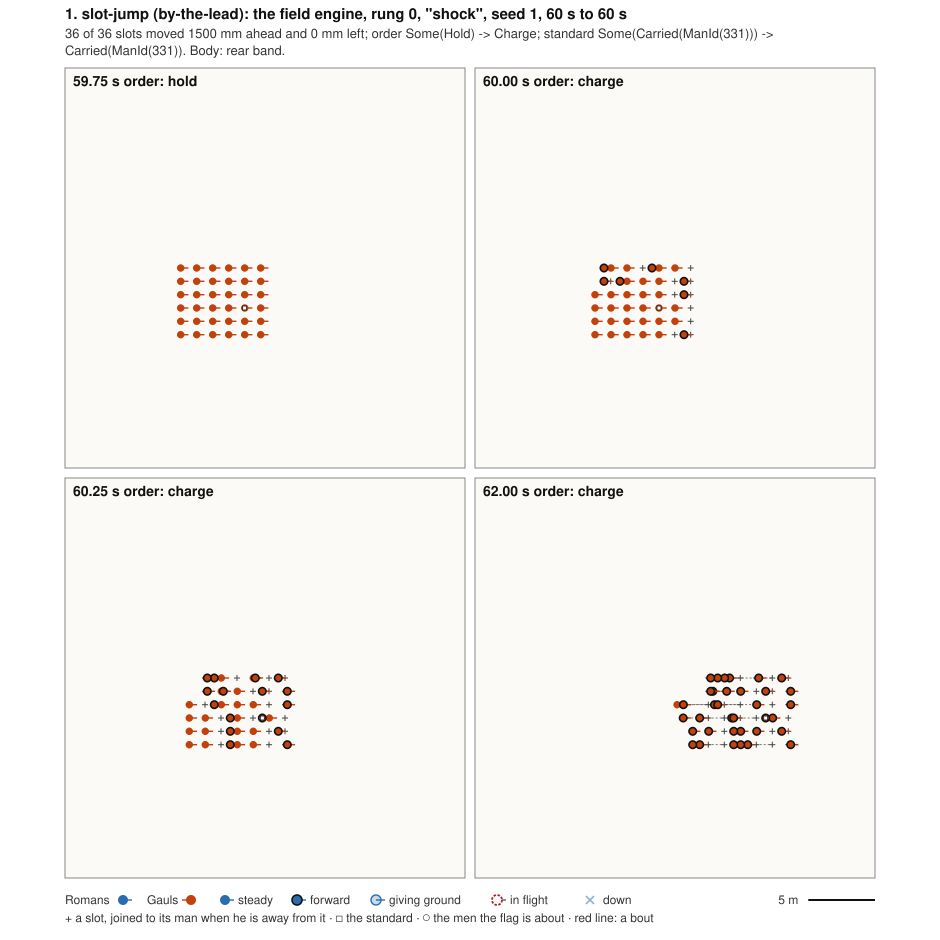

- **Where:** the field engine, rung 0, `shock`, seed 1, at 60 s.
- **Measured:** 36 of 36 slots moved 1500 mm ahead and 0 mm left; order Some(Hold) -> Charge; standard Some(Carried(ManId(331))) -> Carried(ManId(331)). Kind: by-the-lead. One of 503 of this kind on this engine.
- **Bin:** fine. The rear band is ordered to charge and its lead comes on.
- **In the viewer:** http://127.0.0.1:8377/?engine=field&rung=0&variant=shock&seed=1&t=57

### 01-slot-jump-field-other-1

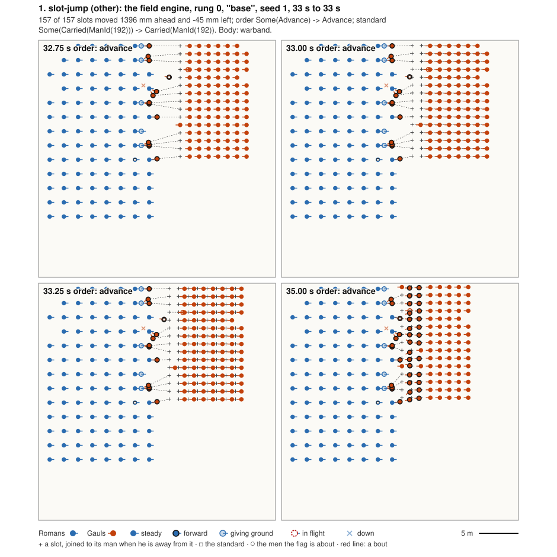

- **Where:** the field engine, rung 0, `base`, seed 1, at 33 s.
- **Measured:** 157 of 157 slots moved 1396 mm ahead and -45 mm left; order Some(Advance) -> Advance; standard Some(Carried(ManId(192))) -> Carried(ManId(192)). Kind: other. One of 510 of this kind on this engine.
- **Bin:** gap A. The halted warband's frame re-forms on its chieftain, who has stepped out more than 1,200 mm; at 38.75 s it moves 1.1 m sideways with him.
- **In the viewer:** http://127.0.0.1:8377/?engine=field&rung=0&variant=base&seed=1&t=30

### 01-slot-jump-field-other-2

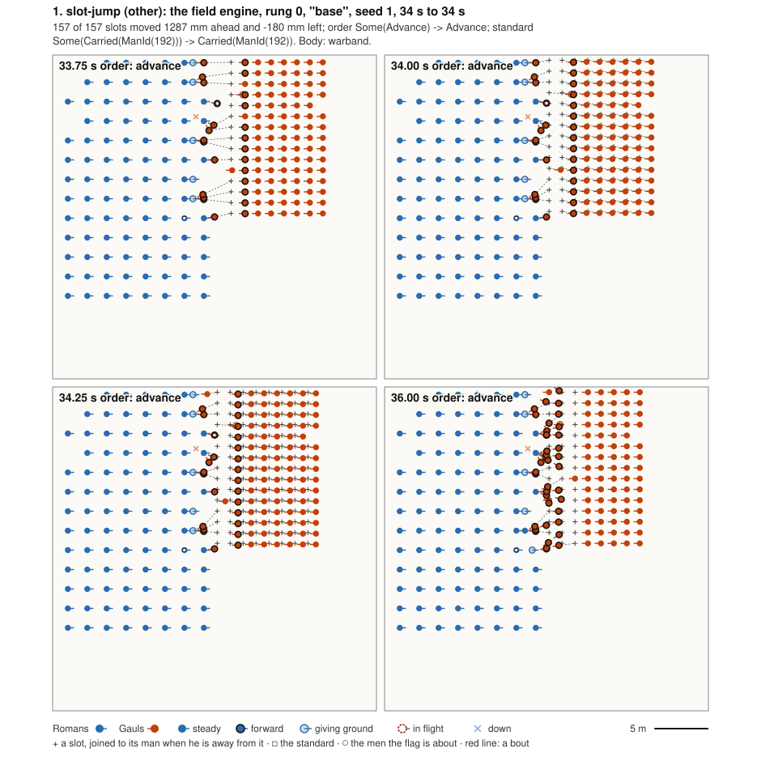

- **Where:** the field engine, rung 0, `base`, seed 1, at 34 s.
- **Measured:** 157 of 157 slots moved 1287 mm ahead and -180 mm left; order Some(Advance) -> Advance; standard Some(Carried(ManId(192))) -> Carried(ManId(192)). Kind: other. One of 510 of this kind on this engine.
- **Bin:** gap A. The halted warband's frame re-forms on its chieftain, who has stepped out more than 1,200 mm; at 38.75 s it moves 1.1 m sideways with him.
- **In the viewer:** http://127.0.0.1:8377/?engine=field&rung=0&variant=base&seed=1&t=31

### 01-slot-jump-field-other-3

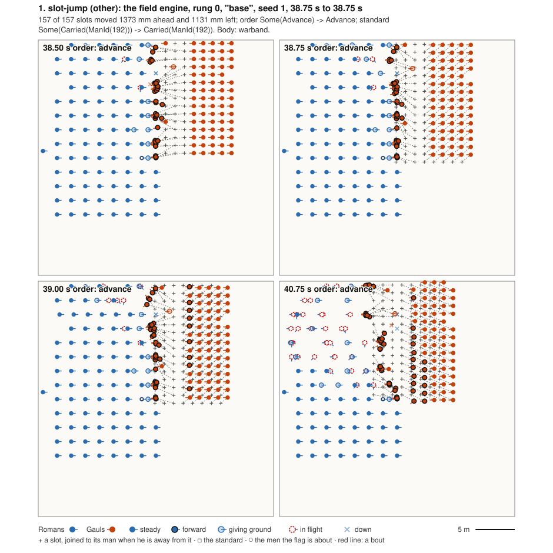

- **Where:** the field engine, rung 0, `base`, seed 1, at 38.75 s.
- **Measured:** 157 of 157 slots moved 1373 mm ahead and 1131 mm left; order Some(Advance) -> Advance; standard Some(Carried(ManId(192))) -> Carried(ManId(192)). Kind: other. One of 510 of this kind on this engine.
- **Bin:** gap A. The halted warband's frame re-forms on its chieftain, who has stepped out more than 1,200 mm; at 38.75 s it moves 1.1 m sideways with him.
- **In the viewer:** http://127.0.0.1:8377/?engine=field&rung=0&variant=base&seed=1&t=35

### 01-slot-jump-field-other-4

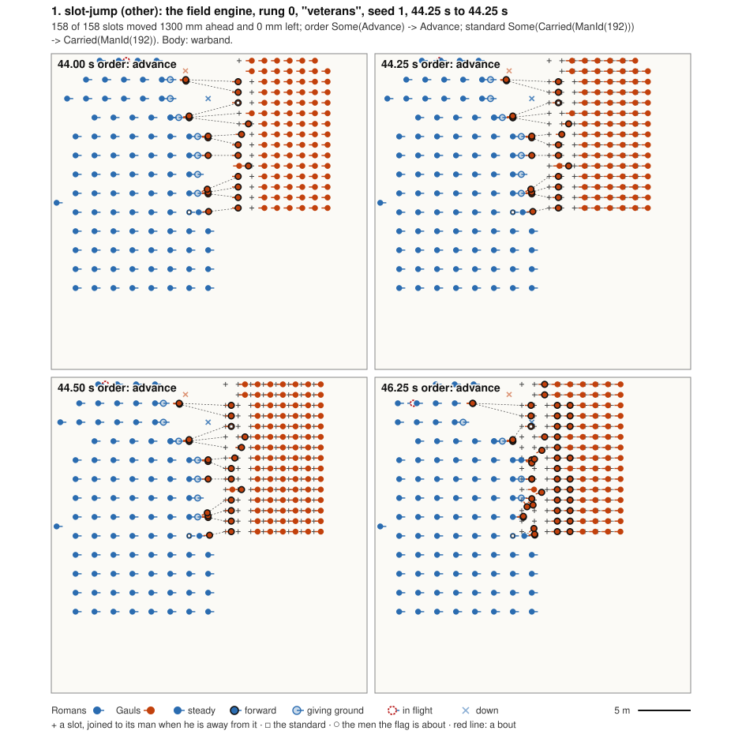

- **Where:** the field engine, rung 0, `veterans`, seed 1, at 44.25 s.
- **Measured:** 158 of 158 slots moved 1300 mm ahead and 0 mm left; order Some(Advance) -> Advance; standard Some(Carried(ManId(192))) -> Carried(ManId(192)). Kind: other. One of 510 of this kind on this engine.
- **Bin:** gap A. The same. Clip of the same battle at 95 to 99 s: he runs 1,000 mm a step in pursuit and the frame re-forms every second step.
- **In the viewer:** http://127.0.0.1:8377/?engine=field&rung=0&variant=veterans&seed=1&t=41

### 02-halted-body-walks-field-1

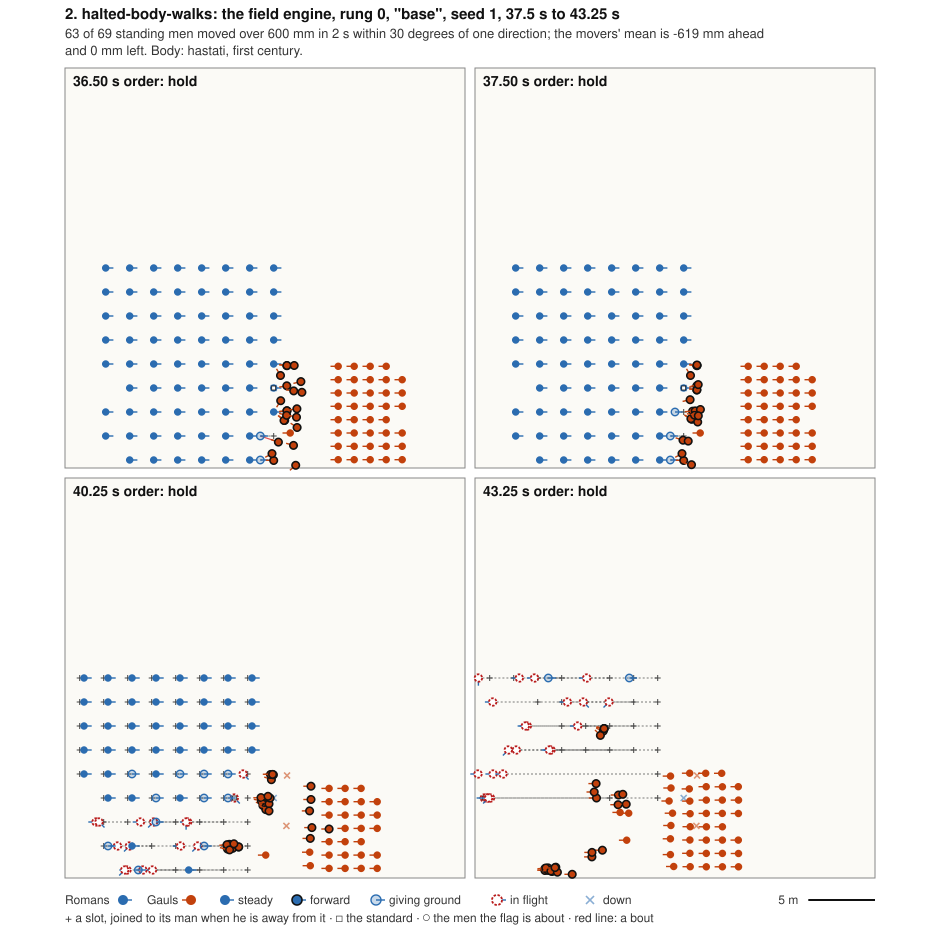

- **Where:** the field engine, rung 0, `base`, seed 1, at 37.5 s, for 5.75 s.
- **Measured:** 63 of 69 standing men moved over 600 mm in 2 s within 30 degrees of one direction; the movers' mean is -619 mm ahead and 0 mm left. One of 577 of this kind on this engine.
- **Bin:** gap A. The men walk back to slots that stepped back 650 mm with their standard-bearer, and then the century breaks.
- **In the viewer:** http://127.0.0.1:8377/?engine=field&rung=0&variant=base&seed=1&t=34

### 02-halted-body-walks-field-2

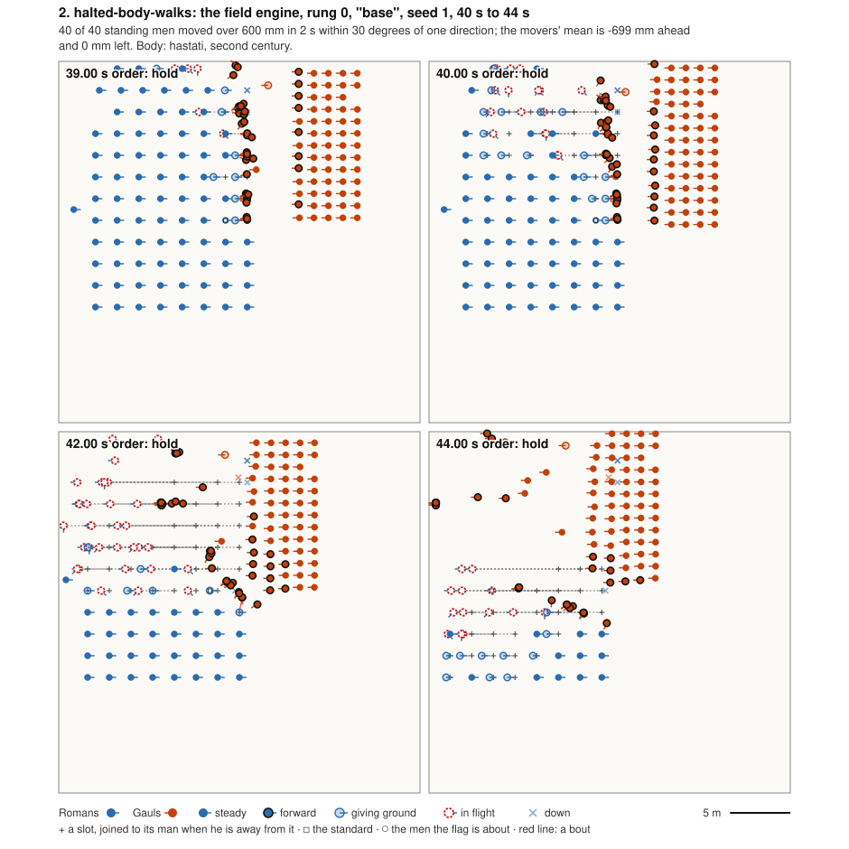

- **Where:** the field engine, rung 0, `base`, seed 1, at 40 s, for 4 s.
- **Measured:** 40 of 40 standing men moved over 600 mm in 2 s within 30 degrees of one direction; the movers' mean is -699 mm ahead and 0 mm left. One of 577 of this kind on this engine.
- **Bin:** gap A. The men walk back to slots that stepped back 650 mm with their standard-bearer, and then the century breaks.
- **In the viewer:** http://127.0.0.1:8377/?engine=field&rung=0&variant=base&seed=1&t=37

### 02-halted-body-walks-field-3

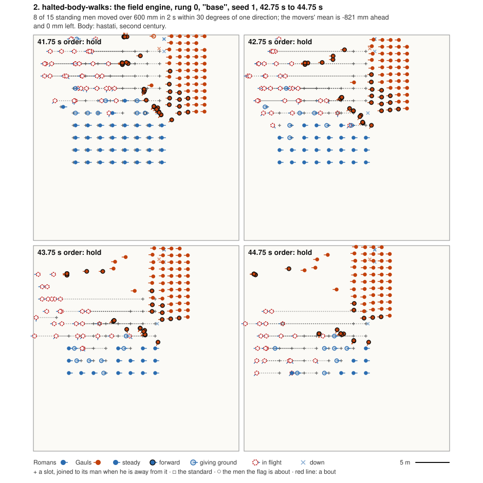

- **Where:** the field engine, rung 0, `base`, seed 1, at 42.75 s, for 2 s.
- **Measured:** 8 of 15 standing men moved over 600 mm in 2 s within 30 degrees of one direction; the movers' mean is -821 mm ahead and 0 mm left. One of 577 of this kind on this engine.
- **Bin:** gap A. The men walk back to slots that stepped back 650 mm with their standard-bearer, and then the century breaks.
- **In the viewer:** http://127.0.0.1:8377/?engine=field&rung=0&variant=base&seed=1&t=39

### 02-halted-body-walks-field-4

*The same drawing as [`02-halted-body-walks-field-1`](#02-halted-body-walks-field-1).*

- **Where:** the field engine, rung 0, `backed`, seed 1, at 37.5 s, for 5.75 s.
- **Measured:** 63 of 69 standing men moved over 600 mm in 2 s within 30 degrees of one direction; the movers' mean is -619 mm ahead and 0 mm left. One of 577 of this kind on this engine.
- **Bin:** gap A. The men walk back to slots that stepped back 650 mm with their standard-bearer, and then the century breaks.
- **In the viewer:** http://127.0.0.1:8377/?engine=field&rung=0&variant=backed&seed=1&t=34

### 03-pinned-runner-field-1

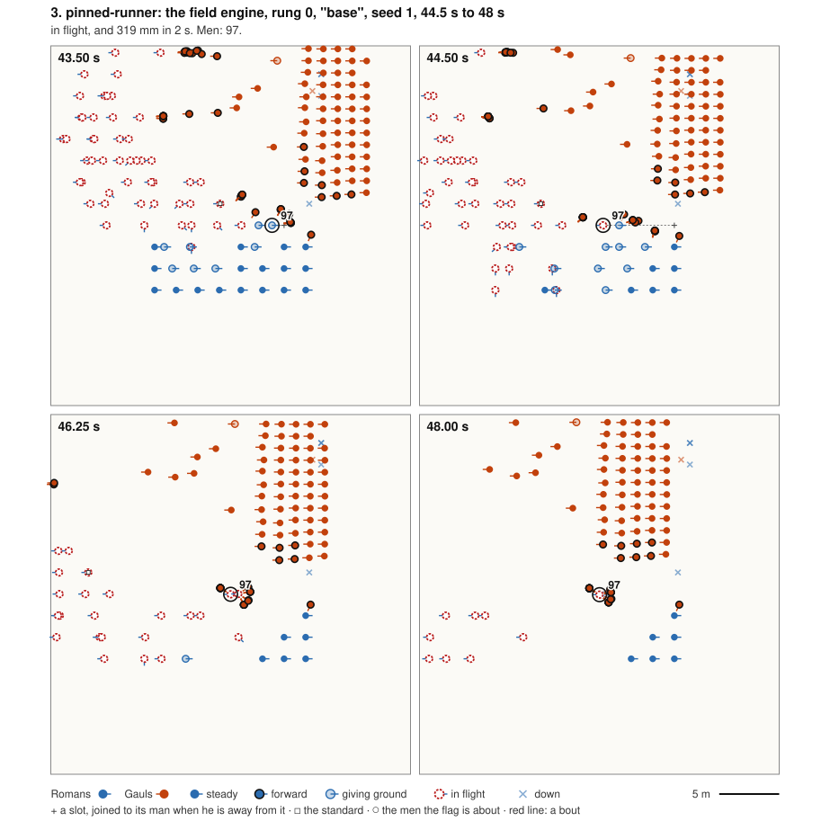

- **Where:** the field engine, rung 0, `base`, seed 1, at 44.5 s, for 3.5 s.
- **Measured:** in flight, and 319 mm in 2 s. One of 354 of this kind on this engine.
- **Bin:** fine. A runner ringed by two to five pursuers cannot pass them, and stands 2.5 to 4.25 s until he is cut down.
- **In the viewer:** http://127.0.0.1:8377/?engine=field&rung=0&variant=base&seed=1&t=41&man=97

### 03-pinned-runner-field-2

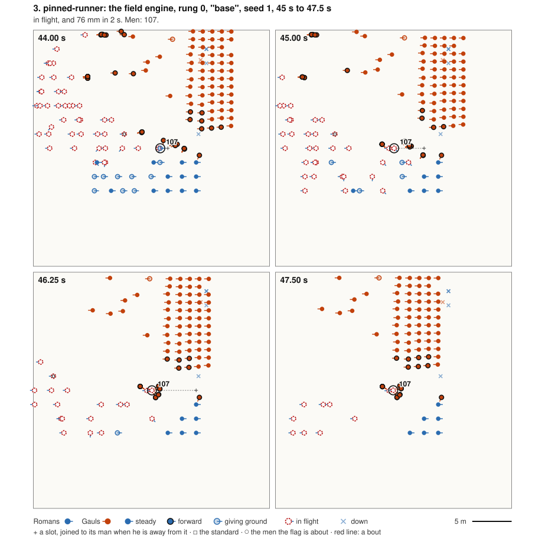

- **Where:** the field engine, rung 0, `base`, seed 1, at 45 s, for 2.5 s.
- **Measured:** in flight, and 76 mm in 2 s. One of 354 of this kind on this engine.
- **Bin:** fine. A runner ringed by two to five pursuers cannot pass them, and stands 2.5 to 4.25 s until he is cut down.
- **In the viewer:** http://127.0.0.1:8377/?engine=field&rung=0&variant=base&seed=1&t=42&man=107

### 03-pinned-runner-field-3

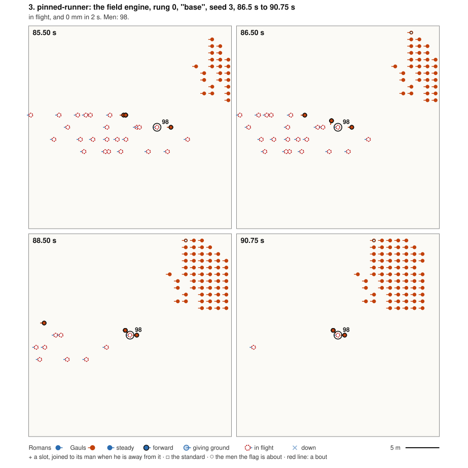

- **Where:** the field engine, rung 0, `base`, seed 3, at 86.5 s, for 4.25 s.
- **Measured:** in flight, and 0 mm in 2 s. One of 354 of this kind on this engine.
- **Bin:** fine. A runner ringed by two to five pursuers cannot pass them, and stands 2.5 to 4.25 s until he is cut down.
- **In the viewer:** http://127.0.0.1:8377/?engine=field&rung=0&variant=base&seed=3&t=83&man=98

### 03-pinned-runner-field-4

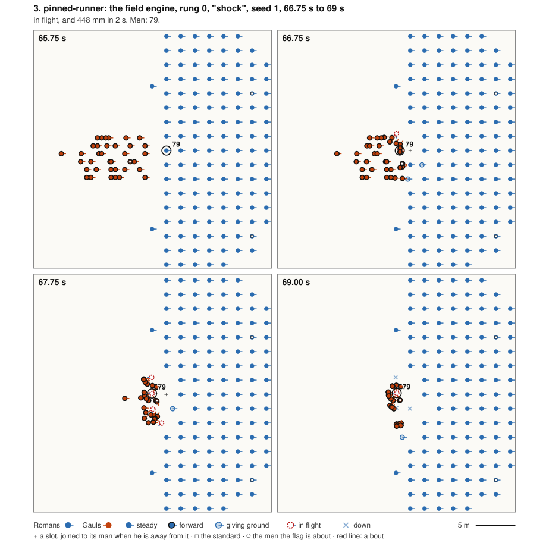

- **Where:** the field engine, rung 0, `shock`, seed 1, at 66.75 s, for 2.25 s.
- **Measured:** in flight, and 448 mm in 2 s. One of 354 of this kind on this engine.
- **Bin:** gap E. A Roman of the rear rank flees into the rear band and is held among its men.
- **In the viewer:** http://127.0.0.1:8377/?engine=field&rung=0&variant=shock&seed=1&t=63&man=79

### 04-overlap-enemies-field-1

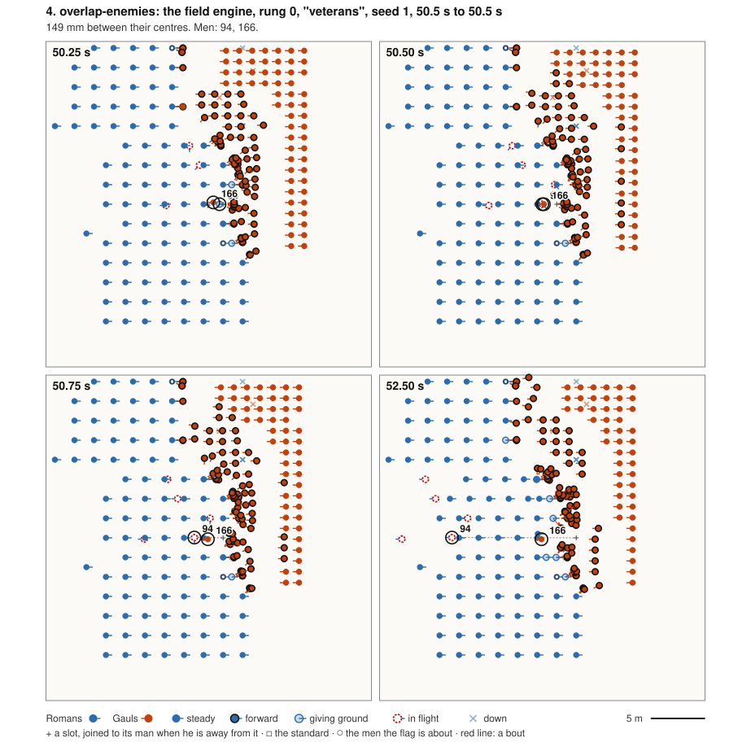

- **Where:** the field engine, rung 0, `veterans`, seed 1, at 50.5 s.
- **Measured:** 149 mm between their centres. One of 123 of this kind on this engine.
- **Bin:** defect D1. Clip: a Roman's first step of flight ends 149 mm from a Gaul; both count as in their places.
- **In the viewer:** http://127.0.0.1:8377/?engine=field&rung=0&variant=veterans&seed=1&t=47&man=94

### 04-overlap-enemies-field-2

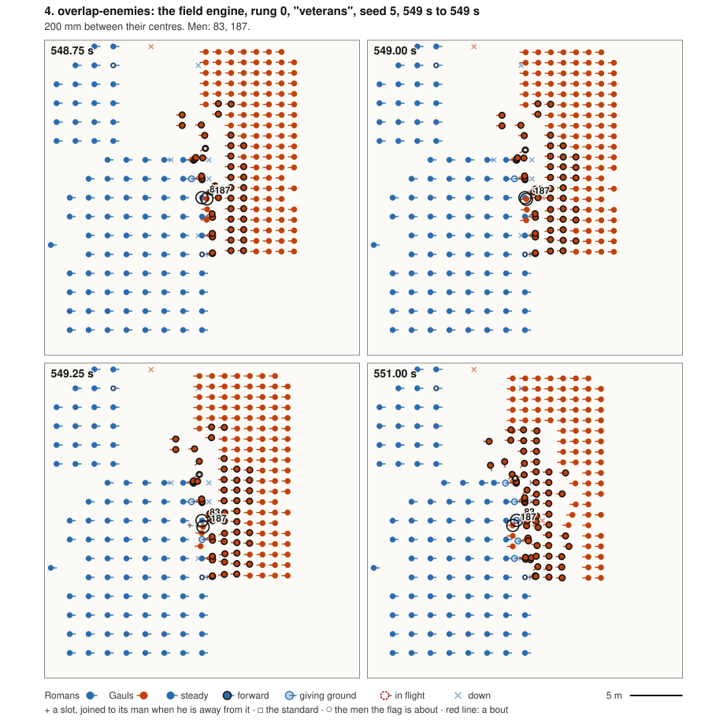

- **Where:** the field engine, rung 0, `veterans`, seed 5, at 549 s.
- **Measured:** 200 mm between their centres. One of 123 of this kind on this engine.
- **Bin:** defect D1. Clip: a Gaul walks to a slot that lies 200 mm from a standing Roman.
- **In the viewer:** http://127.0.0.1:8377/?engine=field&rung=0&variant=veterans&seed=5&t=546&man=83

### 04-overlap-enemies-field-3

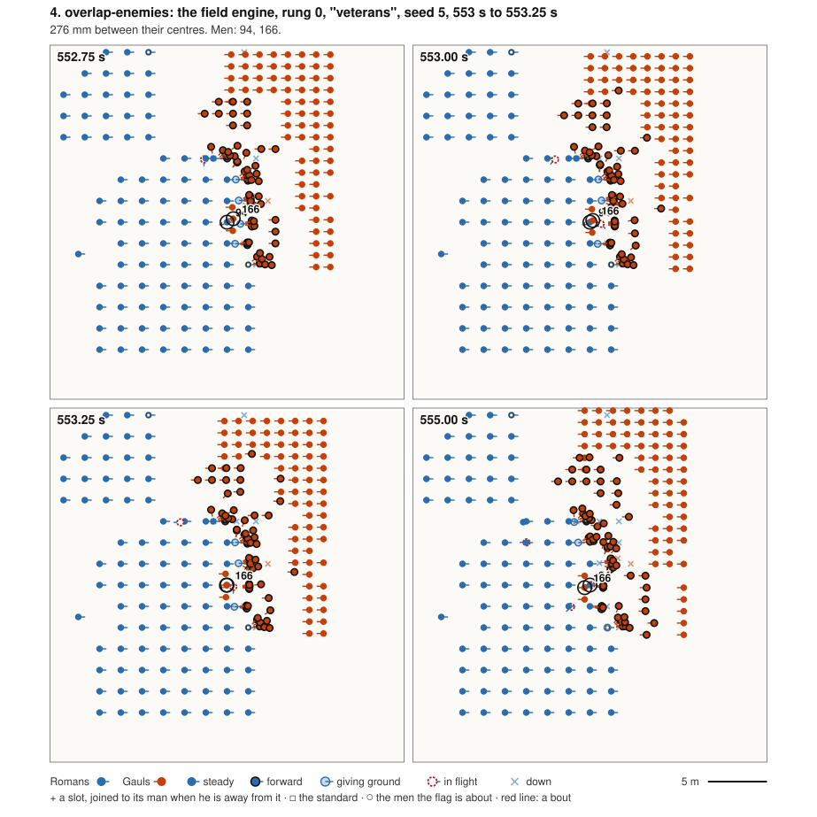

- **Where:** the field engine, rung 0, `veterans`, seed 5, at 553 s, for 0.25 s.
- **Measured:** 276 mm between their centres. One of 123 of this kind on this engine.
- **Bin:** defect D1. The same place four seconds later, another pair at 276 mm for two steps. The warband's ranks stand inside the century's.
- **In the viewer:** http://127.0.0.1:8377/?engine=field&rung=0&variant=veterans&seed=5&t=550&man=94

### 04-overlap-enemies-field-4

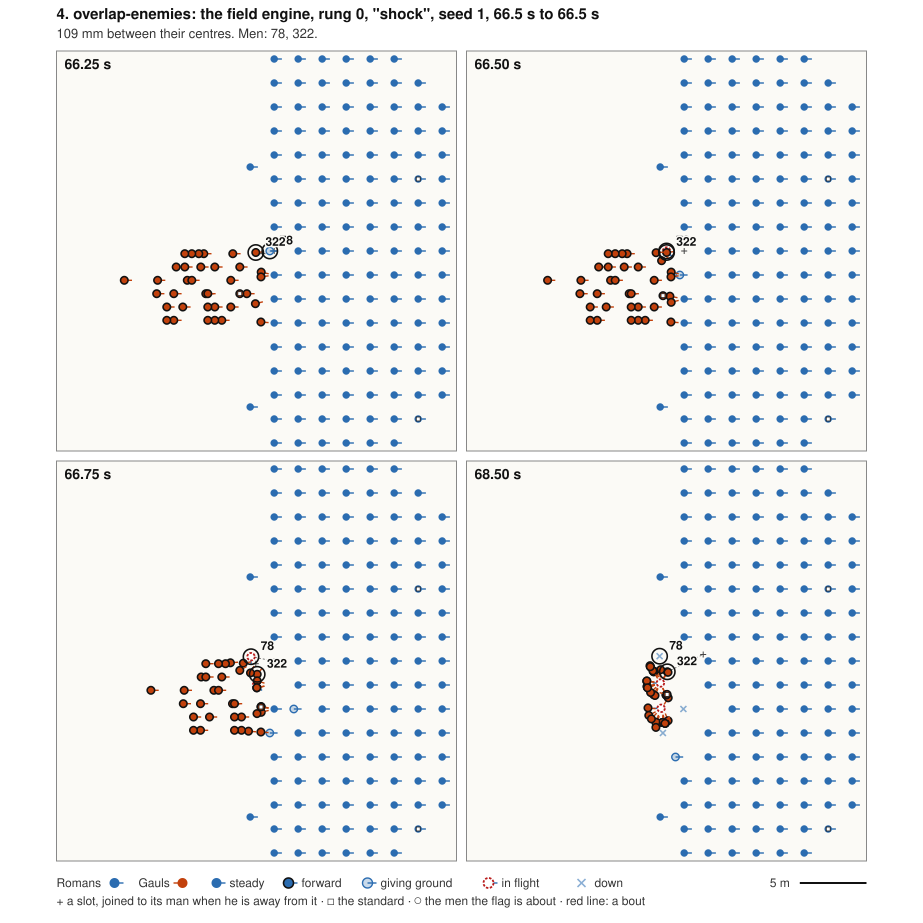

- **Where:** the field engine, rung 0, `shock`, seed 1, at 66.5 s.
- **Measured:** 109 mm between their centres. One of 123 of this kind on this engine.
- **Bin:** defect D1. Clip: a Roman flees a metre into a charging Gaul, 109 mm.
- **In the viewer:** http://127.0.0.1:8377/?engine=field&rung=0&variant=shock&seed=1&t=63&man=78

### 05-overlap-own-field-both-standing-1

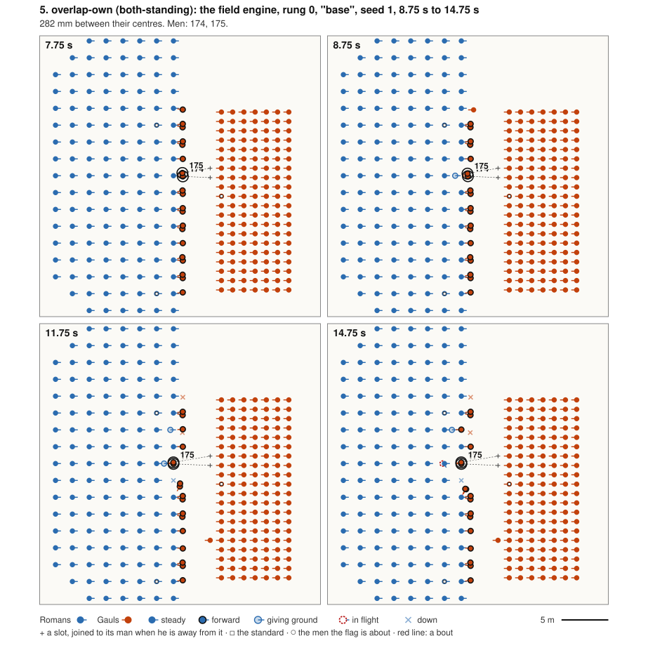

- **Where:** the field engine, rung 0, `base`, seed 1, at 8.75 s, for 6 s.
- **Measured:** 282 mm between their centres. Kind: both-standing. One of 24767 of this kind on this engine.
- **Bin:** fine. Men of one side are not solid on this engine; the list makes it a count.
- **In the viewer:** http://127.0.0.1:8377/?engine=field&rung=0&variant=base&seed=1&t=5&man=174

### 05-overlap-own-field-both-standing-2

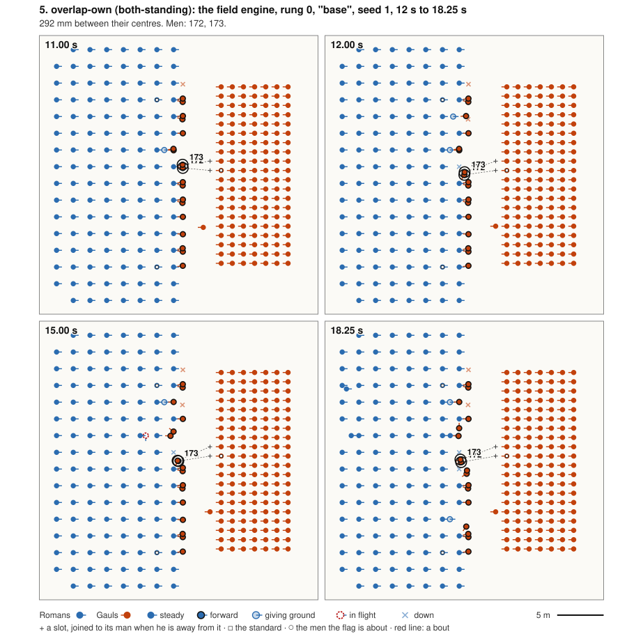

- **Where:** the field engine, rung 0, `base`, seed 1, at 12 s, for 6.25 s.
- **Measured:** 292 mm between their centres. Kind: both-standing. One of 24767 of this kind on this engine.
- **Bin:** fine. Men of one side are not solid on this engine; the list makes it a count.
- **In the viewer:** http://127.0.0.1:8377/?engine=field&rung=0&variant=base&seed=1&t=9&man=172

### 05-overlap-own-field-both-standing-3

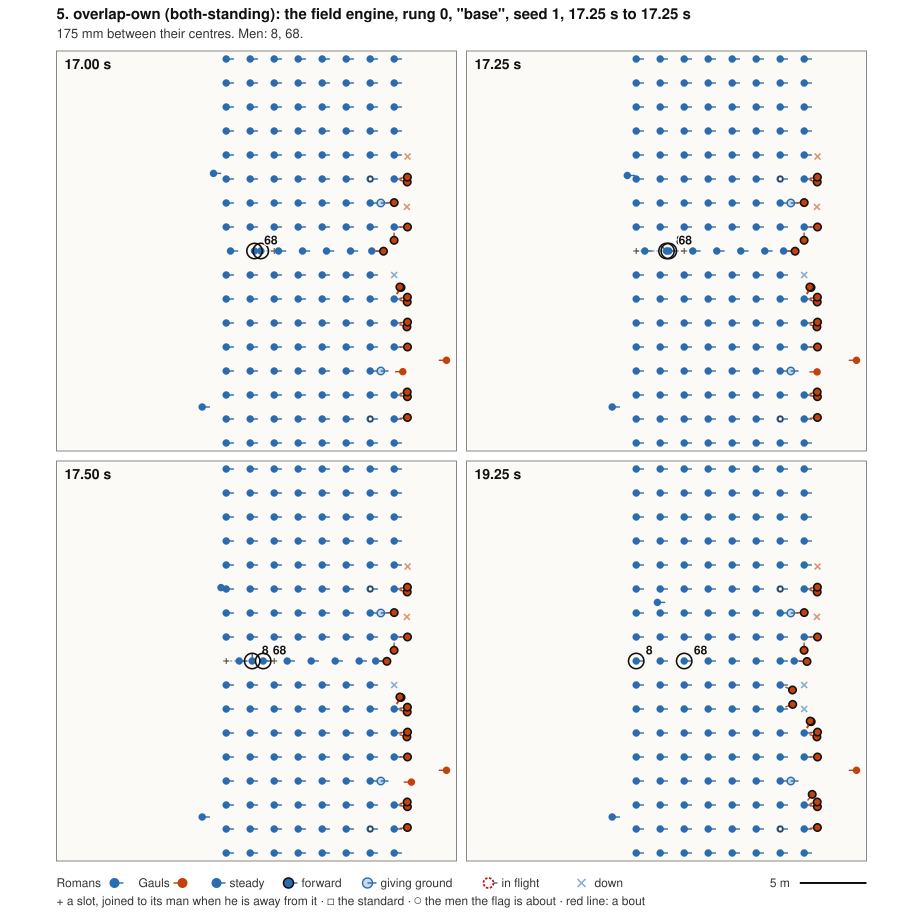

- **Where:** the field engine, rung 0, `base`, seed 1, at 17.25 s.
- **Measured:** 175 mm between their centres. Kind: both-standing. One of 24767 of this kind on this engine.
- **Bin:** fine. Men of one side are not solid on this engine; the list makes it a count.
- **In the viewer:** http://127.0.0.1:8377/?engine=field&rung=0&variant=base&seed=1&t=14&man=8

### 05-overlap-own-field-both-standing-4

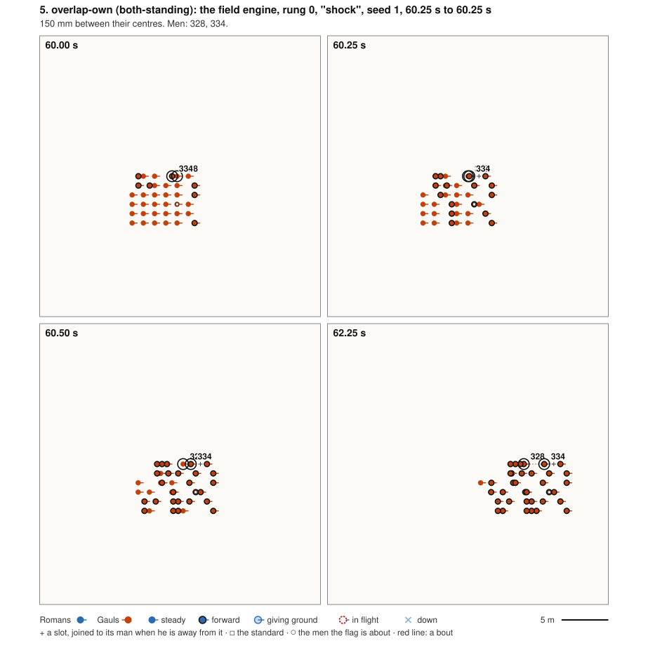

- **Where:** the field engine, rung 0, `shock`, seed 1, at 60.25 s.
- **Measured:** 150 mm between their centres. Kind: both-standing. One of 24767 of this kind on this engine.
- **Bin:** fine. Men of one side are not solid on this engine; the list makes it a count.
- **In the viewer:** http://127.0.0.1:8377/?engine=field&rung=0&variant=shock&seed=1&t=57&man=328

### 05-overlap-own-field-one-in-flight-1

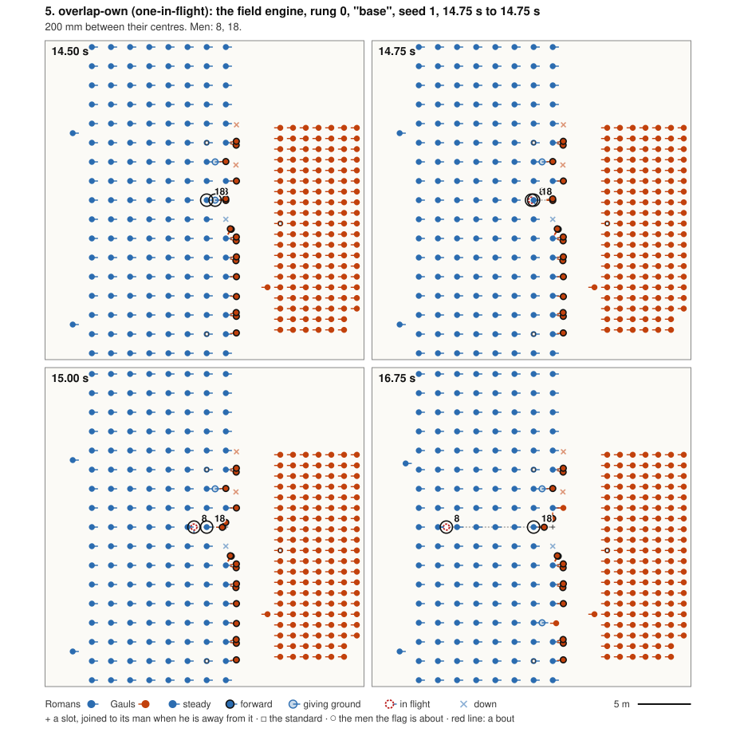

- **Where:** the field engine, rung 0, `base`, seed 1, at 14.75 s.
- **Measured:** 200 mm between their centres. Kind: one-in-flight. One of 25322 of this kind on this engine.
- **Bin:** fine. A runner passes through the men behind him, as the engine is written.
- **In the viewer:** http://127.0.0.1:8377/?engine=field&rung=0&variant=base&seed=1&t=11&man=8

### 05-overlap-own-field-one-in-flight-2

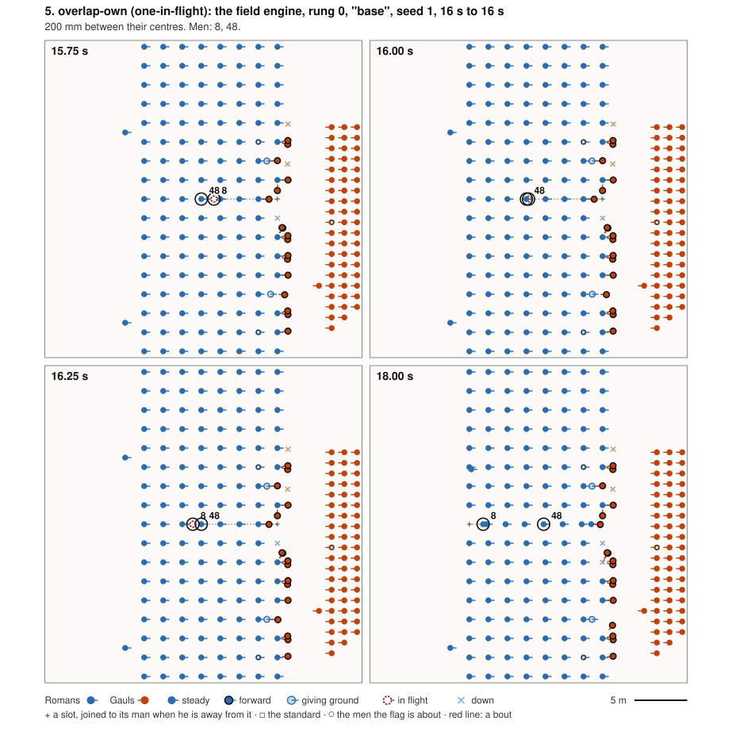

- **Where:** the field engine, rung 0, `base`, seed 1, at 16 s.
- **Measured:** 200 mm between their centres. Kind: one-in-flight. One of 25322 of this kind on this engine.
- **Bin:** fine. A runner passes through the men behind him, as the engine is written.
- **In the viewer:** http://127.0.0.1:8377/?engine=field&rung=0&variant=base&seed=1&t=13&man=8

### 05-overlap-own-field-one-in-flight-3

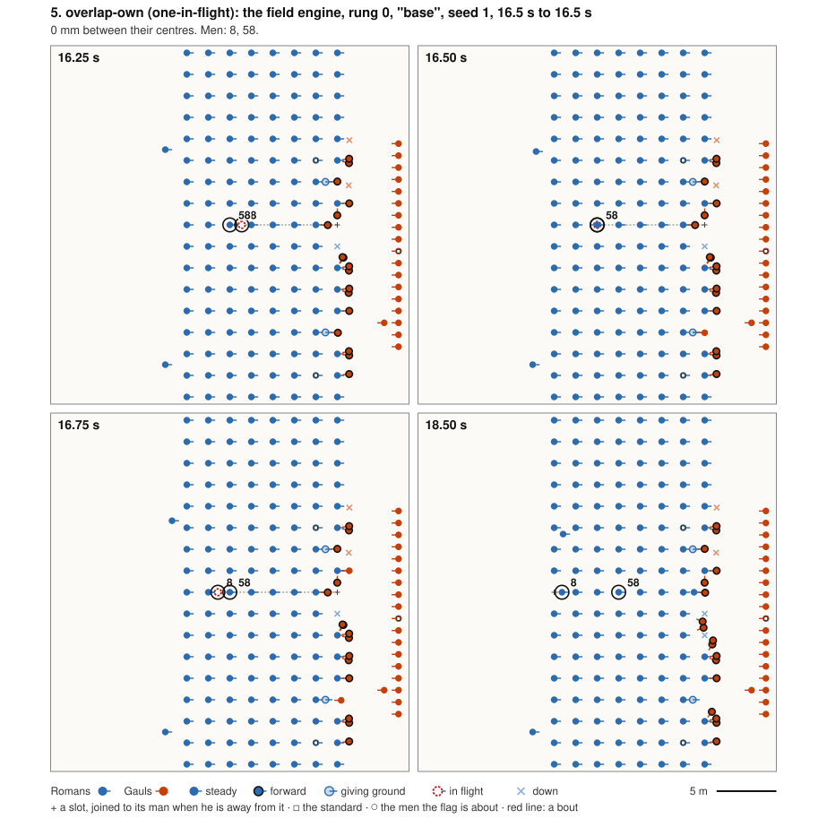

- **Where:** the field engine, rung 0, `base`, seed 1, at 16.5 s.
- **Measured:** 0 mm between their centres. Kind: one-in-flight. One of 25322 of this kind on this engine.
- **Bin:** fine. A runner passes through the men behind him, as the engine is written.
- **In the viewer:** http://127.0.0.1:8377/?engine=field&rung=0&variant=base&seed=1&t=13&man=8

### 05-overlap-own-field-one-in-flight-4

*The same drawing as [`05-overlap-own-field-one-in-flight-1`](#05-overlap-own-field-one-in-flight-1).*

- **Where:** the field engine, rung 0, `backed`, seed 1, at 14.75 s.
- **Measured:** 200 mm between their centres. Kind: one-in-flight. One of 25322 of this kind on this engine.
- **Bin:** fine. A runner passes through the men behind him, as the engine is written.
- **In the viewer:** http://127.0.0.1:8377/?engine=field&rung=0&variant=backed&seed=1&t=11&man=8

### 06-crowd-field-1

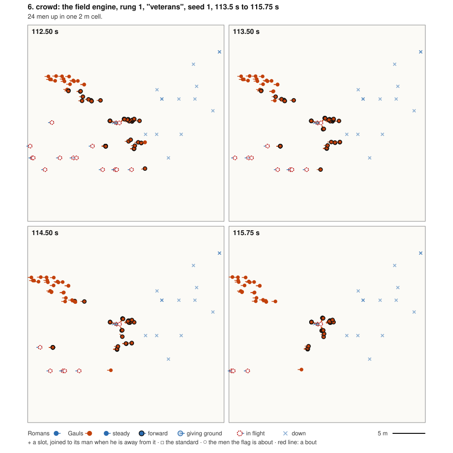

- **Where:** the field engine, rung 1, `veterans`, seed 1, at 113.5 s, for 2.25 s.
- **Measured:** 24 men up in one 2 m cell. One of 3 of this kind on this engine.
- **Bin:** gap N. 24 to 30 pursuers in one cell around one runner. It is under the packing density of 9 per m².
- **In the viewer:** http://127.0.0.1:8377/?engine=field&rung=1&variant=veterans&seed=1&t=110

### 06-crowd-field-2

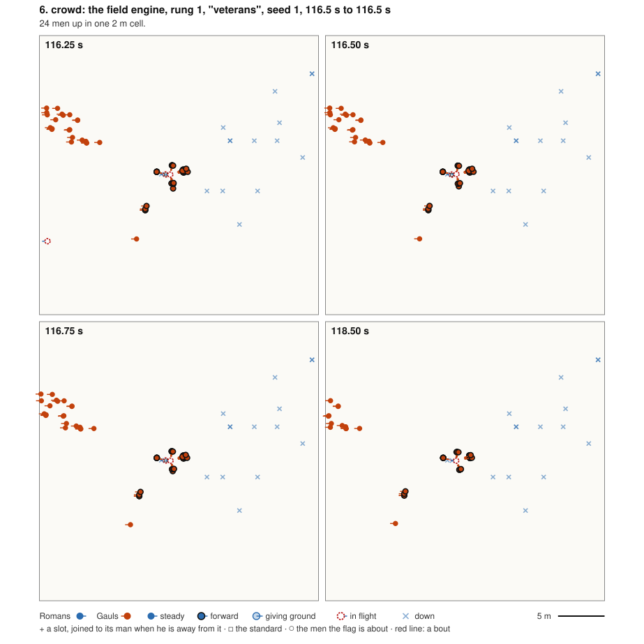

- **Where:** the field engine, rung 1, `veterans`, seed 1, at 116.5 s.
- **Measured:** 24 men up in one 2 m cell. One of 3 of this kind on this engine.
- **Bin:** gap N. 24 to 30 pursuers in one cell around one runner. It is under the packing density of 9 per m².
- **In the viewer:** http://127.0.0.1:8377/?engine=field&rung=1&variant=veterans&seed=1&t=113

### 06-crowd-field-3

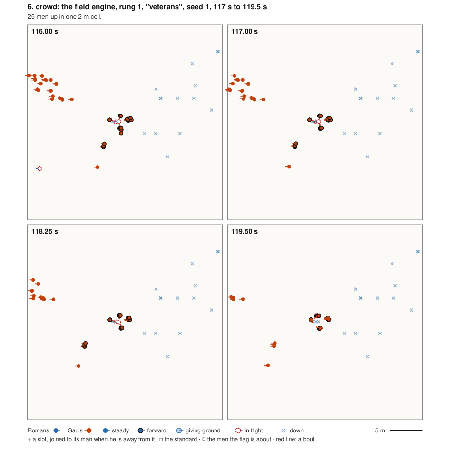

- **Where:** the field engine, rung 1, `veterans`, seed 1, at 117 s, for 2.5 s.
- **Measured:** 25 men up in one 2 m cell. One of 3 of this kind on this engine.
- **Bin:** gap N. 24 to 30 pursuers in one cell around one runner. It is under the packing density of 9 per m².
- **In the viewer:** http://127.0.0.1:8377/?engine=field&rung=1&variant=veterans&seed=1&t=114

### 07-jump-field-1

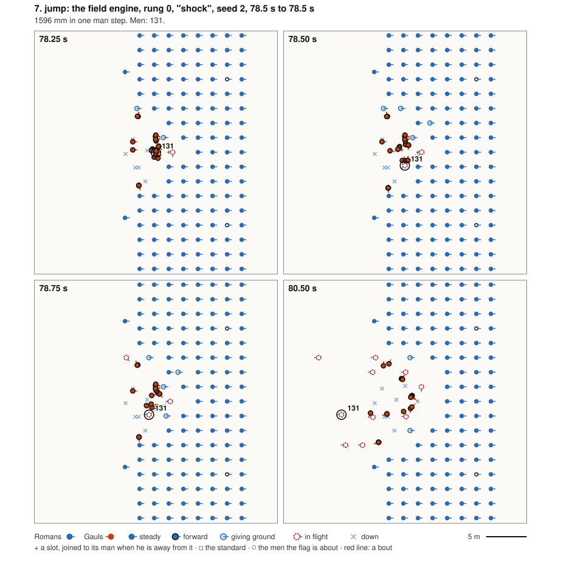

- **Where:** the field engine, rung 0, `shock`, seed 2, at 78.5 s.
- **Measured:** 1596 mm in one man step. One of 3 of this kind on this engine.
- **Bin:** fine. One event at three rungs. A runner in a knot of enemies is pushed a guard's distance clear in the step he runs a metre: 1,596 mm against 1,500.
- **In the viewer:** http://127.0.0.1:8377/?engine=field&rung=0&variant=shock&seed=2&t=75&man=131

### 07-jump-field-2

*The same drawing as [`07-jump-field-1`](#07-jump-field-1).*

- **Where:** the field engine, rung 1, `shock`, seed 2, at 78.5 s.
- **Measured:** 1596 mm in one man step. One of 3 of this kind on this engine.
- **Bin:** fine. One event at three rungs. A runner in a knot of enemies is pushed a guard's distance clear in the step he runs a metre: 1,596 mm against 1,500.
- **In the viewer:** http://127.0.0.1:8377/?engine=field&rung=1&variant=shock&seed=2&t=75&man=131

### 07-jump-field-3

- **Where:** the field engine, rung 3, `shock`, seed 2, at 78.5 s.
- **Measured:** 1596 mm in one man step. One of 3 of this kind on this engine.
- **Bin:** fine. One event at three rungs. A runner in a knot of enemies is pushed a guard's distance clear in the step he runs a metre: 1,596 mm against 1,500.
- **In the viewer:** http://127.0.0.1:8377/?engine=field&rung=3&variant=shock&seed=2&t=75&man=131

### 09-facing-in-place-field-1

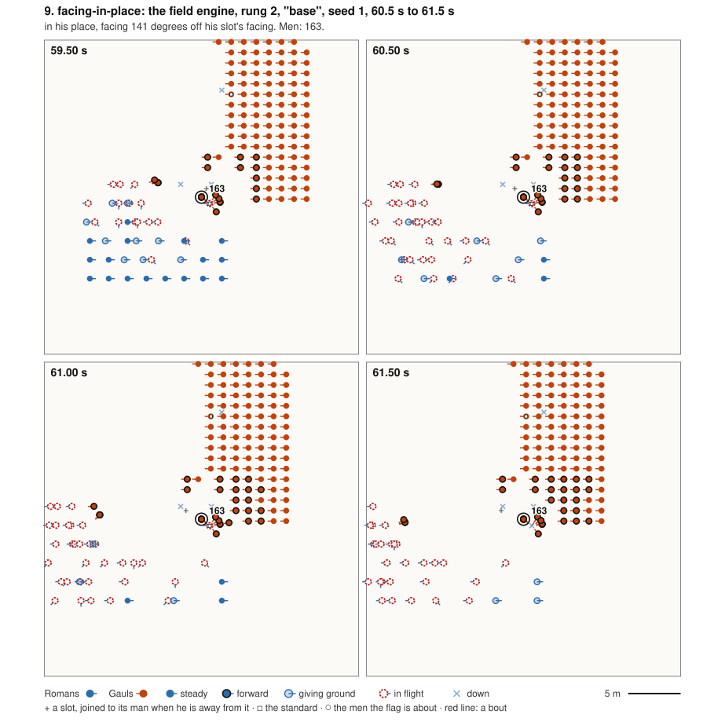

- **Where:** the field engine, rung 2, `base`, seed 1, at 60.5 s, for 1 s.
- **Measured:** in his place, facing 141 degrees off his slot's facing. One of 176 of this kind on this engine.
- **Bin:** fine. A Gaul who is forward faces the man he strikes. He counts as in his place because a warband's place is 1,200 mm wide.
- **In the viewer:** http://127.0.0.1:8377/?engine=field&rung=2&variant=base&seed=1&t=57&man=163

### 09-facing-in-place-field-2

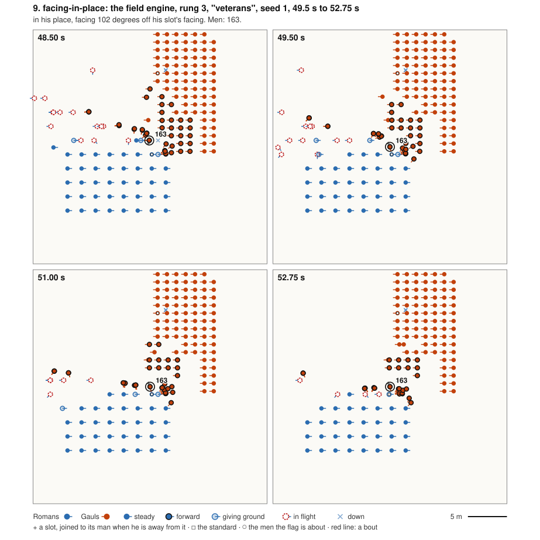

- **Where:** the field engine, rung 3, `veterans`, seed 1, at 49.5 s, for 3.25 s.
- **Measured:** in his place, facing 102 degrees off his slot's facing. One of 176 of this kind on this engine.
- **Bin:** fine. A Gaul who is forward faces the man he strikes. He counts as in his place because a warband's place is 1,200 mm wide.
- **In the viewer:** http://127.0.0.1:8377/?engine=field&rung=3&variant=veterans&seed=1&t=46&man=163

### 09-facing-in-place-field-3

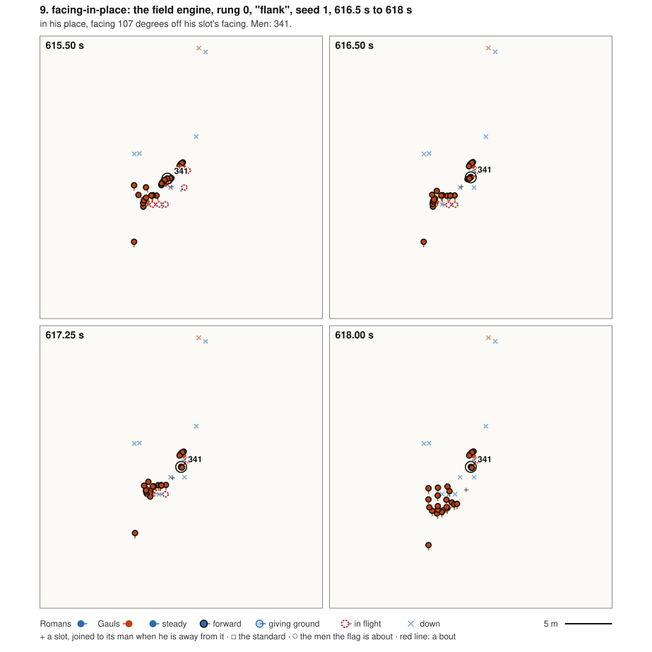

- **Where:** the field engine, rung 0, `flank`, seed 1, at 616.5 s, for 1.5 s.
- **Measured:** in his place, facing 107 degrees off his slot's facing. One of 176 of this kind on this engine.
- **Bin:** fine. A Gaul who is forward faces the man he strikes. He counts as in his place because a warband's place is 1,200 mm wide.
- **In the viewer:** http://127.0.0.1:8377/?engine=field&rung=0&variant=flank&seed=1&t=613&man=341

### 09-facing-in-place-field-4

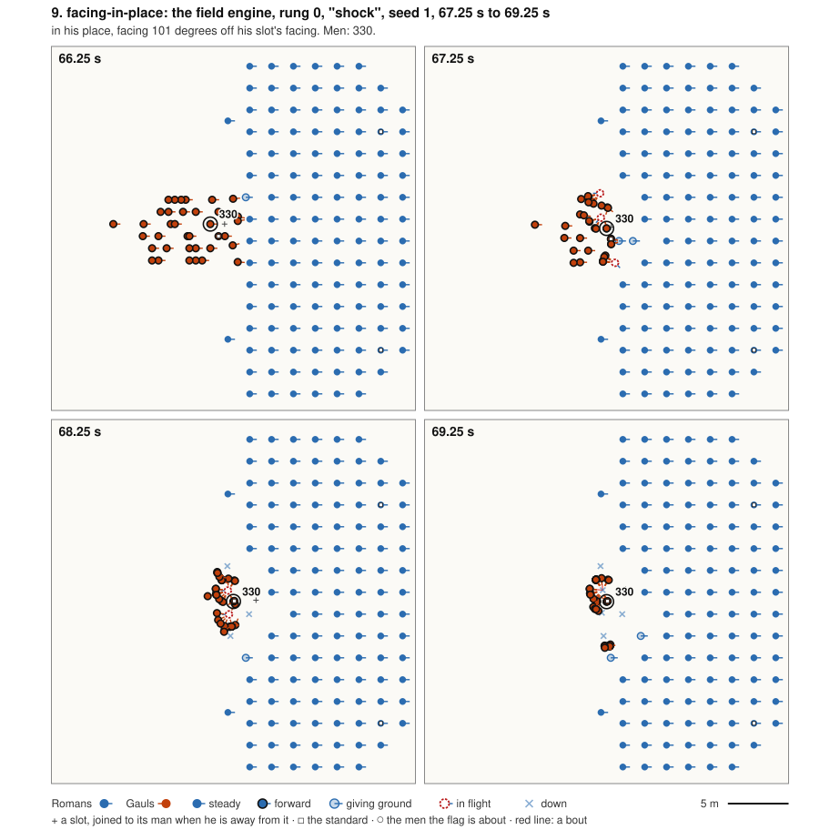

- **Where:** the field engine, rung 0, `shock`, seed 1, at 67.25 s, for 2 s.
- **Measured:** in his place, facing 101 degrees off his slot's facing. One of 176 of this kind on this engine.
- **Bin:** fine. A Gaul who is forward faces the man he strikes. He counts as in his place because a warband's place is 1,200 mm wide.
- **In the viewer:** http://127.0.0.1:8377/?engine=field&rung=0&variant=shock&seed=1&t=64&man=330

### 10-flight-toward-field-1

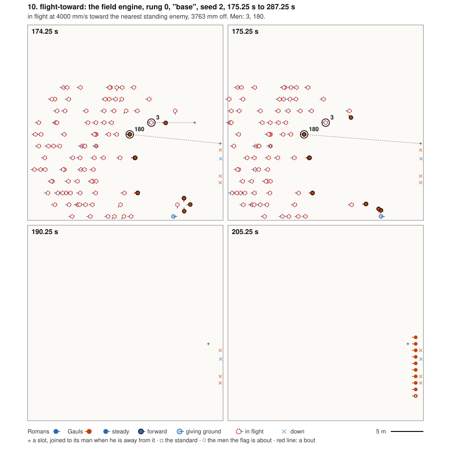

- **Where:** the field engine, rung 0, `base`, seed 2, at 175.25 s, for 112 s.
- **Measured:** in flight at 4000 mm/s toward the nearest standing enemy, 3763 mm off. One of 1983 of this kind on this engine.
- **Bin:** gap E. Runners run on for a minute or two with a pursuer level with them or ahead.
- **In the viewer:** http://127.0.0.1:8377/?engine=field&rung=0&variant=base&seed=2&t=172&man=3

### 10-flight-toward-field-2

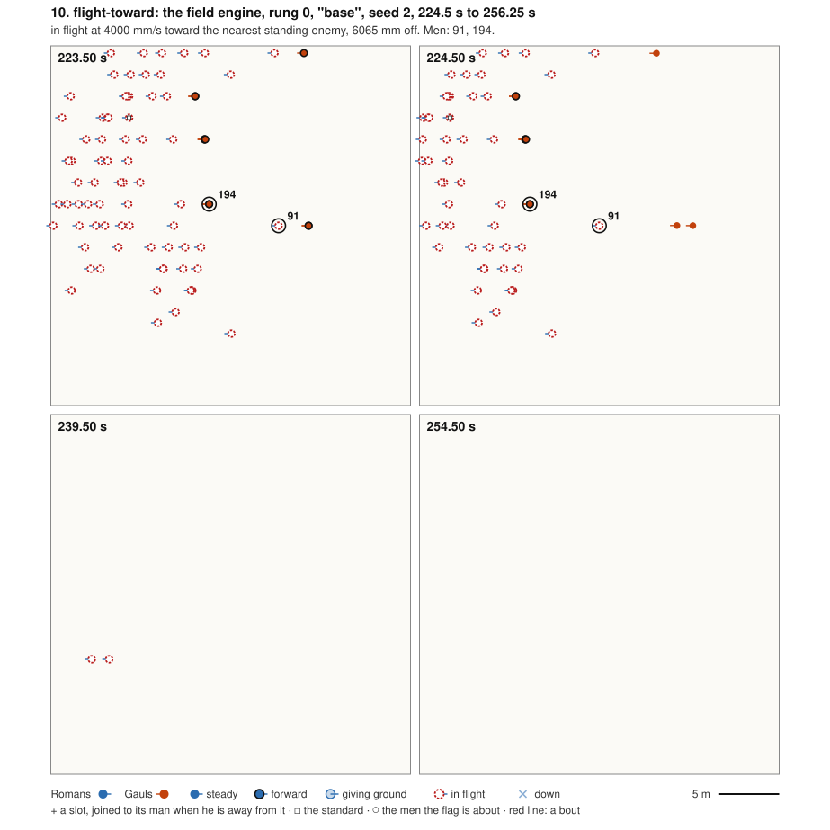

- **Where:** the field engine, rung 0, `base`, seed 2, at 224.5 s, for 31.75 s.
- **Measured:** in flight at 4000 mm/s toward the nearest standing enemy, 6065 mm off. One of 1983 of this kind on this engine.
- **Bin:** gap E. Runners run on for a minute or two with a pursuer level with them or ahead.
- **In the viewer:** http://127.0.0.1:8377/?engine=field&rung=0&variant=base&seed=2&t=221&man=91

### 10-flight-toward-field-3

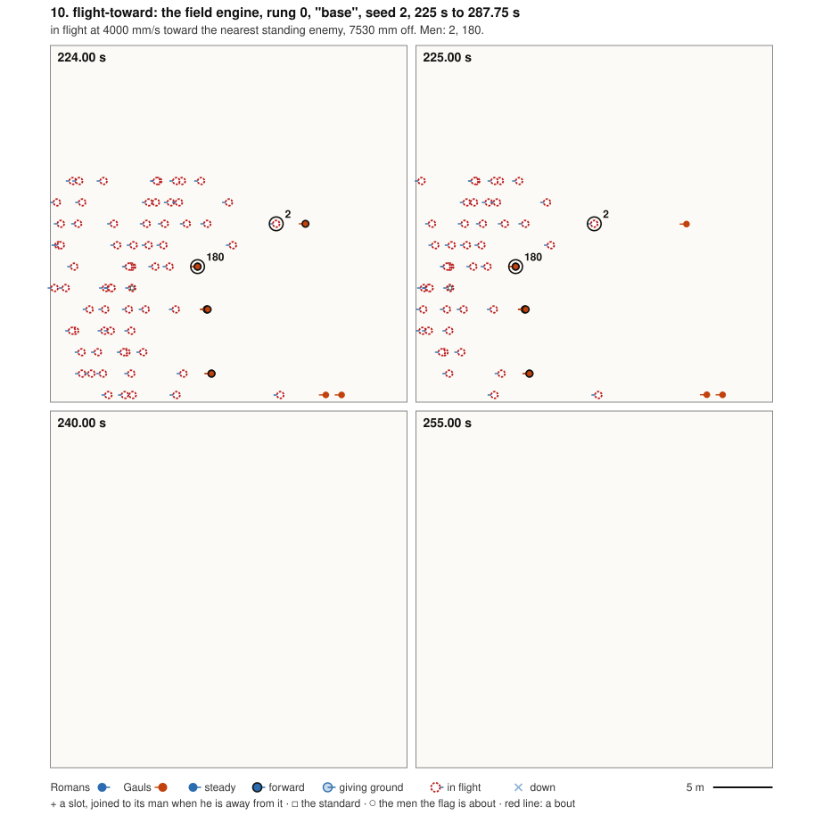

- **Where:** the field engine, rung 0, `base`, seed 2, at 225 s, for 62.75 s.
- **Measured:** in flight at 4000 mm/s toward the nearest standing enemy, 7530 mm off. One of 1983 of this kind on this engine.
- **Bin:** gap E. Runners run on for a minute or two with a pursuer level with them or ahead.
- **In the viewer:** http://127.0.0.1:8377/?engine=field&rung=0&variant=base&seed=2&t=222&man=2

### 10-flight-toward-field-4

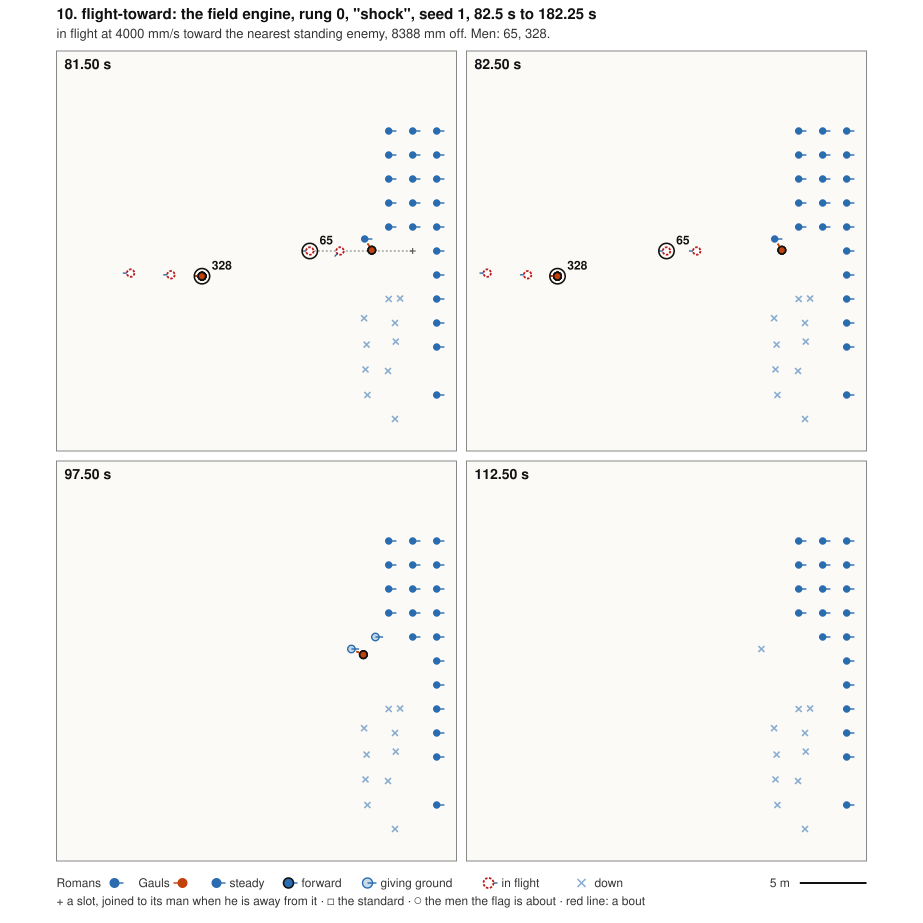

- **Where:** the field engine, rung 0, `shock`, seed 1, at 82.5 s, for 99.75 s.
- **Measured:** in flight at 4000 mm/s toward the nearest standing enemy, 8388 mm off. One of 1983 of this kind on this engine.
- **Bin:** gap E. A Roman runs for 100 s behind a Gaul who chases others.
- **In the viewer:** http://127.0.0.1:8377/?engine=field&rung=0&variant=shock&seed=1&t=79&man=65

### 13-bout-through-field-past-a-comrade-1

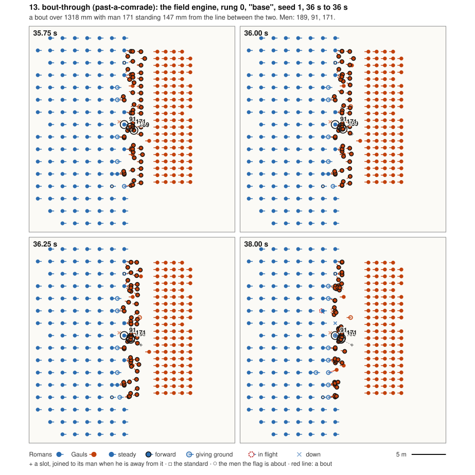

- **Where:** the field engine, rung 0, `base`, seed 1, at 36 s.
- **Measured:** a bout over 1318 mm with man 171 standing 147 mm from the line between the two. Kind: past-a-comrade. One of 240 of this kind on this engine.
- **Bin:** gap I. A Gaul strikes with a comrade 46 to 147 mm from the line of the strike.
- **In the viewer:** http://127.0.0.1:8377/?engine=field&rung=0&variant=base&seed=1&t=33&man=189

### 13-bout-through-field-past-a-comrade-2

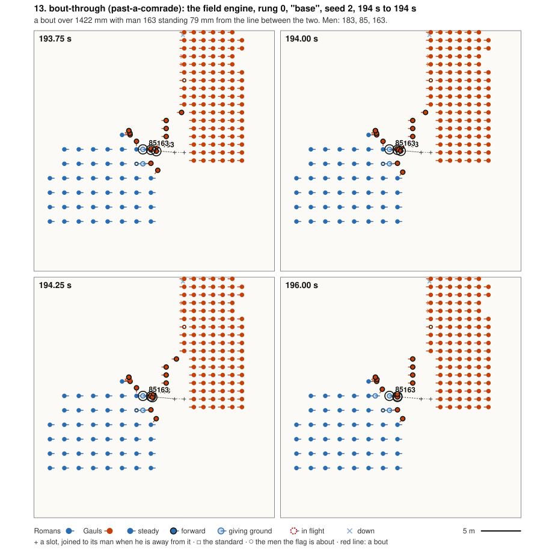

- **Where:** the field engine, rung 0, `base`, seed 2, at 194 s.
- **Measured:** a bout over 1422 mm with man 163 standing 79 mm from the line between the two. Kind: past-a-comrade. One of 240 of this kind on this engine.
- **Bin:** gap I. A Gaul strikes with a comrade 46 to 147 mm from the line of the strike.
- **In the viewer:** http://127.0.0.1:8377/?engine=field&rung=0&variant=base&seed=2&t=191&man=183

### 13-bout-through-field-past-a-comrade-3

*The same drawing as [`13-bout-through-field-past-a-comrade-1`](#13-bout-through-field-past-a-comrade-1).*

- **Where:** the field engine, rung 1, `base`, seed 1, at 36 s.
- **Measured:** a bout over 1318 mm with man 171 standing 147 mm from the line between the two. Kind: past-a-comrade. One of 240 of this kind on this engine.
- **Bin:** gap I. A Gaul strikes with a comrade 46 to 147 mm from the line of the strike.
- **In the viewer:** http://127.0.0.1:8377/?engine=field&rung=1&variant=base&seed=1&t=33&man=189

### 13-bout-through-field-past-a-comrade-4

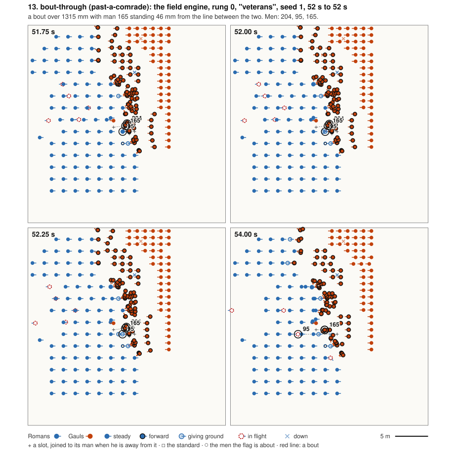

- **Where:** the field engine, rung 0, `veterans`, seed 1, at 52 s.
- **Measured:** a bout over 1315 mm with man 165 standing 46 mm from the line between the two. Kind: past-a-comrade. One of 240 of this kind on this engine.
- **Bin:** gap I. A Gaul strikes with a comrade 46 to 147 mm from the line of the strike.
- **In the viewer:** http://127.0.0.1:8377/?engine=field&rung=0&variant=veterans&seed=1&t=49&man=204

### 14-flicker-field-gives-way-1

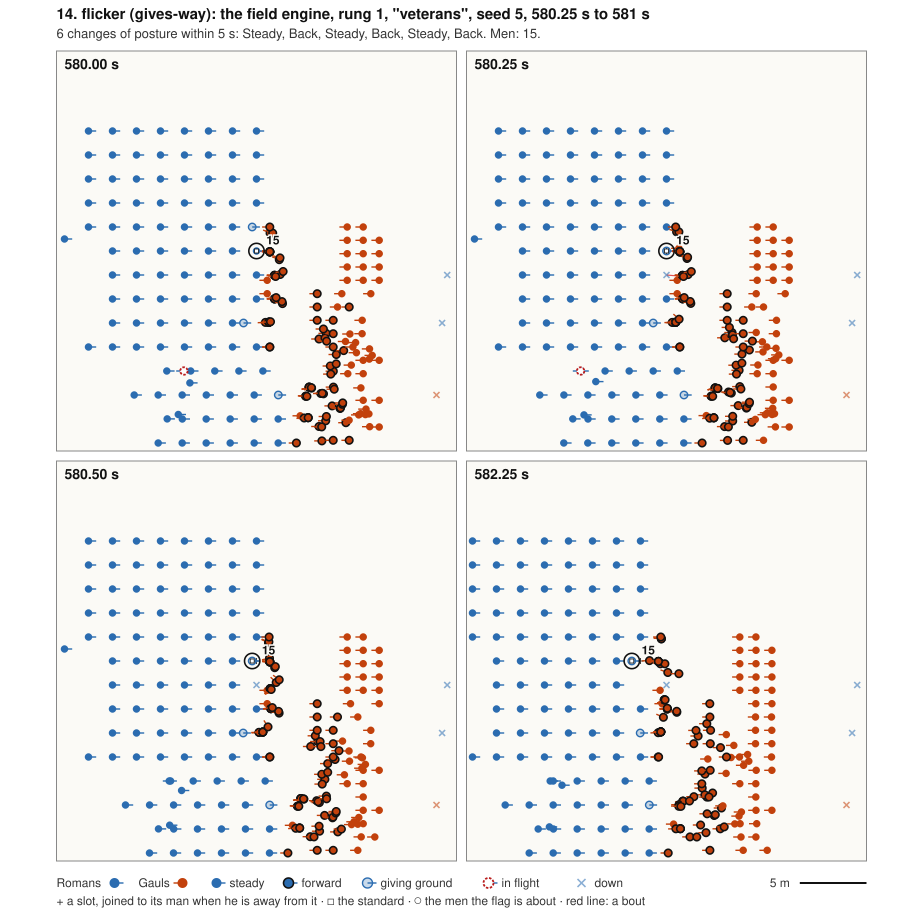

- **Where:** the field engine, rung 1, `veterans`, seed 5, at 580.25 s, for 0.75 s.
- **Measured:** 6 changes of posture within 5 s: Steady, Back, Steady, Back, Steady, Back. Kind: gives-way. One of 2 of this kind on this engine.
- **Bin:** gap O. The first century's standard-bearer goes from steady to back and again, six times in five seconds.
- **In the viewer:** http://127.0.0.1:8377/?engine=field&rung=1&variant=veterans&seed=5&t=577&man=15

### 14-flicker-field-gives-way-2

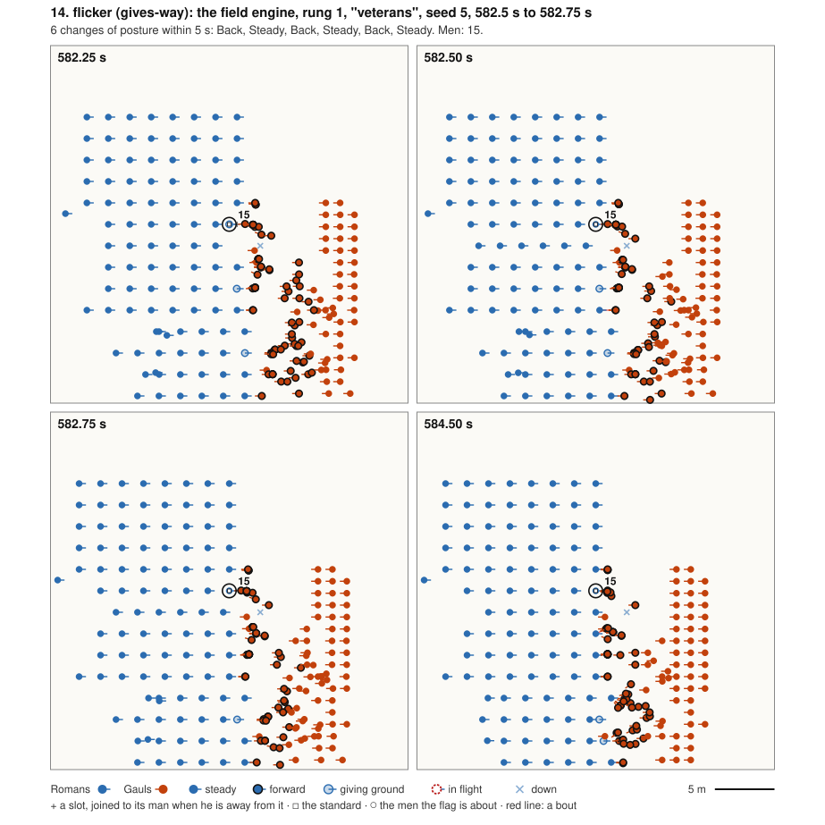

- **Where:** the field engine, rung 1, `veterans`, seed 5, at 582.5 s, for 0.25 s.
- **Measured:** 6 changes of posture within 5 s: Back, Steady, Back, Steady, Back, Steady. Kind: gives-way. One of 2 of this kind on this engine.
- **Bin:** gap O. The first century's standard-bearer goes from steady to back and again, six times in five seconds.
- **In the viewer:** http://127.0.0.1:8377/?engine=field&rung=1&variant=veterans&seed=5&t=579&man=15

### 14-flicker-field-steady-and-forward-1

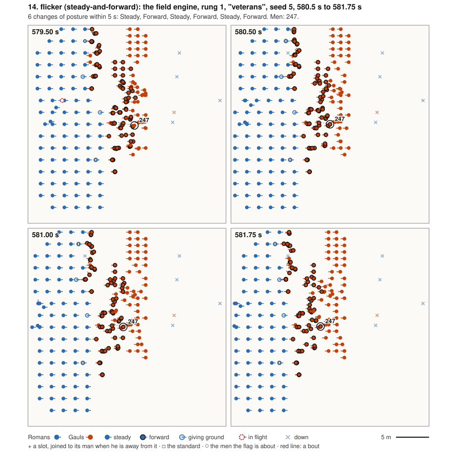

- **Where:** the field engine, rung 1, `veterans`, seed 5, at 580.5 s, for 1.25 s.
- **Measured:** 6 changes of posture within 5 s: Steady, Forward, Steady, Forward, Steady, Forward. Kind: steady-and-forward. One of 8 of this kind on this engine.
- **Bin:** fine. Two Gauls step out and stand again: the pulse of the fight, as the kind says.
- **In the viewer:** http://127.0.0.1:8377/?engine=field&rung=1&variant=veterans&seed=5&t=577&man=247

### 14-flicker-field-steady-and-forward-2

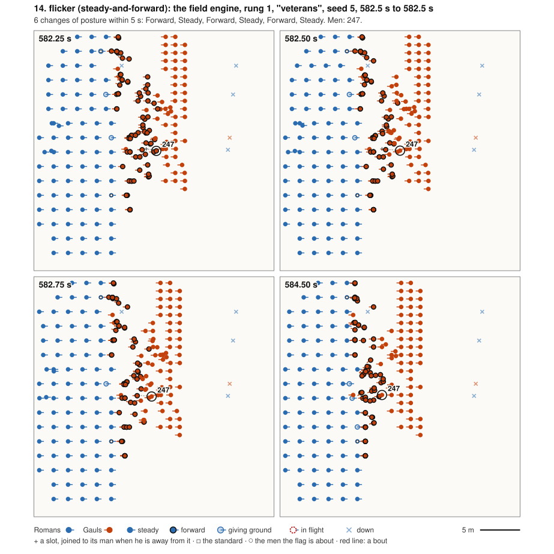

- **Where:** the field engine, rung 1, `veterans`, seed 5, at 582.5 s.
- **Measured:** 6 changes of posture within 5 s: Forward, Steady, Forward, Steady, Forward, Steady. Kind: steady-and-forward. One of 8 of this kind on this engine.
- **Bin:** fine. Two Gauls step out and stand again: the pulse of the fight, as the kind says.
- **In the viewer:** http://127.0.0.1:8377/?engine=field&rung=1&variant=veterans&seed=5&t=579&man=247

### 14-flicker-field-steady-and-forward-3

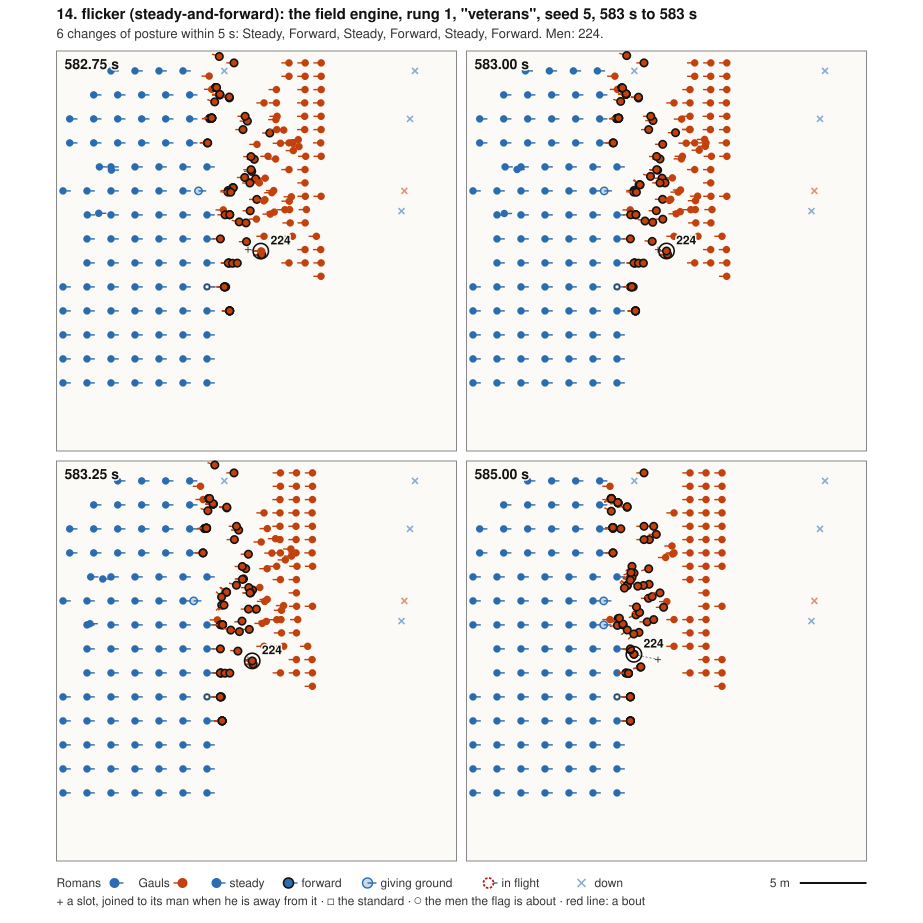

- **Where:** the field engine, rung 1, `veterans`, seed 5, at 583 s.
- **Measured:** 6 changes of posture within 5 s: Steady, Forward, Steady, Forward, Steady, Forward. Kind: steady-and-forward. One of 8 of this kind on this engine.
- **Bin:** fine. Two Gauls step out and stand again: the pulse of the fight, as the kind says.
- **In the viewer:** http://127.0.0.1:8377/?engine=field&rung=1&variant=veterans&seed=5&t=580&man=224

### 15-standard-front-field-front-rank-1

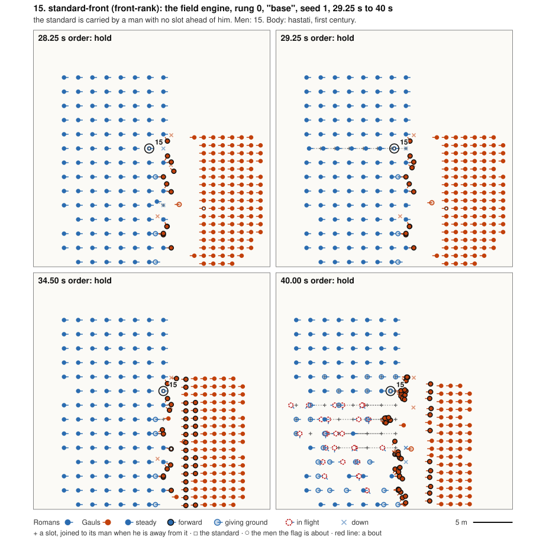

- **Where:** the field engine, rung 0, `base`, seed 1, at 29.25 s, for 10.75 s.
- **Measured:** the standard is carried by a man with no slot ahead of him. Kind: front-rank. One of 212 of this kind on this engine.
- **Bin:** gap B. The standard-bearer walks up into the front rank when his file closes. The frame stays: the fix at work.
- **In the viewer:** http://127.0.0.1:8377/?engine=field&rung=0&variant=base&seed=1&t=26&man=15

### 15-standard-front-field-front-rank-2

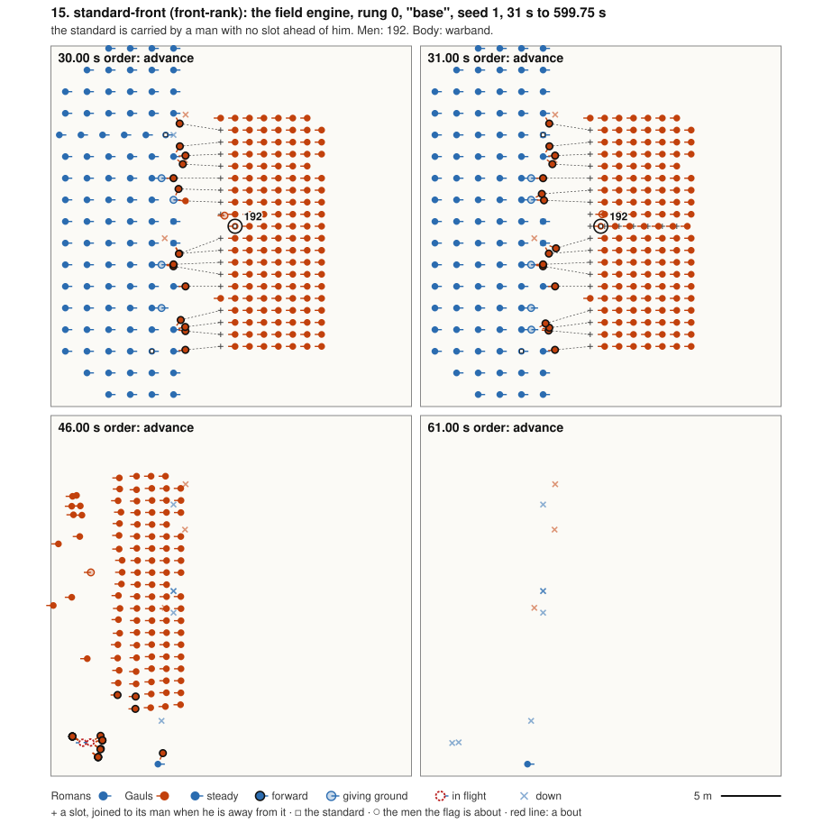

- **Where:** the field engine, rung 0, `base`, seed 1, at 31 s, for 568.75 s.
- **Measured:** the standard is carried by a man with no slot ahead of him. Kind: front-rank. One of 212 of this kind on this engine.
- **Bin:** gap B. The same in the warband.
- **In the viewer:** http://127.0.0.1:8377/?engine=field&rung=0&variant=base&seed=1&t=28&man=192

### 15-standard-front-field-front-rank-3

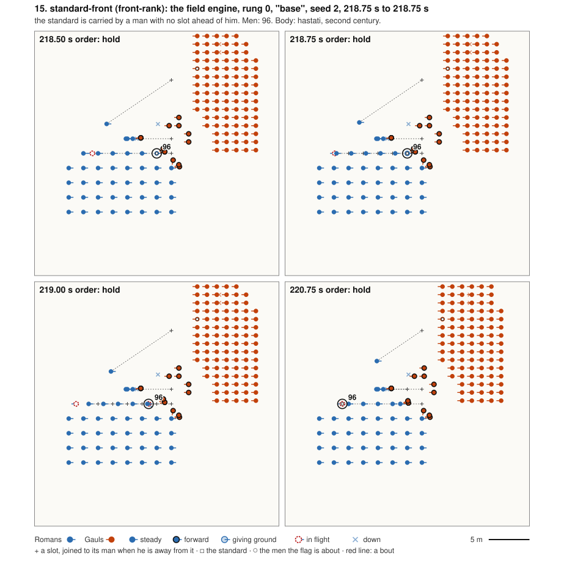

- **Where:** the field engine, rung 0, `base`, seed 2, at 218.75 s.
- **Measured:** the standard is carried by a man with no slot ahead of him. Kind: front-rank. One of 212 of this kind on this engine.
- **Bin:** gap B. The same, in a century that is breaking.
- **In the viewer:** http://127.0.0.1:8377/?engine=field&rung=0&variant=base&seed=2&t=215&man=96

### 15-standard-front-field-front-rank-4

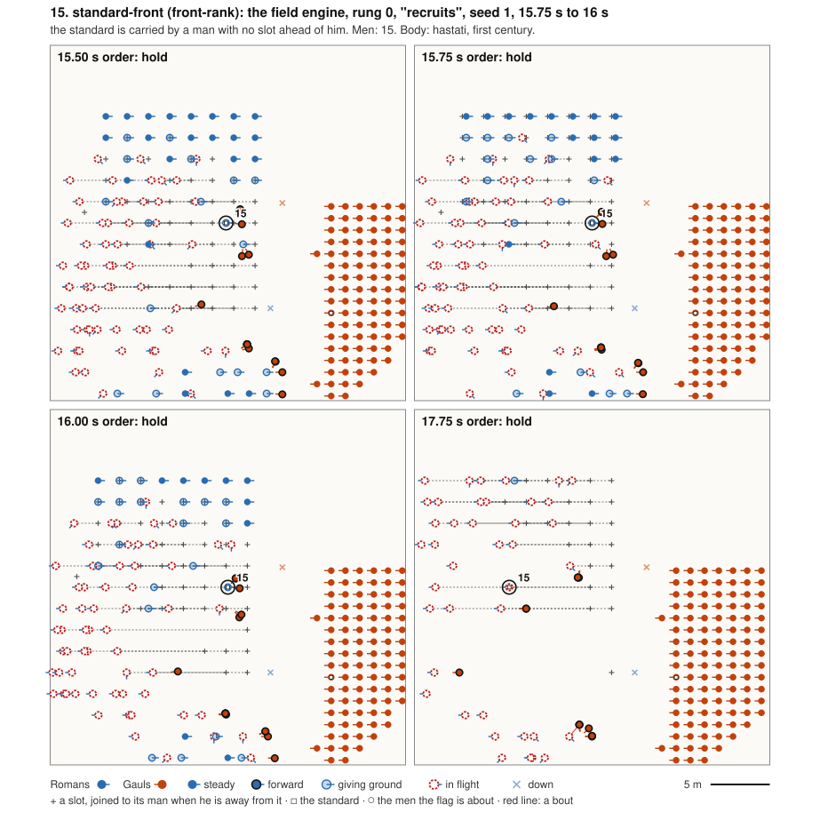

- **Where:** the field engine, rung 0, `recruits`, seed 1, at 15.75 s, for 0.25 s.
- **Measured:** the standard is carried by a man with no slot ahead of him. Kind: front-rank. One of 212 of this kind on this engine.
- **Bin:** gap B. The same, in a century that is breaking.
- **In the viewer:** http://127.0.0.1:8377/?engine=field&rung=0&variant=recruits&seed=1&t=12&man=15

### 16-out-of-place-field-1

- **Where:** the field engine, rung 0, `base`, seed 1, at 16.5 s, for 12.25 s.
- **Measured:** steady, 16197 mm from his slot. One of 5355 of this kind on this engine.
- **Bin:** fine. The closer walks 16 m through his century to the fallen leader's slot: the succession.
- **In the viewer:** http://127.0.0.1:8377/?engine=field&rung=0&variant=base&seed=1&t=13&man=80

### 16-out-of-place-field-2

- **Where:** the field engine, rung 0, `base`, seed 1, at 40.75 s, for 559 s.
- **Measured:** steady, 2078 mm from his slot. One of 5355 of this kind on this engine.
- **Bin:** gap A. Gauls stay steady and 2 m from their slots to the end: the frame runs on behind the chieftain.
- **In the viewer:** http://127.0.0.1:8377/?engine=field&rung=0&variant=base&seed=1&t=37&man=166

### 16-out-of-place-field-3

- **Where:** the field engine, rung 0, `base`, seed 1, at 40.75 s, for 559 s.
- **Measured:** steady, 1904 mm from his slot. One of 5355 of this kind on this engine.
- **Bin:** gap A. Gauls stay steady and 2 m from their slots to the end: the frame runs on behind the chieftain.
- **In the viewer:** http://127.0.0.1:8377/?engine=field&rung=0&variant=base&seed=1&t=37&man=176

### 16-out-of-place-field-4

- **Where:** the field engine, rung 0, `shock`, seed 1, at 169.25 s, for 430.5 s.
- **Measured:** steady, 107121 mm from his slot. One of 5355 of this kind on this engine.
- **Bin:** gap P. A Gaul who chased a runner follows his retiring band at its own pace.
- **In the viewer:** http://127.0.0.1:8377/?engine=field&rung=0&variant=shock&seed=1&t=166&man=340

### 17-forward-idle-field-1

- **Where:** the field engine, rung 0, `base`, seed 1, at 3.75 s, for 91.25 s.
- **Measured:** forward for 20 s with no bout of his. One of 5383 of this kind on this engine.
- **Bin:** gap G. By replay, man 170: from 5.5 s a standing Roman a metre ahead for 35 s and no bout (the tail, as `17` 2); from 40.5 s he is forward for 55 s behind runners who stay out of his reach.
- **In the viewer:** http://127.0.0.1:8377/?engine=field&rung=0&variant=base&seed=1&t=0&man=170

### 17-forward-idle-field-4

*The same drawing as [`17-forward-idle-field-1`](#17-forward-idle-field-1).*

- **Where:** the field engine, rung 0, `flank`, seed 1, at 3.75 s, for 91.25 s.
- **Measured:** forward for 20 s with no bout of his. One of 5383 of this kind on this engine.
- **Bin:** gap G. By replay, man 170: from 5.5 s a standing Roman a metre ahead for 35 s and no bout (the tail, as `17` 2); from 40.5 s he is forward for 55 s behind runners who stay out of his reach.
- **In the viewer:** http://127.0.0.1:8377/?engine=field&rung=0&variant=flank&seed=1&t=0&man=170

### 17-forward-idle-field-2

- **Where:** the field engine, rung 0, `base`, seed 1, at 5.75 s, for 25 s.
- **Measured:** forward for 20 s with no bout of his. One of 5383 of this kind on this engine.
- **Bin:** fine. 25 s: the ordinary tail of the bout rate, as on the pairwise engine.
- **In the viewer:** http://127.0.0.1:8377/?engine=field&rung=0&variant=base&seed=1&t=2&man=169

### 17-forward-idle-field-3

- **Where:** the field engine, rung 0, `base`, seed 1, at 7 s, for 131.5 s.
- **Measured:** forward for 20 s with no bout of his. One of 5383 of this kind on this engine.
- **Bin:** gap G. By replay, man 180: his last bout is at 7 s; 33 s more at the line with no other; from 44.25 s he is forward for 94 s behind a runner 1.8 to 2.6 m ahead at his own pace.
- **In the viewer:** http://127.0.0.1:8377/?engine=field&rung=0&variant=base&seed=1&t=4&man=180

### 18-gap-field-left-1

- **Where:** the field engine, rung 0, `base`, seed 1, at 42.5 s, for 557.25 s.
- **Measured:** in the front rank, the slot on his left exists and is empty. Kind: left. One of 201 of this kind on this engine.
- **Bin:** gap K. A front-rank man stands beside a file that is empty to the end.
- **In the viewer:** http://127.0.0.1:8377/?engine=field&rung=0&variant=base&seed=1&t=39&man=88

### 18-gap-field-left-2

- **Where:** the field engine, rung 0, `base`, seed 2, at 189.25 s, for 20.75 s.
- **Measured:** in the front rank, the slot on his left exists and is empty. Kind: left. One of 201 of this kind on this engine.
- **Bin:** gap K. A front-rank man stands beside a file that is empty to the end.
- **In the viewer:** http://127.0.0.1:8377/?engine=field&rung=0&variant=base&seed=2&t=186&man=114

### 18-gap-field-left-3

- **Where:** the field engine, rung 0, `base`, seed 2, at 214.5 s, for 11.25 s.
- **Measured:** in the front rank, the slot on his left exists and is empty. Kind: left. One of 201 of this kind on this engine.
- **Bin:** gap K. A front-rank man stands beside a file that is empty to the end.
- **In the viewer:** http://127.0.0.1:8377/?engine=field&rung=0&variant=base&seed=2&t=211&man=105

### 18-gap-field-left-4

- **Where:** the field engine, rung 0, `backed`, seed 1, at 42.5 s, for 1757.25 s.
- **Measured:** in the front rank, the slot on his left exists and is empty. Kind: left. One of 201 of this kind on this engine.
- **Bin:** gap K. A front-rank man stands beside a file that is empty to the end. Judged from the flag's note; the picture was not looked at.
- **In the viewer:** http://127.0.0.1:8377/?engine=field&rung=0&variant=backed&seed=1&t=39&man=88

### 18-gap-field-right-1

- **Where:** the field engine, rung 0, `base`, seed 2, at 216.25 s, for 59.5 s.
- **Measured:** in the front rank, the slot on his right exists and is empty. Kind: right. One of 45 of this kind on this engine.
- **Bin:** gap K. The same. In `veterans` the warband walks past 14 steady Romans 5 m off.
- **In the viewer:** http://127.0.0.1:8377/?engine=field&rung=0&variant=base&seed=2&t=213&man=115

### 18-gap-field-right-2

- **Where:** the field engine, rung 0, `veterans`, seed 1, at 103 s, for 496.75 s.
- **Measured:** in the front rank, the slot on his right exists and is empty. Kind: right. One of 45 of this kind on this engine.
- **Bin:** gap K. The same. In `veterans` the warband walks past 14 steady Romans 5 m off.
- **In the viewer:** http://127.0.0.1:8377/?engine=field&rung=0&variant=veterans&seed=1&t=100&man=3

### 18-gap-field-right-3

- **Where:** the field engine, rung 1, `veterans`, seed 1, at 83.75 s, for 35 s.
- **Measured:** in the front rank, the slot on his right exists and is empty. Kind: right. One of 45 of this kind on this engine.
- **Bin:** gap K. The same. In `veterans` the warband walks past 14 steady Romans 5 m off. Judged from the flag's note; the picture was not looked at.
- **In the viewer:** http://127.0.0.1:8377/?engine=field&rung=1&variant=veterans&seed=1&t=80&man=26

### 18-gap-field-right-4

- **Where:** the field engine, rung 0, `recruits`, seed 1, at 122.25 s, for 477.5 s.
- **Measured:** in the front rank, the slot on his right exists and is empty. Kind: right. One of 45 of this kind on this engine.
- **Bin:** gap K. The same. In `veterans` the warband walks past 14 steady Romans 5 m off. Judged from the flag's note; the picture was not looked at.
- **In the viewer:** http://127.0.0.1:8377/?engine=field&rung=0&variant=recruits&seed=1&t=119&man=96

### 19-leaderless-field-closer-in-flight-1

- **Where:** the field engine, rung 0, `flank`, seed 1, at 617.5 s, for 582.25 s.
- **Measured:** the leader is down and the closer lives. Kind: closer-in-flight. One of 11 of this kind on this engine.
- **Bin:** fine. The century is in flight, the closer with it. The rule gives a closer in flight no succession.
- **In the viewer:** http://127.0.0.1:8377/?engine=field&rung=0&variant=flank&seed=1&t=614&man=90

### 19-leaderless-field-closer-in-flight-2

*The same drawing as [`19-leaderless-field-closer-in-flight-1`](#19-leaderless-field-closer-in-flight-1).*

- **Where:** the field engine, rung 1, `flank`, seed 1, at 617.5 s, for 582.25 s.
- **Measured:** the leader is down and the closer lives. Kind: closer-in-flight. One of 11 of this kind on this engine.
- **Bin:** fine. The century is in flight, the closer with it. The rule gives a closer in flight no succession.
- **In the viewer:** http://127.0.0.1:8377/?engine=field&rung=1&variant=flank&seed=1&t=614&man=90

### 19-leaderless-field-closer-in-flight-3

- **Where:** the field engine, rung 2, `flank`, seed 3, at 617.75 s, for 582 s.
- **Measured:** the leader is down and the closer lives. Kind: closer-in-flight. One of 11 of this kind on this engine.
- **Bin:** fine. The century is in flight, the closer with it. The rule gives a closer in flight no succession. Judged from the flag's note; the picture was not looked at.
- **In the viewer:** http://127.0.0.1:8377/?engine=field&rung=2&variant=flank&seed=3&t=614&man=90

### 19-leaderless-field-closer-standing-1

- **Where:** the field engine, rung 2, `base`, seed 1, at 11.25 s, for 588.5 s.
- **Measured:** the leader is down and the closer lives. Kind: closer-standing. One of 11 of this kind on this engine.
- **Bin:** fine. Clip: the leader falls at 11.25 s and the closer flees at 14.75 s, before his five seconds.
- **In the viewer:** http://127.0.0.1:8377/?engine=field&rung=2&variant=base&seed=1&t=8&man=9

### 19-leaderless-field-closer-standing-2

- **Where:** the field engine, rung 0, `recruits`, seed 1, at 11.25 s, for 588.5 s.
- **Measured:** the leader is down and the closer lives. Kind: closer-standing. One of 11 of this kind on this engine.
- **Bin:** fine. Clip of rungs 0 and 3: the same. Also `volleys` rungs 0 and 3: he flees 4.75 s after the fall. Judged by a replay of the battle.
- **In the viewer:** http://127.0.0.1:8377/?engine=field&rung=0&variant=recruits&seed=1&t=8&man=9

### 19-leaderless-field-closer-standing-3

*The same drawing as [`19-leaderless-field-closer-standing-2`](#19-leaderless-field-closer-standing-2).*

- **Where:** the field engine, rung 1, `recruits`, seed 1, at 11.25 s, for 588.5 s.
- **Measured:** the leader is down and the closer lives. Kind: closer-standing. One of 11 of this kind on this engine.
- **Bin:** fine. Clip of rungs 0 and 3: the same. Also `volleys` rungs 0 and 3: he flees 4.75 s after the fall.
- **In the viewer:** http://127.0.0.1:8377/?engine=field&rung=1&variant=recruits&seed=1&t=8&man=9

### 20-far-field-standing-1

- **Where:** the field engine, rung 0, `base`, seed 1, at 115 s, for 484.75 s.
- **Measured:** standing 300011 mm from the field's centre. Kind: standing. One of 15724 of this kind on this engine.
- **Bin:** gap G. The chieftain and the men beside him, among the runners 300 m out.
- **In the viewer:** http://127.0.0.1:8377/?engine=field&rung=0&variant=base&seed=1&t=112&man=192

### 20-far-field-standing-2

- **Where:** the field engine, rung 0, `base`, seed 1, at 115.25 s, for 484.5 s.
- **Measured:** standing 300465 mm from the field's centre. Kind: standing. One of 15724 of this kind on this engine.
- **Bin:** gap G. The chieftain and the men beside him, among the runners 300 m out. Judged from the flag's note; the picture was not looked at.
- **In the viewer:** http://127.0.0.1:8377/?engine=field&rung=0&variant=base&seed=1&t=112&man=191

### 20-far-field-standing-3

- **Where:** the field engine, rung 0, `base`, seed 1, at 115.25 s, for 484.5 s.
- **Measured:** standing 300355 mm from the field's centre. Kind: standing. One of 15724 of this kind on this engine.
- **Bin:** gap G. The chieftain and the men beside him, among the runners 300 m out. Judged from the flag's note; the picture was not looked at.
- **In the viewer:** http://127.0.0.1:8377/?engine=field&rung=0&variant=base&seed=1&t=112&man=193

### 20-far-field-standing-4

- **Where:** the field engine, rung 0, `flank`, seed 1, at 115.25 s, for 1084.5 s.
- **Measured:** standing 300107 mm from the field's centre. Kind: standing. One of 15724 of this kind on this engine.
- **Bin:** gap G. The same moment in a variant watched longer.
- **In the viewer:** http://127.0.0.1:8377/?engine=field&rung=0&variant=flank&seed=1&t=112&man=192

### 25-slot-back-field-by-the-lead-1

- **Where:** the field engine, rung 2, `flank`, seed 2, at 608.25 s.
- **Measured:** 36 of 36 slots moved -1454 mm ahead and -26 mm left; order Some(Charge) -> Charge; standard Some(Carried(ManId(331))) -> Carried(ManId(331)). Kind: by-the-lead. One of 21 of this kind on this engine.
- **Bin:** fine. The flank band's lead goes off as it reaches its contact distance.
- **In the viewer:** http://127.0.0.1:8377/?engine=field&rung=2&variant=flank&seed=2&t=605

### 25-slot-back-field-by-the-lead-2

- **Where:** the field engine, rung 2, `flank`, seed 5, at 614.25 s.
- **Measured:** 36 of 36 slots moved -1500 mm ahead and 0 mm left; order Some(Charge) -> Charge; standard Some(Carried(ManId(331))) -> Carried(ManId(331)). Kind: by-the-lead. One of 21 of this kind on this engine.
- **Bin:** fine. The flank band's lead goes off as it reaches its contact distance. Judged from the flag's note; the picture was not looked at.
- **In the viewer:** http://127.0.0.1:8377/?engine=field&rung=2&variant=flank&seed=5&t=611

### 25-slot-back-field-by-the-lead-3

- **Where:** the field engine, rung 0, `shock`, seed 1, at 71.25 s.
- **Measured:** 36 of 36 slots moved -1503 mm ahead and 12 mm left; order Some(Charge) -> Charge; standard Some(Carried(ManId(331))) -> Carried(ManId(331)). Kind: by-the-lead. One of 21 of this kind on this engine.
- **Bin:** fine. The rear band's lead goes off.
- **In the viewer:** http://127.0.0.1:8377/?engine=field&rung=0&variant=shock&seed=1&t=68

### 25-slot-back-field-other-1

- **Where:** the field engine, rung 0, `base`, seed 1, at 2.75 s.
- **Measured:** 160 of 160 slots moved -1175 mm ahead and 0 mm left; order Some(Advance) -> Advance; standard Some(Carried(ManId(192))) -> Carried(ManId(192)). Kind: other. One of 2167 of this kind on this engine.
- **Bin:** fine. The warband halts at its standoff: the lead goes off as its bearer walks his last step, 1,175 mm back.
- **In the viewer:** http://127.0.0.1:8377/?engine=field&rung=0&variant=base&seed=1&t=0

### 25-slot-back-field-other-4

*The same drawing as [`25-slot-back-field-other-1`](#25-slot-back-field-other-1).*

- **Where:** the field engine, rung 0, `backed`, seed 1, at 2.75 s.
- **Measured:** 160 of 160 slots moved -1175 mm ahead and 0 mm left; order Some(Advance) -> Advance; standard Some(Carried(ManId(192))) -> Carried(ManId(192)). Kind: other. One of 2167 of this kind on this engine.
- **Bin:** fine. The warband halts at its standoff: the lead goes off as its bearer walks his last step, 1,175 mm back.
- **In the viewer:** http://127.0.0.1:8377/?engine=field&rung=0&variant=backed&seed=1&t=0

### 25-slot-back-field-other-5

*The same drawing as [`25-slot-back-field-other-1`](#25-slot-back-field-other-1).*

- **Where:** the field engine, rung 0, `relief`, seed 1, at 2.75 s.
- **Measured:** 160 of 160 slots moved -1175 mm ahead and 0 mm left; order Some(Advance) -> Advance; standard Some(Carried(ManId(192))) -> Carried(ManId(192)). Kind: other. One of 2167 of this kind on this engine.
- **Bin:** fine. The warband halts at its standoff: the lead goes off as its bearer walks his last step, 1,175 mm back.
- **In the viewer:** http://127.0.0.1:8377/?engine=field&rung=0&variant=relief&seed=1&t=0

### 25-slot-back-field-other-2

- **Where:** the field engine, rung 0, `base`, seed 1, at 39.25 s.
- **Measured:** 78 of 78 slots moved -650 mm ahead and 0 mm left; order Some(Hold) -> Hold; standard Some(Carried(ManId(15))) -> Carried(ManId(15)). Kind: other. One of 2167 of this kind on this engine.
- **Bin:** gap A. The first century steps back 650 mm, twice in half a second.
- **In the viewer:** http://127.0.0.1:8377/?engine=field&rung=0&variant=base&seed=1&t=36

### 25-slot-back-field-other-3

- **Where:** the field engine, rung 0, `base`, seed 1, at 39.75 s.
- **Measured:** 78 of 78 slots moved -650 mm ahead and 0 mm left; order Some(Hold) -> Hold; standard Some(Carried(ManId(15))) -> Carried(ManId(15)). Kind: other. One of 2167 of this kind on this engine.
- **Bin:** gap A. The first century steps back 650 mm, twice in half a second. Judged from the flag's note; the picture was not looked at.
- **In the viewer:** http://127.0.0.1:8377/?engine=field&rung=0&variant=base&seed=1&t=36

### 26-stalled-field-1

- **Where:** the field engine, rung 0, `backed`, seed 4, at 1158.5 s, for 10 s.
- **Measured:** under the order Advance for 10 s, 160 of 160 men standing, no enemy up within 10 m, and its slots 0 mm from where they were. One of 2 of this kind on this engine.
- **Bin:** fine. The detector reads the enemy only at the end of its ten seconds. The warband stood at its standoff from 1,101.5 s; the Roman fell at 1,168.25 s; its lead came on at 1,168.75 s. It shows gap M. Also Paullus's.
- **In the viewer:** http://127.0.0.1:8377/?engine=field&rung=0&variant=backed&seed=4&t=1155

### 26-stalled-field-2

*The same drawing as [`26-stalled-field-1`](#26-stalled-field-1).*

- **Where:** the field engine, rung 0, `relief`, seed 4, at 1158.5 s, for 10 s.
- **Measured:** under the order Advance for 10 s, 160 of 160 men standing, no enemy up within 10 m, and its slots 0 mm from where they were. One of 2 of this kind on this engine.
- **Bin:** fine. The detector reads the enemy only at the end of its ten seconds. The warband stood at its standoff from 1,101.5 s; the Roman fell at 1,168.25 s; its lead came on at 1,168.75 s. It shows gap M. Also Paullus's.
- **In the viewer:** http://127.0.0.1:8377/?engine=field&rung=0&variant=relief&seed=4&t=1155

### 28-sudden-flight-field-1

- **Where:** the field engine, rung 0, `base`, seed 1, at 38.25 s.
- **Measured:** turned to flight 500 ms after he was steady. One of 16876 of this kind on this engine.
- **Bin:** gap D. Romans of the front rank turn within half a second of standing steady.
- **In the viewer:** http://127.0.0.1:8377/?engine=field&rung=0&variant=base&seed=1&t=35&man=91

### 28-sudden-flight-field-2

- **Where:** the field engine, rung 0, `base`, seed 1, at 38.75 s.
- **Measured:** turned to flight 500 ms after he was steady. One of 16876 of this kind on this engine.
- **Bin:** gap D. Romans of the front rank turn within half a second of standing steady.
- **In the viewer:** http://127.0.0.1:8377/?engine=field&rung=0&variant=base&seed=1&t=35&man=28

### 28-sudden-flight-field-3

- **Where:** the field engine, rung 0, `base`, seed 1, at 39 s.
- **Measured:** turned to flight 500 ms after he was steady. One of 16876 of this kind on this engine.
- **Bin:** gap D. Romans of the front rank turn within half a second of standing steady. Judged from the flag's note; the picture was not looked at.
- **In the viewer:** http://127.0.0.1:8377/?engine=field&rung=0&variant=base&seed=1&t=36&man=37

### 28-sudden-flight-field-4

*The same drawing as [`28-sudden-flight-field-1`](#28-sudden-flight-field-1).*

- **Where:** the field engine, rung 0, `backed`, seed 1, at 38.25 s.
- **Measured:** turned to flight 500 ms after he was steady. One of 16876 of this kind on this engine.
- **Bin:** gap D. Romans of the front rank turn within half a second of standing steady.
- **In the viewer:** http://127.0.0.1:8377/?engine=field&rung=0&variant=backed&seed=1&t=35&man=91
