# Slice 0, QC pass: every pairwise flag looked at

The 75 flags the rule picks on the pairwise engine, each with its picture, what the detector
measured, the bin it went into and why, and the link that opens the live viewer a few
seconds before it (on the Mac only, while the viewer runs there).

- **Bins:** 37 fine, 38 gaps. The letters are explained in
  [qc-results.md](../qc-results.md), and the page that shows one picture for each kind of
  thing found is [README.md](README.md).
- **A picture** has four panels of 30 m by 30 m: the moments around the flag. A
  drawing shown once already is not repeated: 63 pictures for 75 flags.
- **Made by** [`tools/qc-page.py`](../../../tools/qc-page.py) from the table in
  qc-results.md and the pictures of [`tools/qc-render.py`](../../../tools/qc-render.py).
  Nothing here is written by hand.

### 01-slot-jump-pairwise-by-the-lead-1

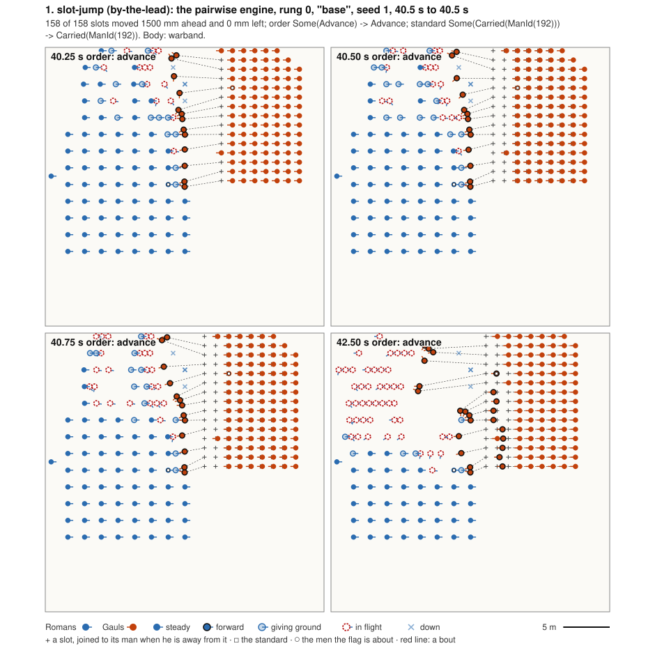

- **Where:** the pairwise engine, rung 0, `base`, seed 1, at 40.5 s.
- **Measured:** 158 of 158 slots moved 1500 mm ahead and 0 mm left; order Some(Advance) -> Advance; standard Some(Carried(ManId(192))) -> Carried(ManId(192)). Kind: by-the-lead. One of 459 of this kind on this engine.
- **Bin:** fine. The warband's lead comes on as the century ahead breaks.
- **In the viewer:** http://127.0.0.1:8377/?engine=pairwise&rung=0&variant=base&seed=1&t=37

### 01-slot-jump-pairwise-by-the-lead-2

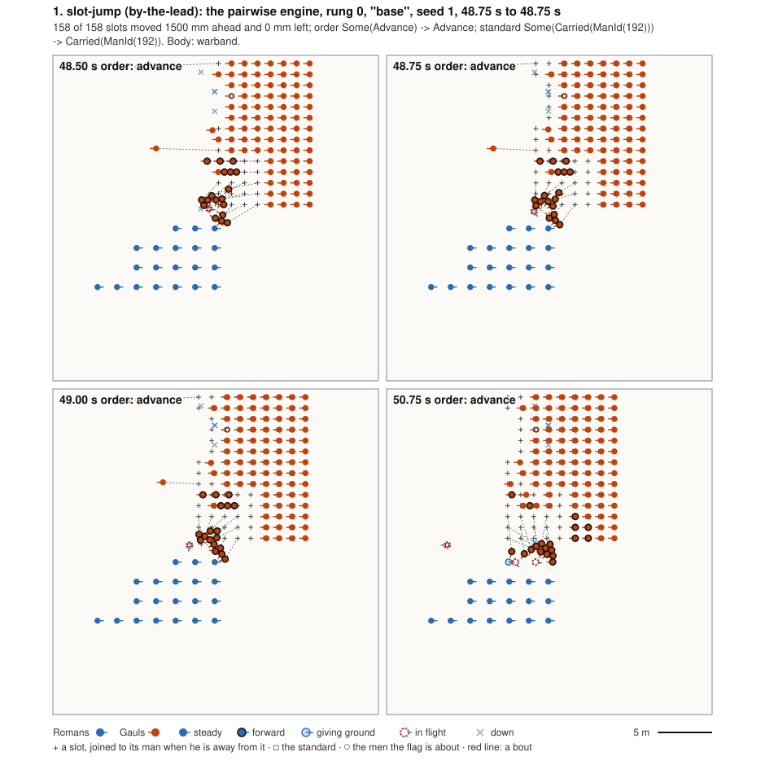

- **Where:** the pairwise engine, rung 0, `base`, seed 1, at 48.75 s.
- **Measured:** 158 of 158 slots moved 1500 mm ahead and 0 mm left; order Some(Advance) -> Advance; standard Some(Carried(ManId(192))) -> Carried(ManId(192)). Kind: by-the-lead. One of 459 of this kind on this engine.
- **Bin:** fine. The same, a second time.
- **In the viewer:** http://127.0.0.1:8377/?engine=pairwise&rung=0&variant=base&seed=1&t=45

### 01-slot-jump-pairwise-by-the-lead-3

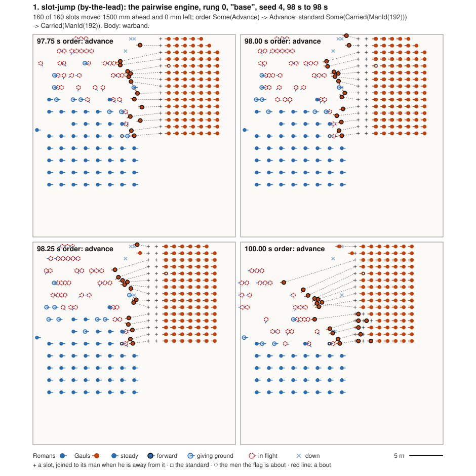

- **Where:** the pairwise engine, rung 0, `base`, seed 4, at 98 s.
- **Measured:** 160 of 160 slots moved 1500 mm ahead and 0 mm left; order Some(Advance) -> Advance; standard Some(Carried(ManId(192))) -> Carried(ManId(192)). Kind: by-the-lead. One of 459 of this kind on this engine.
- **Bin:** fine. The same, another seed.
- **In the viewer:** http://127.0.0.1:8377/?engine=pairwise&rung=0&variant=base&seed=4&t=95

### 01-slot-jump-pairwise-by-the-lead-4

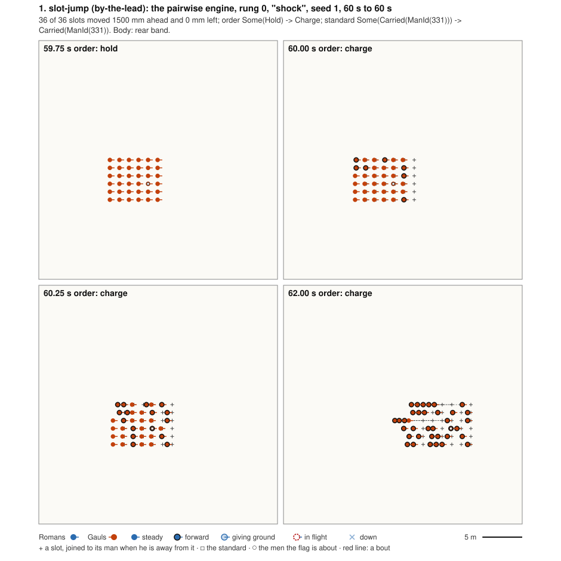

- **Where:** the pairwise engine, rung 0, `shock`, seed 1, at 60 s.
- **Measured:** 36 of 36 slots moved 1500 mm ahead and 0 mm left; order Some(Hold) -> Charge; standard Some(Carried(ManId(331))) -> Carried(ManId(331)). Kind: by-the-lead. One of 459 of this kind on this engine.
- **Bin:** fine. The rear band's lead comes on with its order to charge.
- **In the viewer:** http://127.0.0.1:8377/?engine=pairwise&rung=0&variant=shock&seed=1&t=57

### 01-slot-jump-pairwise-other-1

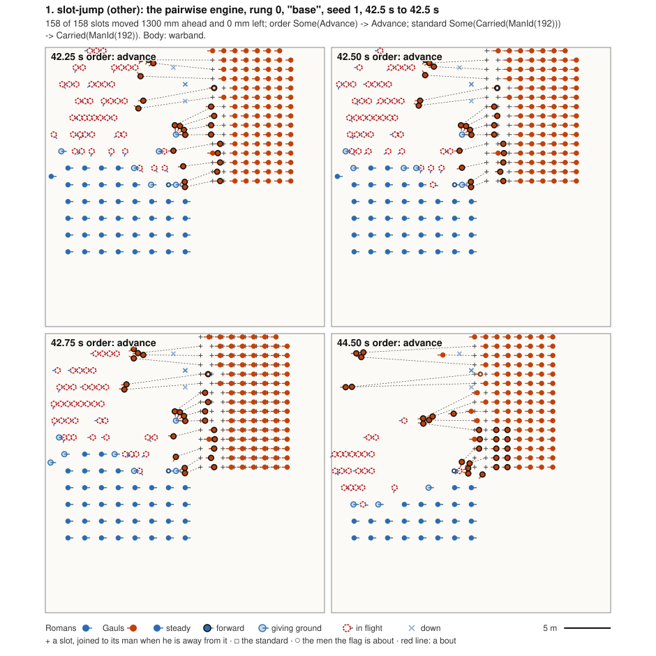

- **Where:** the pairwise engine, rung 0, `base`, seed 1, at 42.5 s.
- **Measured:** 158 of 158 slots moved 1300 mm ahead and 0 mm left; order Some(Advance) -> Advance; standard Some(Carried(ManId(192))) -> Carried(ManId(192)). Kind: other. One of 686 of this kind on this engine.
- **Bin:** gap A. The halted warband's frame is re-formed on its bearer, who stepped out to fight: 158 slots move 1.3 m.
- **In the viewer:** http://127.0.0.1:8377/?engine=pairwise&rung=0&variant=base&seed=1&t=39

### 01-slot-jump-pairwise-other-2

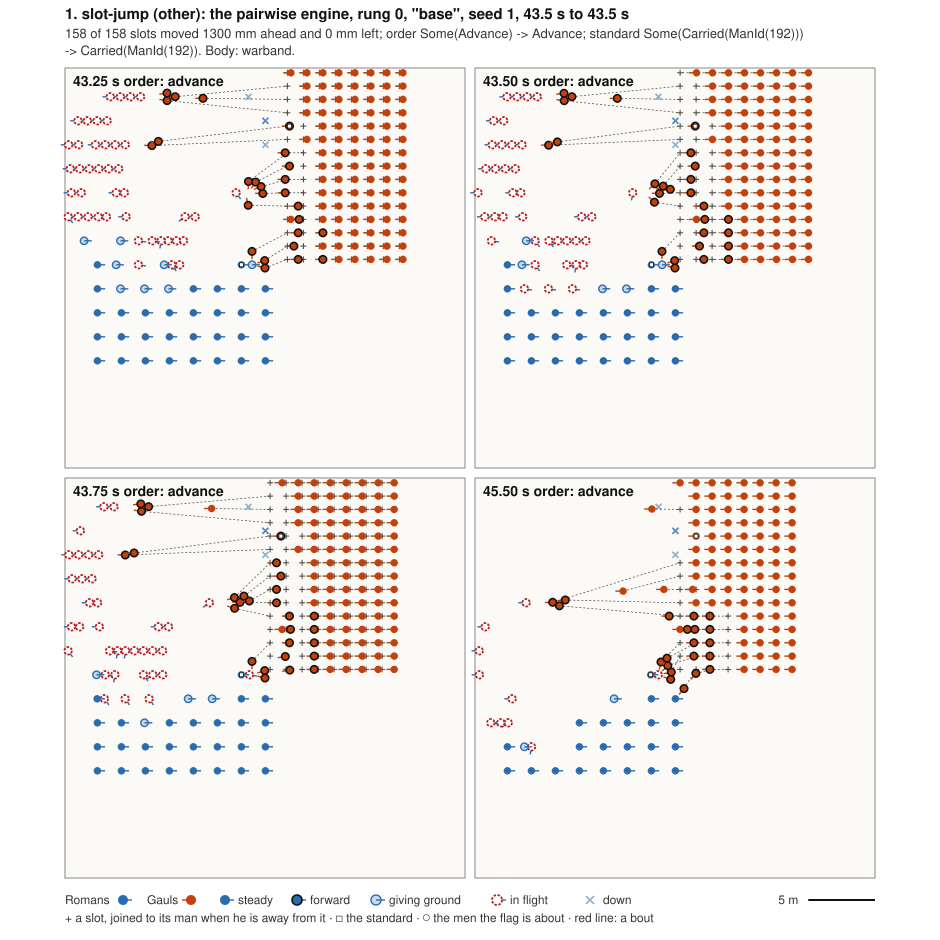

- **Where:** the pairwise engine, rung 0, `base`, seed 1, at 43.5 s.
- **Measured:** 158 of 158 slots moved 1300 mm ahead and 0 mm left; order Some(Advance) -> Advance; standard Some(Carried(ManId(192))) -> Carried(ManId(192)). Kind: other. One of 686 of this kind on this engine.
- **Bin:** gap A. The same, a second later.
- **In the viewer:** http://127.0.0.1:8377/?engine=pairwise&rung=0&variant=base&seed=1&t=40

### 01-slot-jump-pairwise-other-3

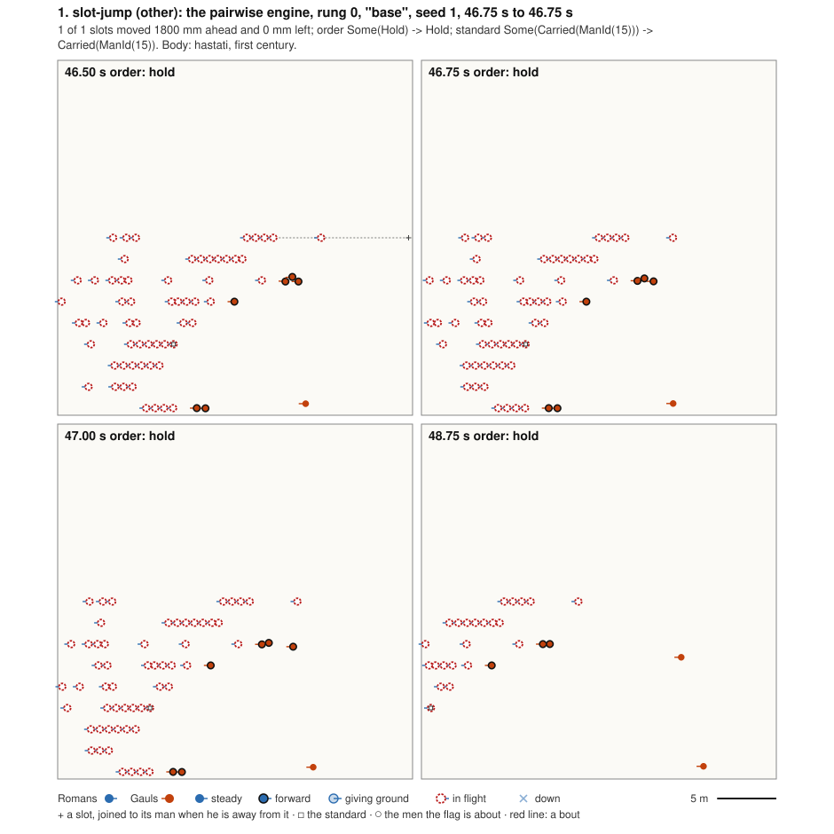

- **Where:** the pairwise engine, rung 0, `base`, seed 1, at 46.75 s.
- **Measured:** 1 of 1 slots moved 1800 mm ahead and 0 mm left; order Some(Hold) -> Hold; standard Some(Carried(ManId(15))) -> Carried(ManId(15)). Kind: other. One of 686 of this kind on this engine.
- **Bin:** fine. 1 of 1 slots: the last slotted man of a broken century, his file closing.
- **In the viewer:** http://127.0.0.1:8377/?engine=pairwise&rung=0&variant=base&seed=1&t=43

### 01-slot-jump-pairwise-other-4

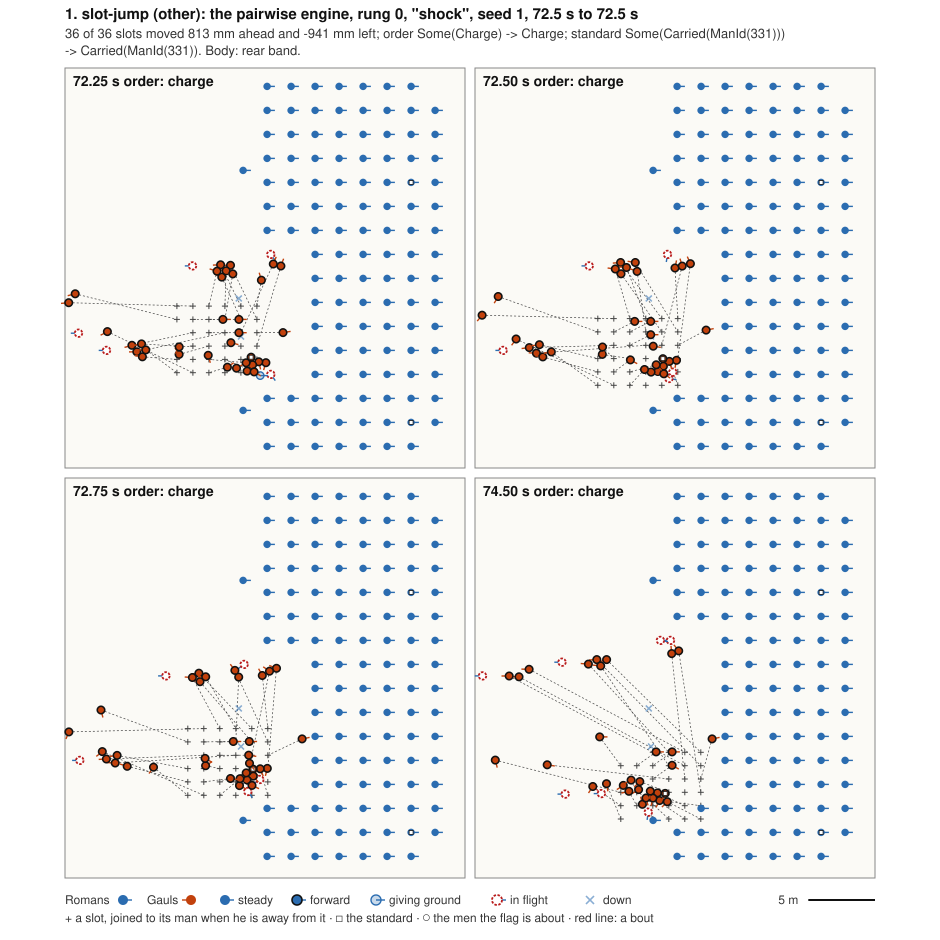

- **Where:** the pairwise engine, rung 0, `shock`, seed 1, at 72.5 s.
- **Measured:** 36 of 36 slots moved 813 mm ahead and -941 mm left; order Some(Charge) -> Charge; standard Some(Carried(ManId(331))) -> Carried(ManId(331)). Kind: other. One of 686 of this kind on this engine.
- **Bin:** gap A. The charging band's frame slides 1.2 m in a step with its bearer; its men stand in knots 2 to 5 m from their slots.
- **In the viewer:** http://127.0.0.1:8377/?engine=pairwise&rung=0&variant=shock&seed=1&t=69

### 02-halted-body-walks-pairwise-1

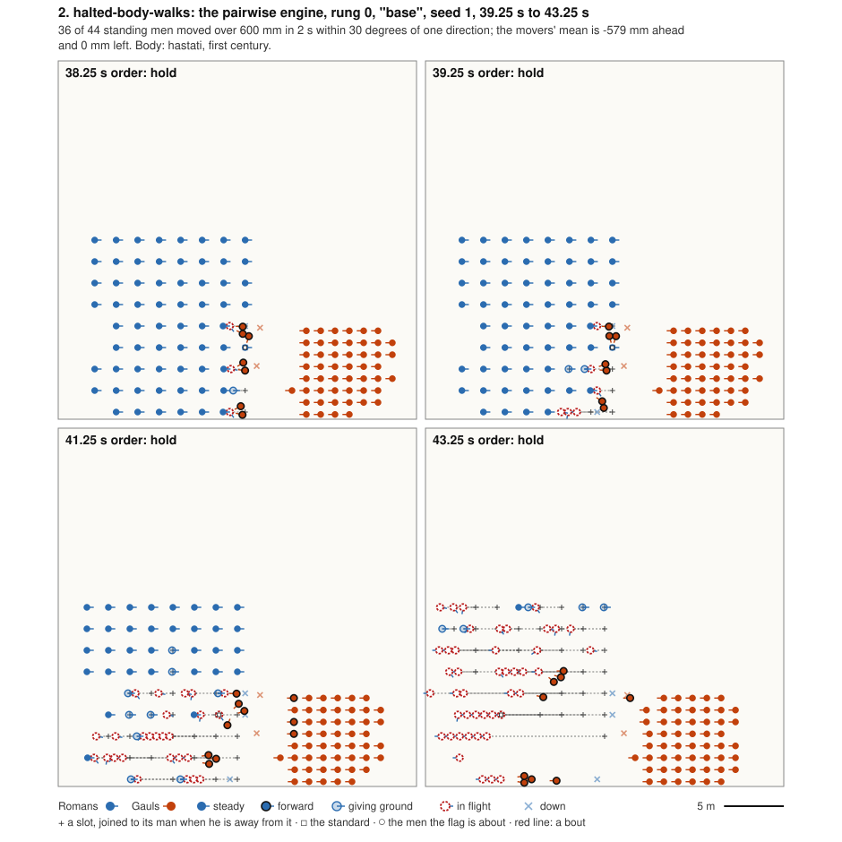

- **Where:** the pairwise engine, rung 0, `base`, seed 1, at 39.25 s, for 4 s.
- **Measured:** 36 of 44 standing men moved over 600 mm in 2 s within 30 degrees of one direction; the movers' mean is -579 mm ahead and 0 mm left. One of 511 of this kind on this engine.
- **Bin:** gap A. The first century steps back 0.65 m after its bearer gave ground, then breaks.
- **In the viewer:** http://127.0.0.1:8377/?engine=pairwise&rung=0&variant=base&seed=1&t=36

### 02-halted-body-walks-pairwise-2

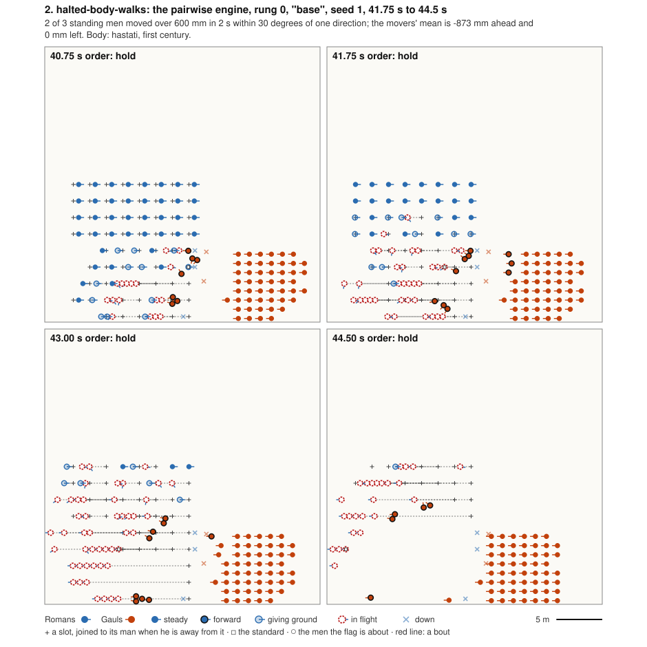

- **Where:** the pairwise engine, rung 0, `base`, seed 1, at 41.75 s, for 2.75 s.
- **Measured:** 2 of 3 standing men moved over 600 mm in 2 s within 30 degrees of one direction; the movers' mean is -873 mm ahead and 0 mm left. One of 511 of this kind on this engine.
- **Bin:** fine. 2 of 3 standing men: the remnant of a broken century.
- **In the viewer:** http://127.0.0.1:8377/?engine=pairwise&rung=0&variant=base&seed=1&t=38

### 02-halted-body-walks-pairwise-3

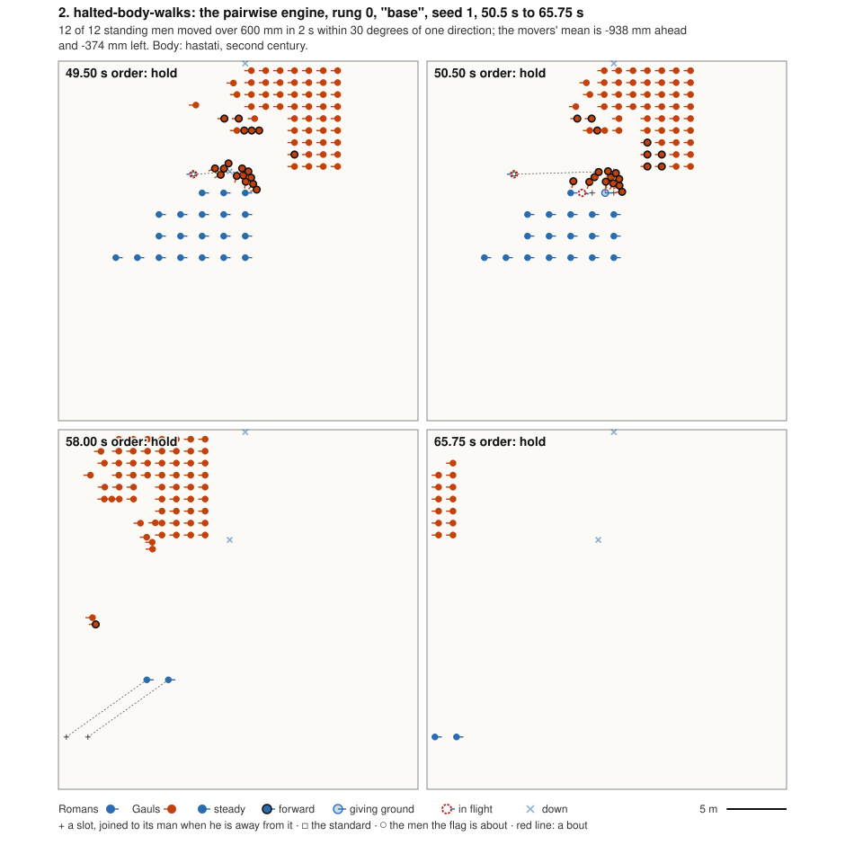

- **Where:** the pairwise engine, rung 0, `base`, seed 1, at 50.5 s, for 15.25 s.
- **Measured:** 12 of 12 standing men moved over 600 mm in 2 s within 30 degrees of one direction; the movers' mean is -938 mm ahead and -374 mm left. One of 511 of this kind on this engine.
- **Bin:** gap A. The second century's 12 standing men walk 16 m to a frame re-formed on their bearer, who fled and stood again.
- **In the viewer:** http://127.0.0.1:8377/?engine=pairwise&rung=0&variant=base&seed=1&t=47

### 02-halted-body-walks-pairwise-4

*The same drawing as [`02-halted-body-walks-pairwise-1`](#02-halted-body-walks-pairwise-1).*

- **Where:** the pairwise engine, rung 0, `backed`, seed 1, at 39.25 s, for 4 s.
- **Measured:** 36 of 44 standing men moved over 600 mm in 2 s within 30 degrees of one direction; the movers' mean is -579 mm ahead and 0 mm left. One of 511 of this kind on this engine.
- **Bin:** gap A. = `02` 1.
- **In the viewer:** http://127.0.0.1:8377/?engine=pairwise&rung=0&variant=backed&seed=1&t=36

### 03-pinned-runner-pairwise-1

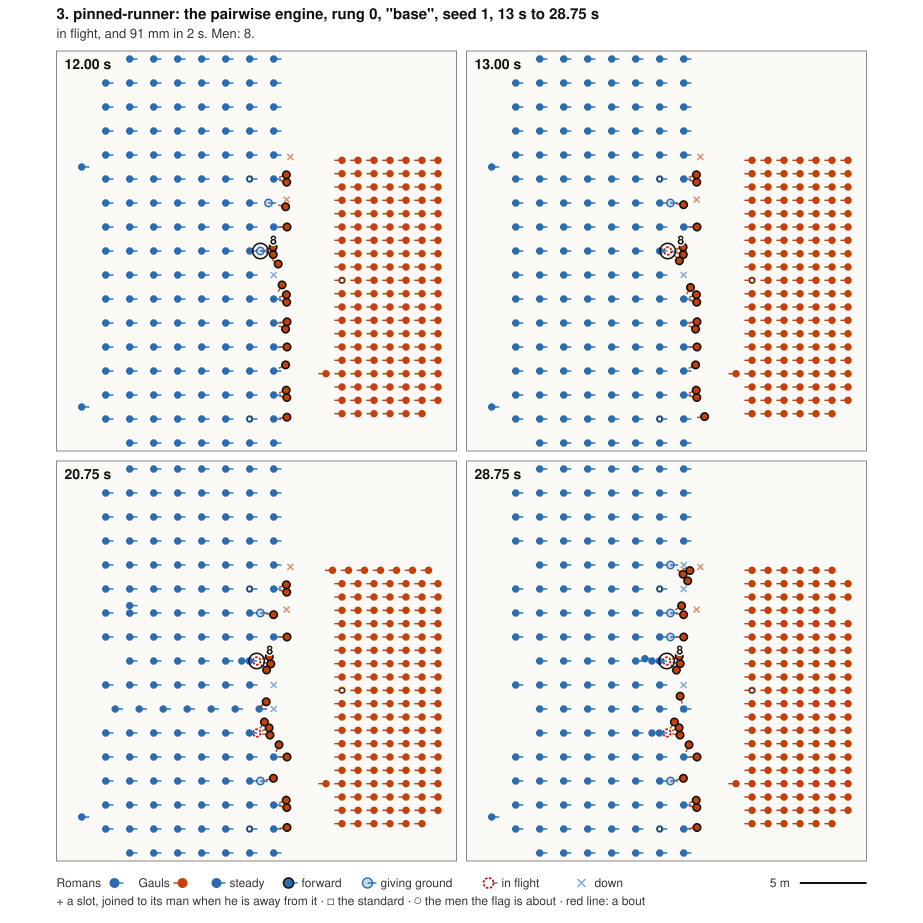

- **Where:** the pairwise engine, rung 0, `base`, seed 1, at 13 s, for 15.75 s.
- **Measured:** in flight, and 91 mm in 2 s. One of 1279 of this kind on this engine.
- **Bin:** gap C. A front-rank Roman in flight for 15.75 s between his own file and the Gauls.
- **In the viewer:** http://127.0.0.1:8377/?engine=pairwise&rung=0&variant=base&seed=1&t=10&man=8

### 03-pinned-runner-pairwise-2

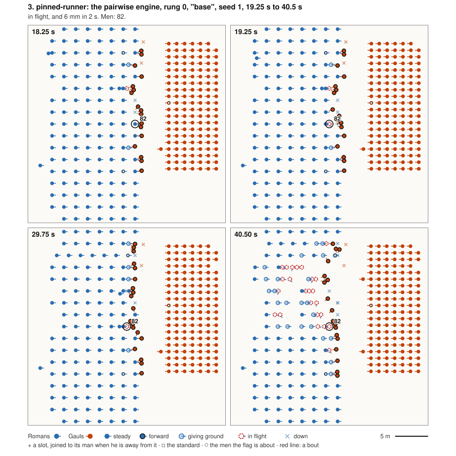

- **Where:** the pairwise engine, rung 0, `base`, seed 1, at 19.25 s, for 21.25 s.
- **Measured:** in flight, and 6 mm in 2 s. One of 1279 of this kind on this engine.
- **Bin:** gap C. The same, 21 s.
- **In the viewer:** http://127.0.0.1:8377/?engine=pairwise&rung=0&variant=base&seed=1&t=16&man=82

### 03-pinned-runner-pairwise-3

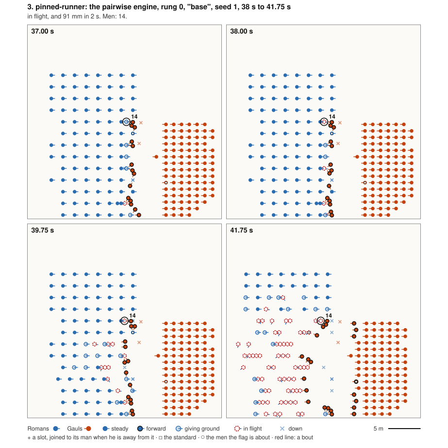

- **Where:** the pairwise engine, rung 0, `base`, seed 1, at 38 s, for 3.75 s.
- **Measured:** in flight, and 91 mm in 2 s. One of 1279 of this kind on this engine.
- **Bin:** gap C. The same, until the century breaks.
- **In the viewer:** http://127.0.0.1:8377/?engine=pairwise&rung=0&variant=base&seed=1&t=35&man=14

### 03-pinned-runner-pairwise-4

*The same drawing as [`03-pinned-runner-pairwise-1`](#03-pinned-runner-pairwise-1).*

- **Where:** the pairwise engine, rung 0, `backed`, seed 1, at 13 s, for 15.75 s.
- **Measured:** in flight, and 91 mm in 2 s. One of 1279 of this kind on this engine.
- **Bin:** gap C. = `03` 1.
- **In the viewer:** http://127.0.0.1:8377/?engine=pairwise&rung=0&variant=backed&seed=1&t=10&man=8

### 09-facing-in-place-pairwise-1

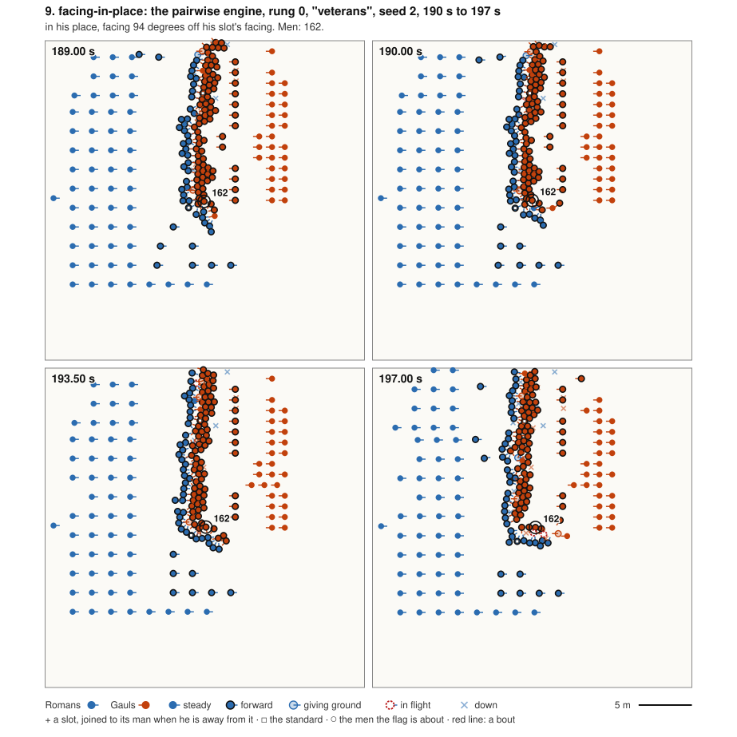

- **Where:** the pairwise engine, rung 0, `veterans`, seed 2, at 190 s, for 7 s.
- **Measured:** in his place, facing 94 degrees off his slot's facing. One of 368 of this kind on this engine.
- **Bin:** fine. A Gaul at the warband's corner faces the Romans who came round it. Beside it: H.
- **In the viewer:** http://127.0.0.1:8377/?engine=pairwise&rung=0&variant=veterans&seed=2&t=187&man=162

### 09-facing-in-place-pairwise-2

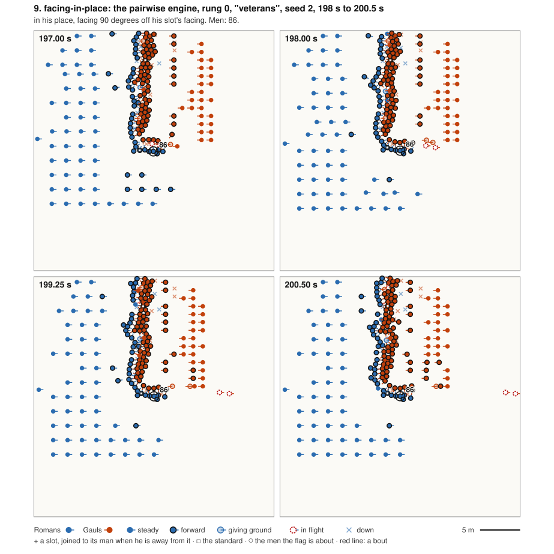

- **Where:** the pairwise engine, rung 0, `veterans`, seed 2, at 198 s, for 2.5 s.
- **Measured:** in his place, facing 90 degrees off his slot's facing. One of 368 of this kind on this engine.
- **Bin:** fine. A Roman at the band's end faces the enemy beside him.
- **In the viewer:** http://127.0.0.1:8377/?engine=pairwise&rung=0&variant=veterans&seed=2&t=195&man=86

### 09-facing-in-place-pairwise-3

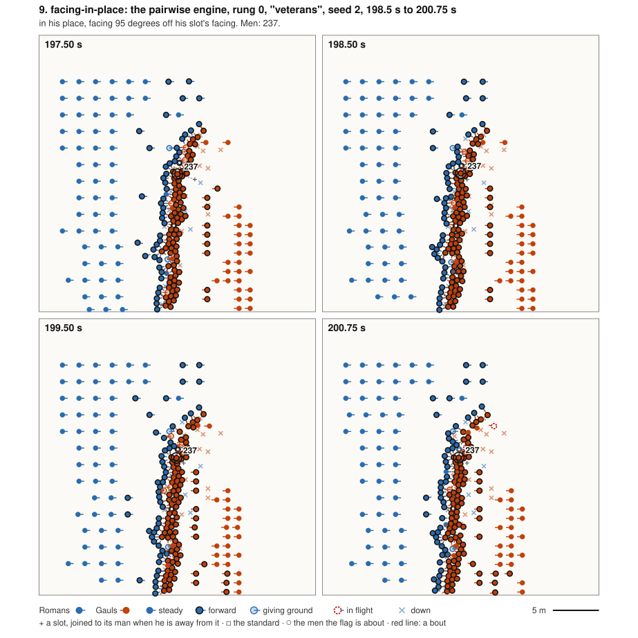

- **Where:** the pairwise engine, rung 0, `veterans`, seed 2, at 198.5 s, for 2.25 s.
- **Measured:** in his place, facing 95 degrees off his slot's facing. One of 368 of this kind on this engine.
- **Bin:** fine. The same, a Gaul.
- **In the viewer:** http://127.0.0.1:8377/?engine=pairwise&rung=0&variant=veterans&seed=2&t=195&man=237

### 09-facing-in-place-pairwise-4

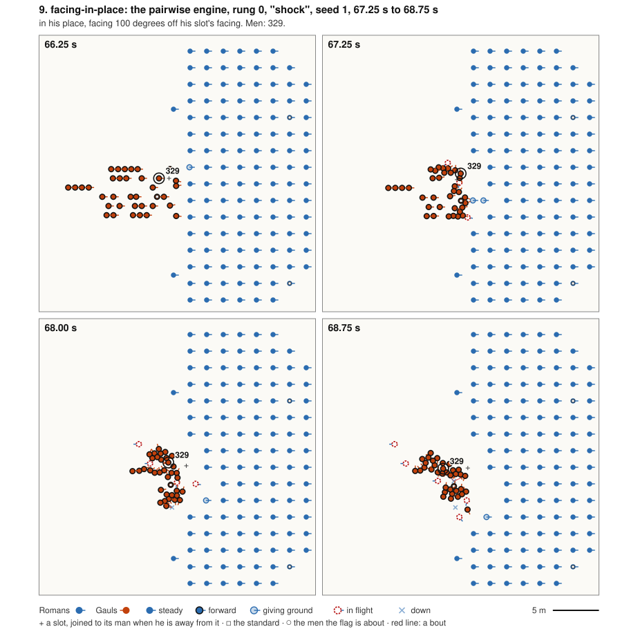

- **Where:** the pairwise engine, rung 0, `shock`, seed 1, at 67.25 s, for 1.5 s.
- **Measured:** in his place, facing 100 degrees off his slot's facing. One of 368 of this kind on this engine.
- **Bin:** fine. A man of the charging band, near a slot of a frame that moves with its bearer, fights facing sideways. All 332 such flags in `shock` are the band's men.
- **In the viewer:** http://127.0.0.1:8377/?engine=pairwise&rung=0&variant=shock&seed=1&t=64&man=329

### 10-flight-toward-pairwise-1

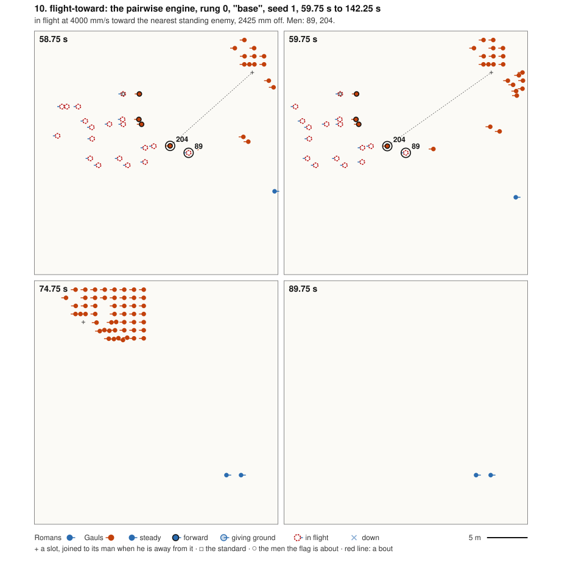

- **Where:** the pairwise engine, rung 0, `base`, seed 1, at 59.75 s, for 82.5 s.
- **Measured:** in flight at 4000 mm/s toward the nearest standing enemy, 2425 mm off. One of 2101 of this kind on this engine.
- **Bin:** gap E. A runner 2.4 m behind a pursuer for 82 s.
- **In the viewer:** http://127.0.0.1:8377/?engine=pairwise&rung=0&variant=base&seed=1&t=56&man=89

### 10-flight-toward-pairwise-2

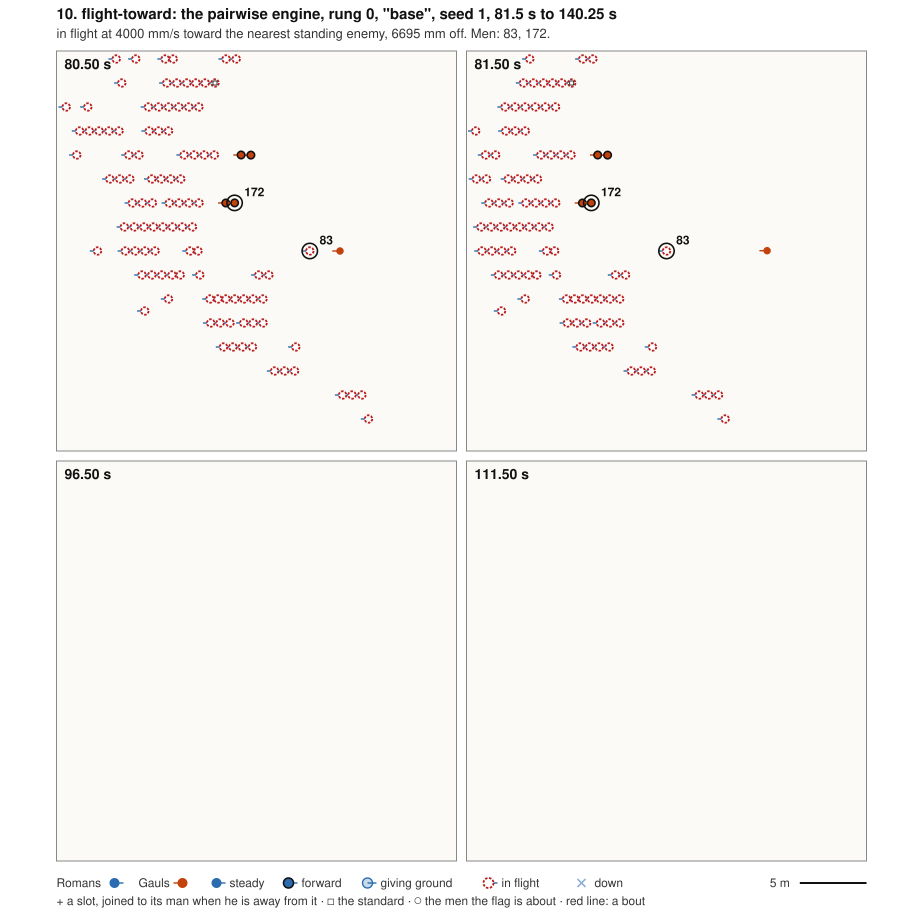

- **Where:** the pairwise engine, rung 0, `base`, seed 1, at 81.5 s, for 58.75 s.
- **Measured:** in flight at 4000 mm/s toward the nearest standing enemy, 6695 mm off. One of 2101 of this kind on this engine.
- **Bin:** gap E. The same, 59 s. Beside it: F.
- **In the viewer:** http://127.0.0.1:8377/?engine=pairwise&rung=0&variant=base&seed=1&t=78&man=83

### 10-flight-toward-pairwise-3

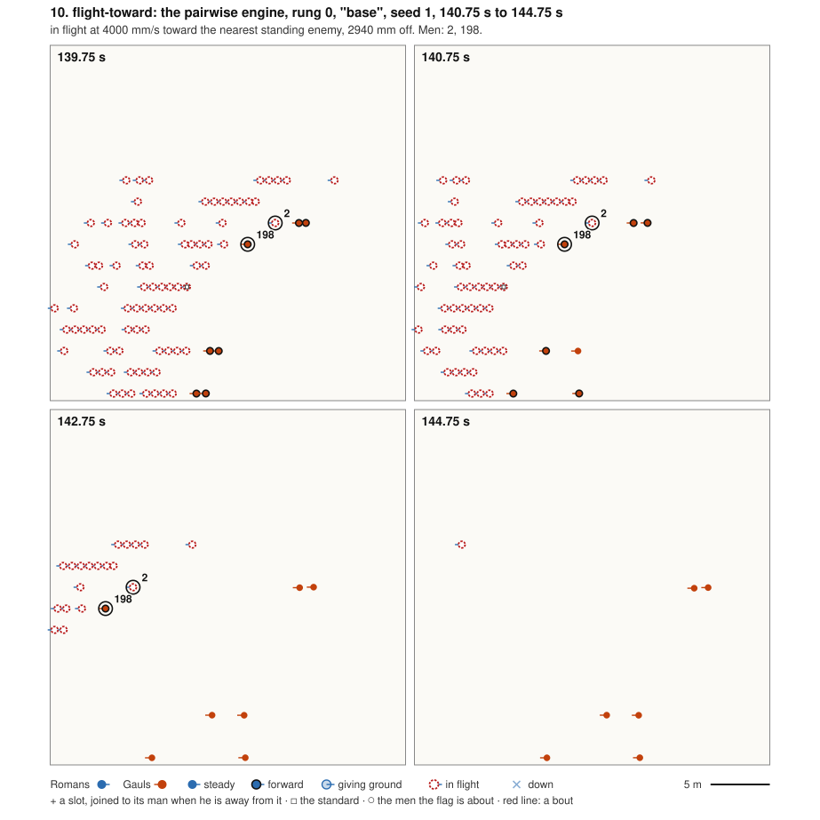

- **Where:** the pairwise engine, rung 0, `base`, seed 1, at 140.75 s, for 4 s.
- **Measured:** in flight at 4000 mm/s toward the nearest standing enemy, 2940 mm off. One of 2101 of this kind on this engine.
- **Bin:** gap E. The same.
- **In the viewer:** http://127.0.0.1:8377/?engine=pairwise&rung=0&variant=base&seed=1&t=137&man=2

### 10-flight-toward-pairwise-4

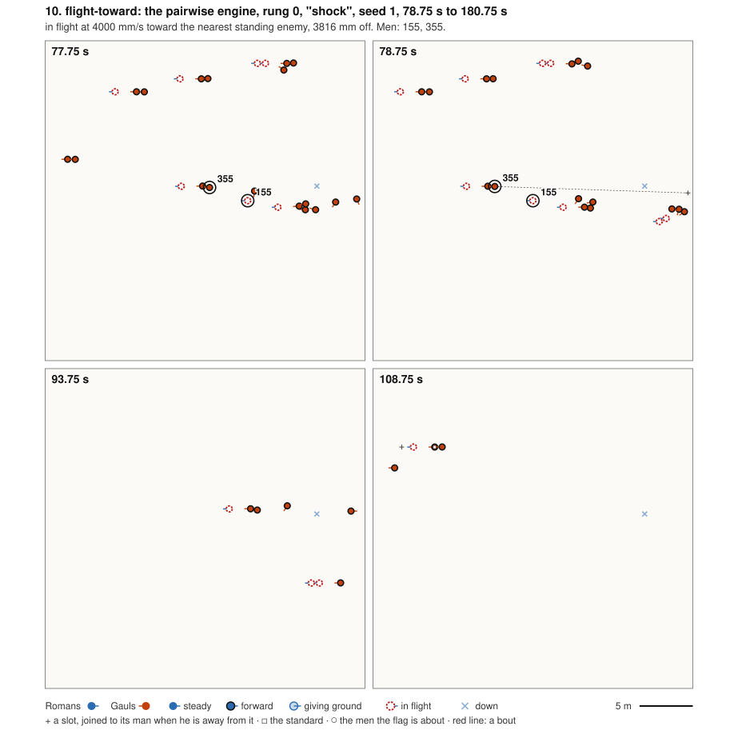

- **Where:** the pairwise engine, rung 0, `shock`, seed 1, at 78.75 s, for 102 s.
- **Measured:** in flight at 4000 mm/s toward the nearest standing enemy, 3816 mm off. One of 2101 of this kind on this engine.
- **Bin:** gap E. The same behind a man of the band, 102 s.
- **In the viewer:** http://127.0.0.1:8377/?engine=pairwise&rung=0&variant=shock&seed=1&t=75&man=155

### 13-bout-through-pairwise-past-a-comrade-1

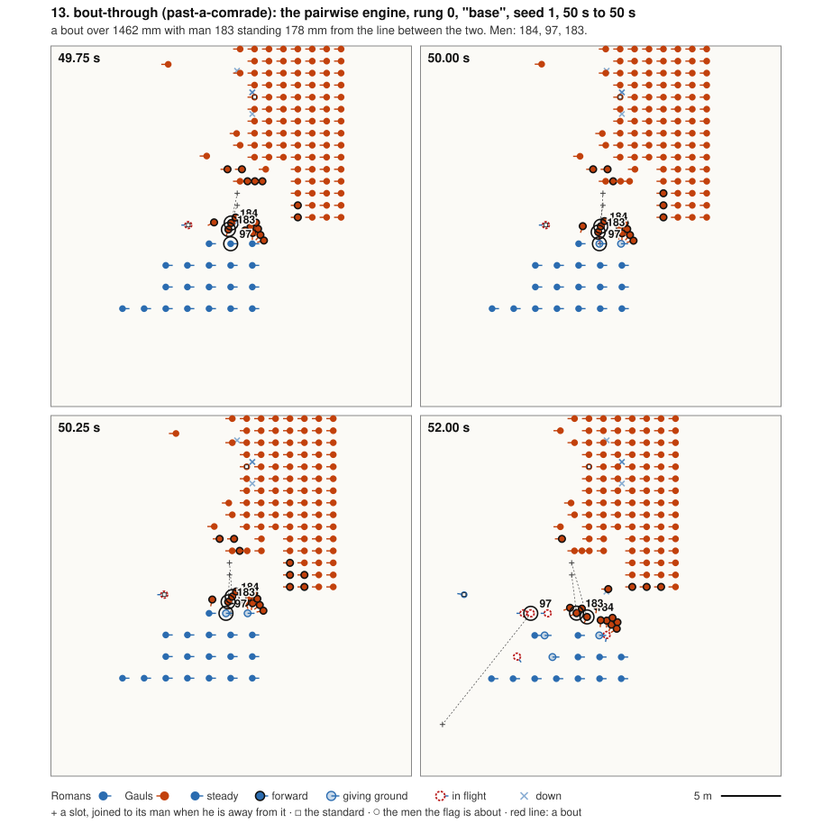

- **Where:** the pairwise engine, rung 0, `base`, seed 1, at 50 s.
- **Measured:** a bout over 1462 mm with man 183 standing 178 mm from the line between the two. Kind: past-a-comrade. One of 549 of this kind on this engine.
- **Bin:** gap I. A strike over 1.46 m with a comrade 0.18 m from the line, in the knot round the standard-bearer.
- **In the viewer:** http://127.0.0.1:8377/?engine=pairwise&rung=0&variant=base&seed=1&t=47&man=184

### 13-bout-through-pairwise-past-a-comrade-2

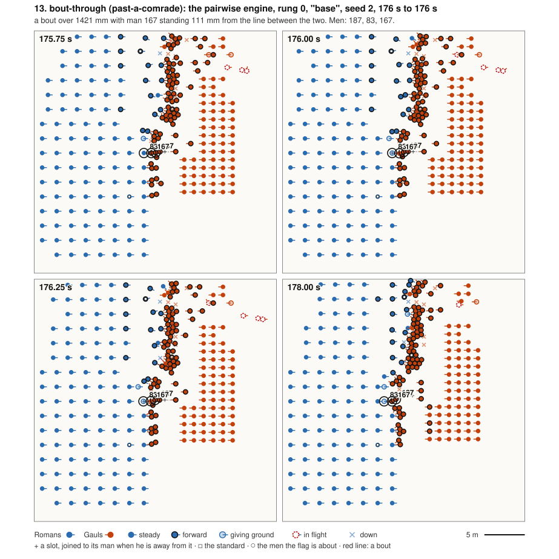

- **Where:** the pairwise engine, rung 0, `base`, seed 2, at 176 s.
- **Measured:** a bout over 1421 mm with man 167 standing 111 mm from the line between the two. Kind: past-a-comrade. One of 549 of this kind on this engine.
- **Bin:** gap I. The same, in the band of H.
- **In the viewer:** http://127.0.0.1:8377/?engine=pairwise&rung=0&variant=base&seed=2&t=173&man=187

### 13-bout-through-pairwise-past-a-comrade-3

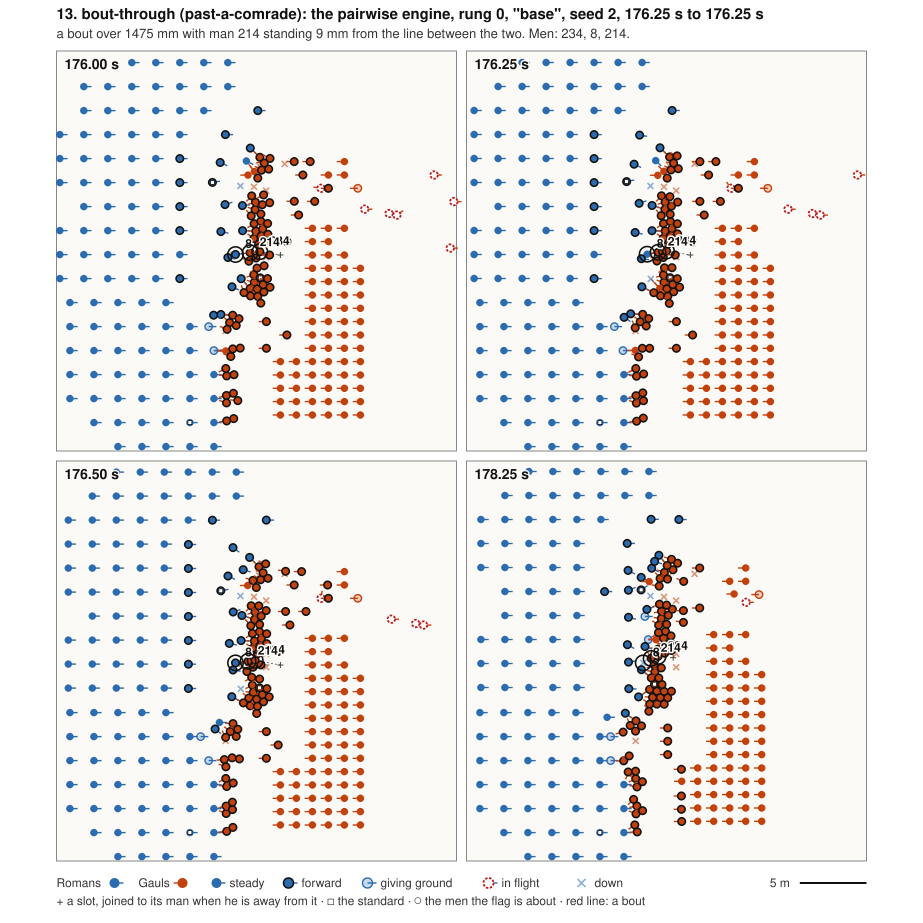

- **Where:** the pairwise engine, rung 0, `base`, seed 2, at 176.25 s.
- **Measured:** a bout over 1475 mm with man 214 standing 9 mm from the line between the two. Kind: past-a-comrade. One of 549 of this kind on this engine.
- **Bin:** gap I. The same, the comrade 9 mm from the line.
- **In the viewer:** http://127.0.0.1:8377/?engine=pairwise&rung=0&variant=base&seed=2&t=173&man=234

### 13-bout-through-pairwise-past-a-comrade-4

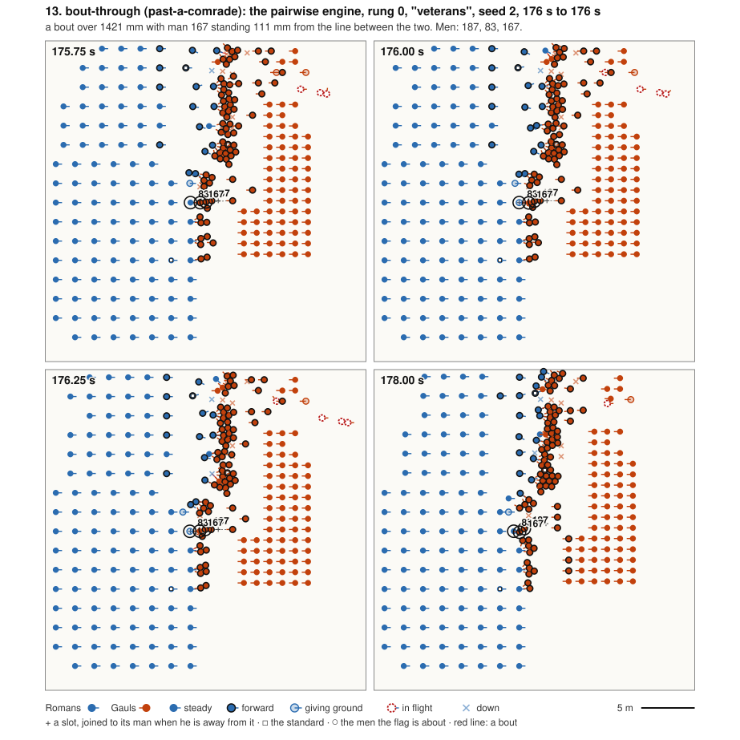

- **Where:** the pairwise engine, rung 0, `veterans`, seed 2, at 176 s.
- **Measured:** a bout over 1421 mm with man 167 standing 111 mm from the line between the two. Kind: past-a-comrade. One of 549 of this kind on this engine.
- **Bin:** gap I. The same men and second as `13` 2.
- **In the viewer:** http://127.0.0.1:8377/?engine=pairwise&rung=0&variant=veterans&seed=2&t=173&man=187

### 14-flicker-pairwise-gives-way-1

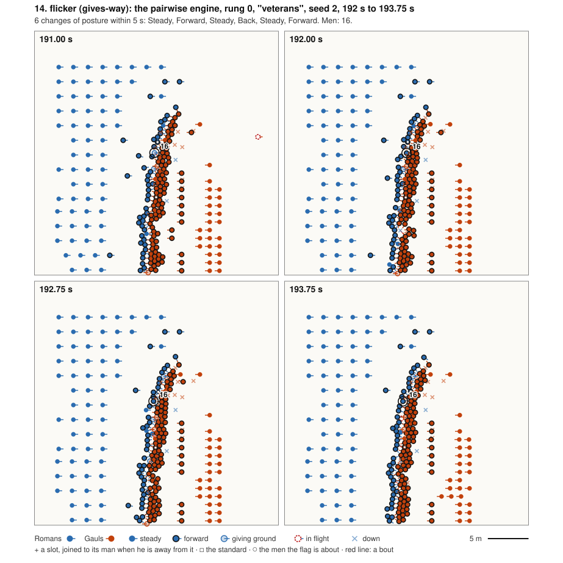

- **Where:** the pairwise engine, rung 0, `veterans`, seed 2, at 192 s, for 1.75 s.
- **Measured:** 6 changes of posture within 5 s: Steady, Forward, Steady, Back, Steady, Forward. Kind: gives-way. One of 2 of this kind on this engine.
- **Bin:** fine. A Roman in the band: steady, forward, steady, back, steady, forward in 1.75 s. Rare: 14 flickers in 160 battles.
- **In the viewer:** http://127.0.0.1:8377/?engine=pairwise&rung=0&variant=veterans&seed=2&t=189&man=16

### 14-flicker-pairwise-gives-way-2

*The same drawing as [`14-flicker-pairwise-gives-way-1`](#14-flicker-pairwise-gives-way-1).*

- **Where:** the pairwise engine, rung 1, `veterans`, seed 2, at 192 s, for 1.75 s.
- **Measured:** 6 changes of posture within 5 s: Steady, Forward, Steady, Back, Steady, Forward. Kind: gives-way. One of 2 of this kind on this engine.
- **Bin:** fine. = gives-way 1.
- **In the viewer:** http://127.0.0.1:8377/?engine=pairwise&rung=1&variant=veterans&seed=2&t=189&man=16

### 14-flicker-pairwise-steady-and-forward-1

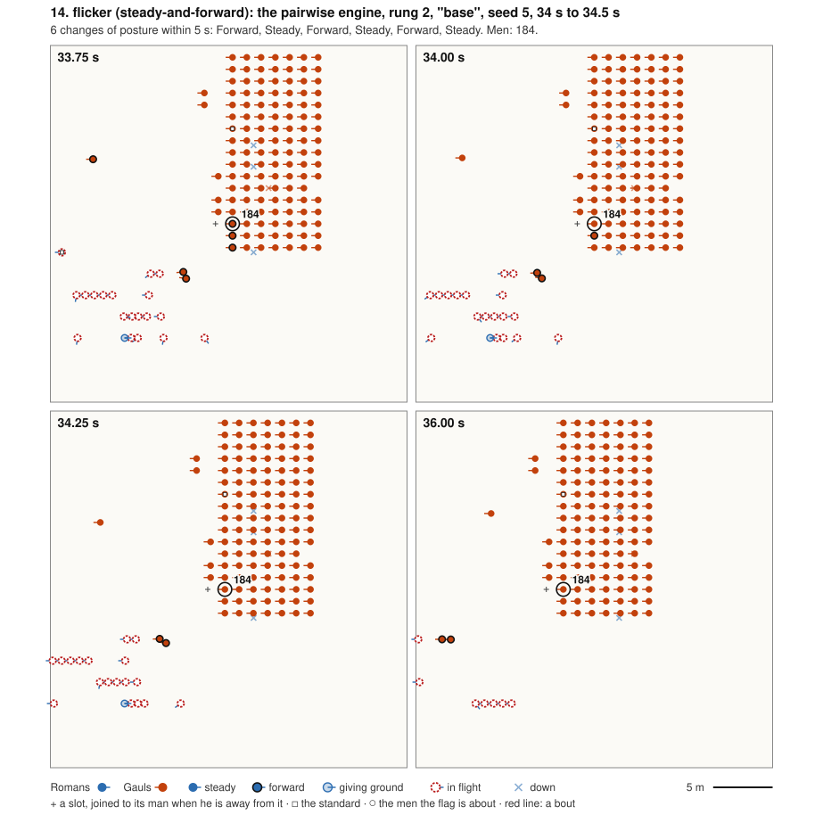

- **Where:** the pairwise engine, rung 2, `base`, seed 5, at 34 s, for 0.5 s.
- **Measured:** 6 changes of posture within 5 s: Forward, Steady, Forward, Steady, Forward, Steady. Kind: steady-and-forward. One of 12 of this kind on this engine.
- **Bin:** fine. A front-rank Gaul toggles after the Romans have fled. Rare.
- **In the viewer:** http://127.0.0.1:8377/?engine=pairwise&rung=2&variant=base&seed=5&t=31&man=184

### 14-flicker-pairwise-steady-and-forward-2

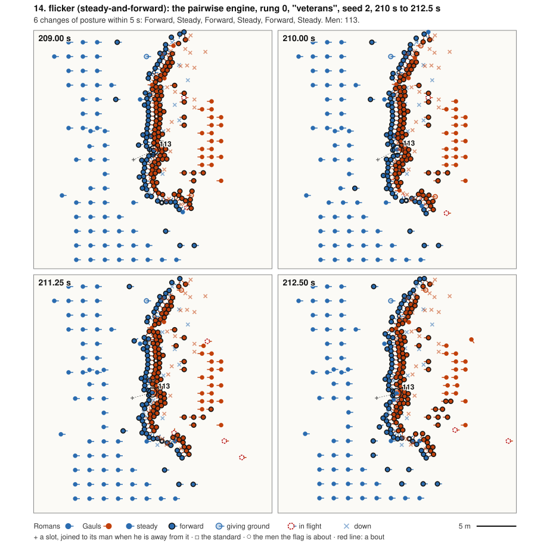

- **Where:** the pairwise engine, rung 0, `veterans`, seed 2, at 210 s, for 2.5 s.
- **Measured:** 6 changes of posture within 5 s: Forward, Steady, Forward, Steady, Forward, Steady. Kind: steady-and-forward. One of 12 of this kind on this engine.
- **Bin:** fine. A Roman in the band. Rare.
- **In the viewer:** http://127.0.0.1:8377/?engine=pairwise&rung=0&variant=veterans&seed=2&t=207&man=113

### 14-flicker-pairwise-steady-and-forward-3

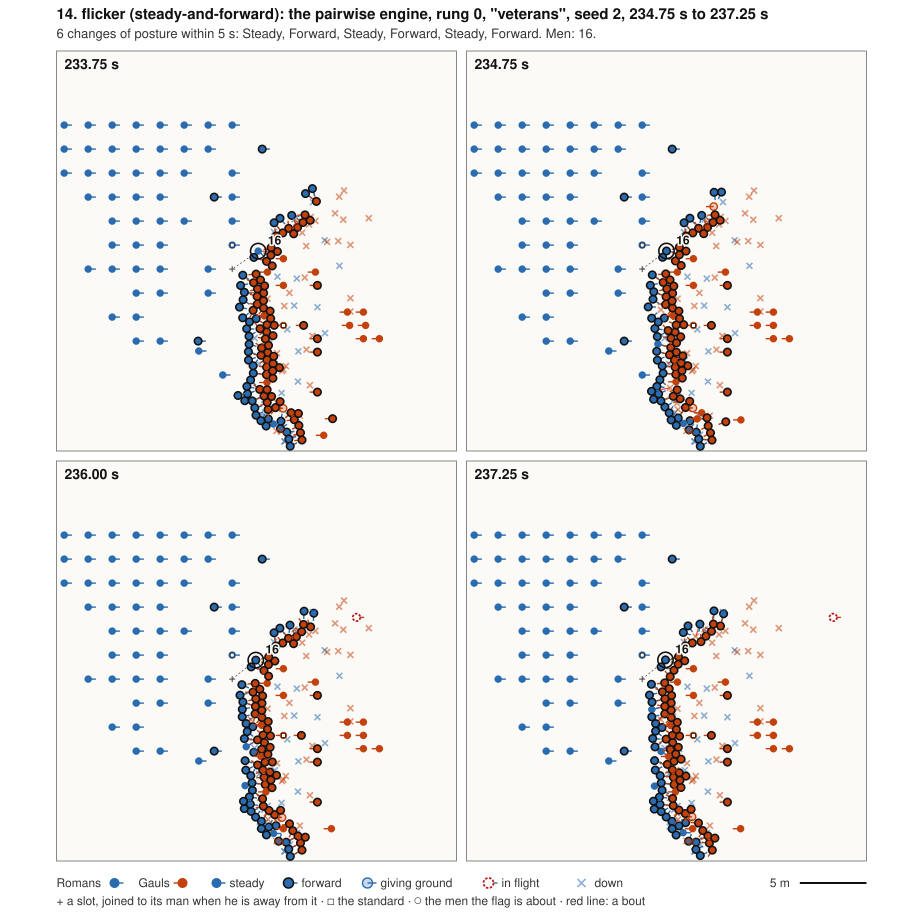

- **Where:** the pairwise engine, rung 0, `veterans`, seed 2, at 234.75 s, for 2.5 s.
- **Measured:** 6 changes of posture within 5 s: Steady, Forward, Steady, Forward, Steady, Forward. Kind: steady-and-forward. One of 12 of this kind on this engine.
- **Bin:** fine. The same.
- **In the viewer:** http://127.0.0.1:8377/?engine=pairwise&rung=0&variant=veterans&seed=2&t=231&man=16

### 15-standard-front-pairwise-front-rank-1

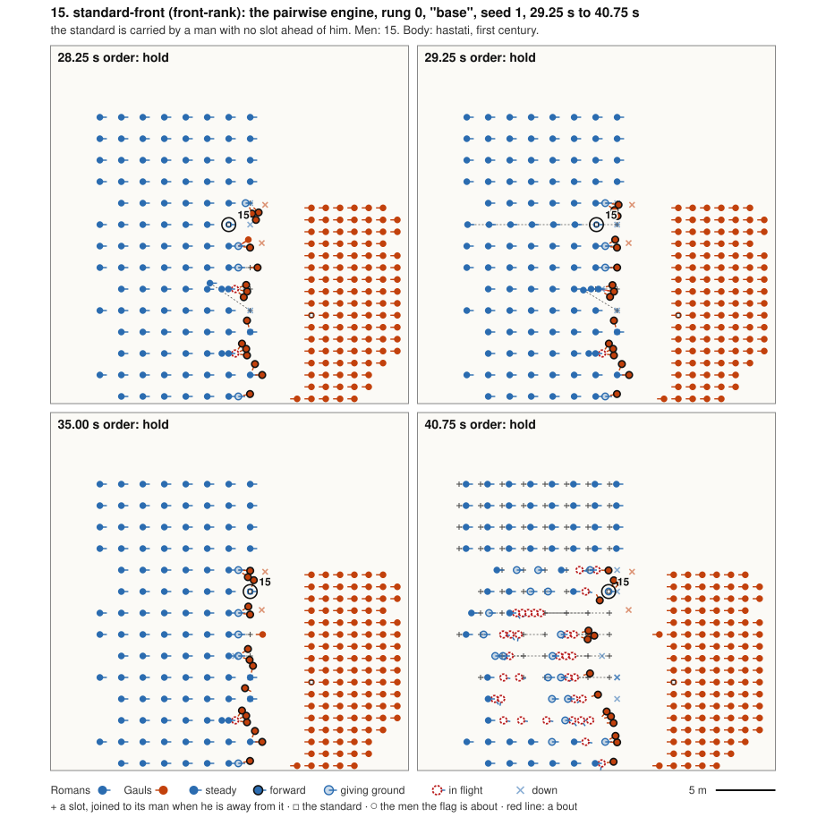

- **Where:** the pairwise engine, rung 0, `base`, seed 1, at 29.25 s, for 11.5 s.
- **Measured:** the standard is carried by a man with no slot ahead of him. Kind: front-rank. One of 239 of this kind on this engine.
- **Bin:** gap B. The bearer walks up into the front rank (the frame stays: the fix works) and fights there for 11.5 s.
- **In the viewer:** http://127.0.0.1:8377/?engine=pairwise&rung=0&variant=base&seed=1&t=26&man=15

### 15-standard-front-pairwise-front-rank-2

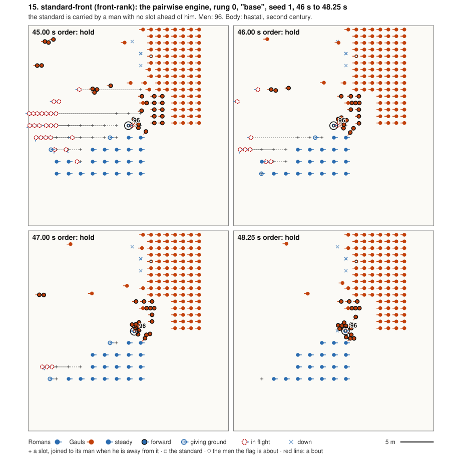

- **Where:** the pairwise engine, rung 0, `base`, seed 1, at 46 s, for 2.25 s.
- **Measured:** the standard is carried by a man with no slot ahead of him. Kind: front-rank. One of 239 of this kind on this engine.
- **Bin:** gap B. The second century's bearer in the front rank at its corner; a dozen Gauls gather round him.
- **In the viewer:** http://127.0.0.1:8377/?engine=pairwise&rung=0&variant=base&seed=1&t=43&man=96

### 15-standard-front-pairwise-front-rank-3

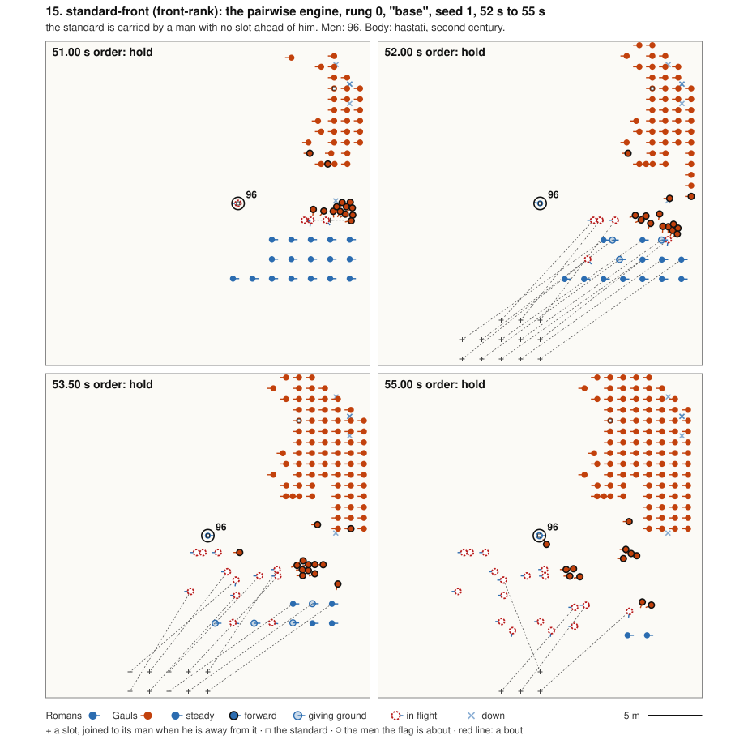

- **Where:** the pairwise engine, rung 0, `base`, seed 1, at 52 s, for 3 s.
- **Measured:** the standard is carried by a man with no slot ahead of him. Kind: front-rank. One of 239 of this kind on this engine.
- **Bin:** gap A. He fled 5 m and stood again: the frame snaps to him, and the 14 men left get slots more than 10 m away.
- **In the viewer:** http://127.0.0.1:8377/?engine=pairwise&rung=0&variant=base&seed=1&t=49&man=96

### 15-standard-front-pairwise-front-rank-4

*The same drawing as [`15-standard-front-pairwise-front-rank-1`](#15-standard-front-pairwise-front-rank-1).*

- **Where:** the pairwise engine, rung 0, `backed`, seed 1, at 29.25 s, for 11.5 s.
- **Measured:** the standard is carried by a man with no slot ahead of him. Kind: front-rank. One of 239 of this kind on this engine.
- **Bin:** gap B. = `15` 1.
- **In the viewer:** http://127.0.0.1:8377/?engine=pairwise&rung=0&variant=backed&seed=1&t=26&man=15

### 16-out-of-place-pairwise-1

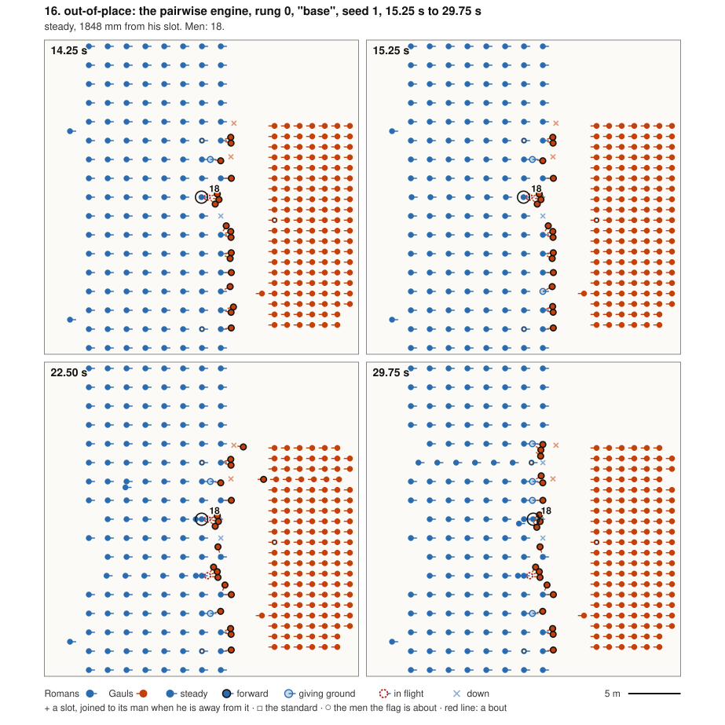

- **Where:** the pairwise engine, rung 0, `base`, seed 1, at 15.25 s, for 14.5 s.
- **Measured:** steady, 1848 mm from his slot. One of 4210 of this kind on this engine.
- **Bin:** gap C. Steady, 1.85 m short of his slot for 14.5 s: pinned runner 8 stands in it.
- **In the viewer:** http://127.0.0.1:8377/?engine=pairwise&rung=0&variant=base&seed=1&t=12&man=18

### 16-out-of-place-pairwise-2

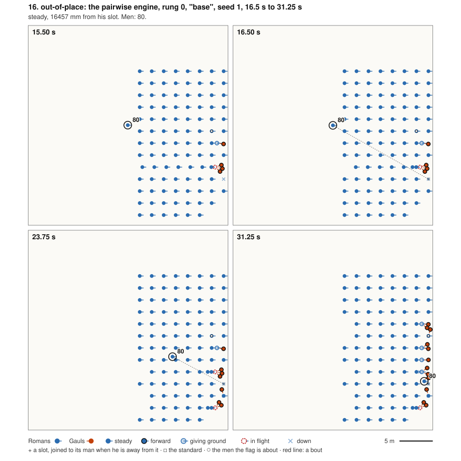

- **Where:** the pairwise engine, rung 0, `base`, seed 1, at 16.5 s, for 14.75 s.
- **Measured:** steady, 16457 mm from his slot. One of 4210 of this kind on this engine.
- **Bin:** fine. The closer takes the fallen leader's place, as the rule says, and needs 14.75 s to walk 16.5 m through his own files.
- **In the viewer:** http://127.0.0.1:8377/?engine=pairwise&rung=0&variant=base&seed=1&t=13&man=80

### 16-out-of-place-pairwise-3

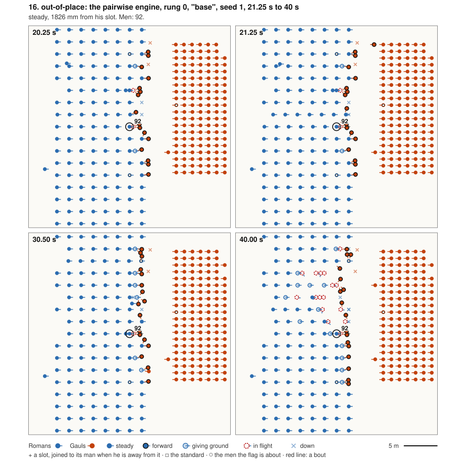

- **Where:** the pairwise engine, rung 0, `base`, seed 1, at 21.25 s, for 18.75 s.
- **Measured:** steady, 1826 mm from his slot. One of 4210 of this kind on this engine.
- **Bin:** gap C. As `16` 1, behind pinned runner 82.
- **In the viewer:** http://127.0.0.1:8377/?engine=pairwise&rung=0&variant=base&seed=1&t=18&man=92

### 16-out-of-place-pairwise-4

*The same drawing as [`16-out-of-place-pairwise-1`](#16-out-of-place-pairwise-1).*

- **Where:** the pairwise engine, rung 0, `flank`, seed 1, at 15.25 s, for 14.5 s.
- **Measured:** steady, 1848 mm from his slot. One of 4210 of this kind on this engine.
- **Bin:** gap C. = `16` 1.
- **In the viewer:** http://127.0.0.1:8377/?engine=pairwise&rung=0&variant=flank&seed=1&t=12&man=18

### 17-forward-idle-pairwise-1

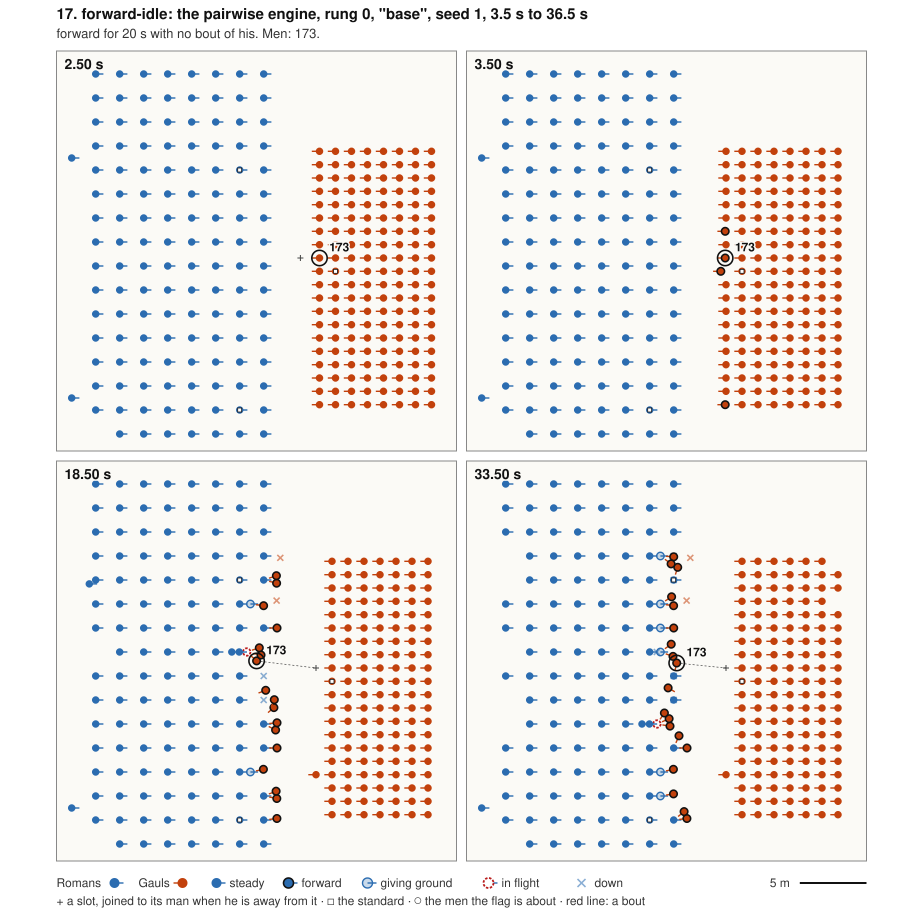

- **Where:** the pairwise engine, rung 0, `base`, seed 1, at 3.5 s, for 33 s.
- **Measured:** forward for 20 s with no bout of his. One of 4622 of this kind on this engine.
- **Bin:** fine. Bouts come once in ten seconds in the nominal set, so one forward man in seven waits 20 s. My threshold caught the ordinary.
- **In the viewer:** http://127.0.0.1:8377/?engine=pairwise&rung=0&variant=base&seed=1&t=0&man=173

### 17-forward-idle-pairwise-2

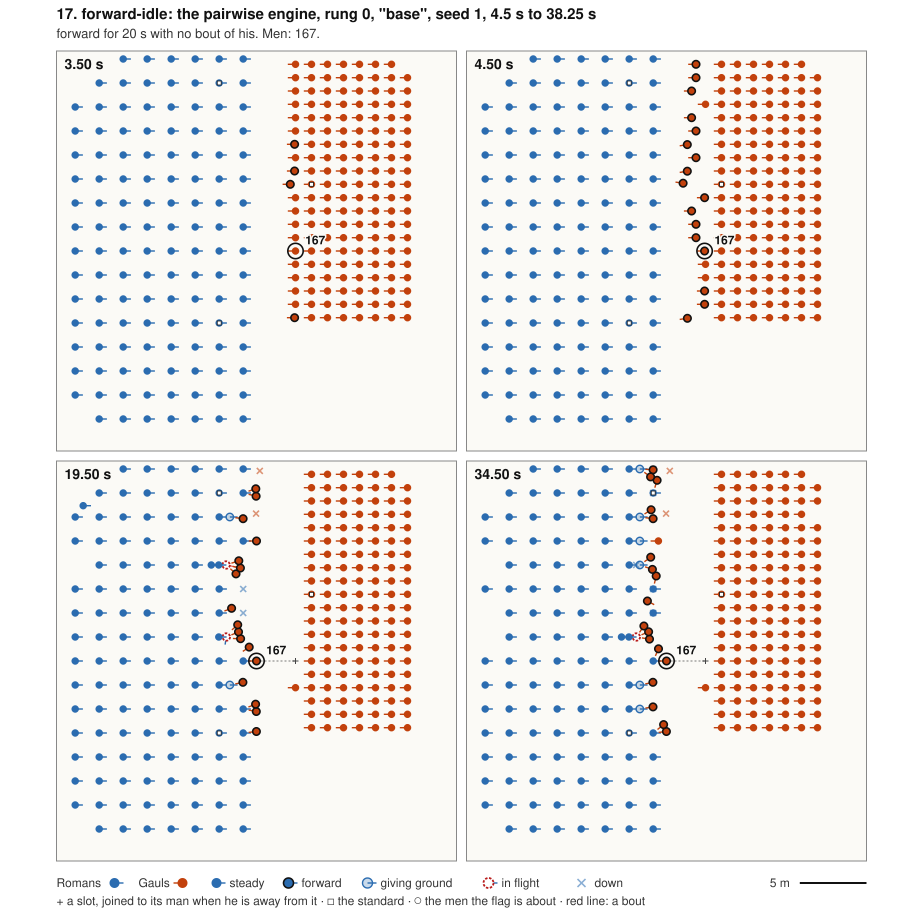

- **Where:** the pairwise engine, rung 0, `base`, seed 1, at 4.5 s, for 33.75 s.
- **Measured:** forward for 20 s with no bout of his. One of 4622 of this kind on this engine.
- **Bin:** fine. The same.
- **In the viewer:** http://127.0.0.1:8377/?engine=pairwise&rung=0&variant=base&seed=1&t=1&man=167

### 17-forward-idle-pairwise-3

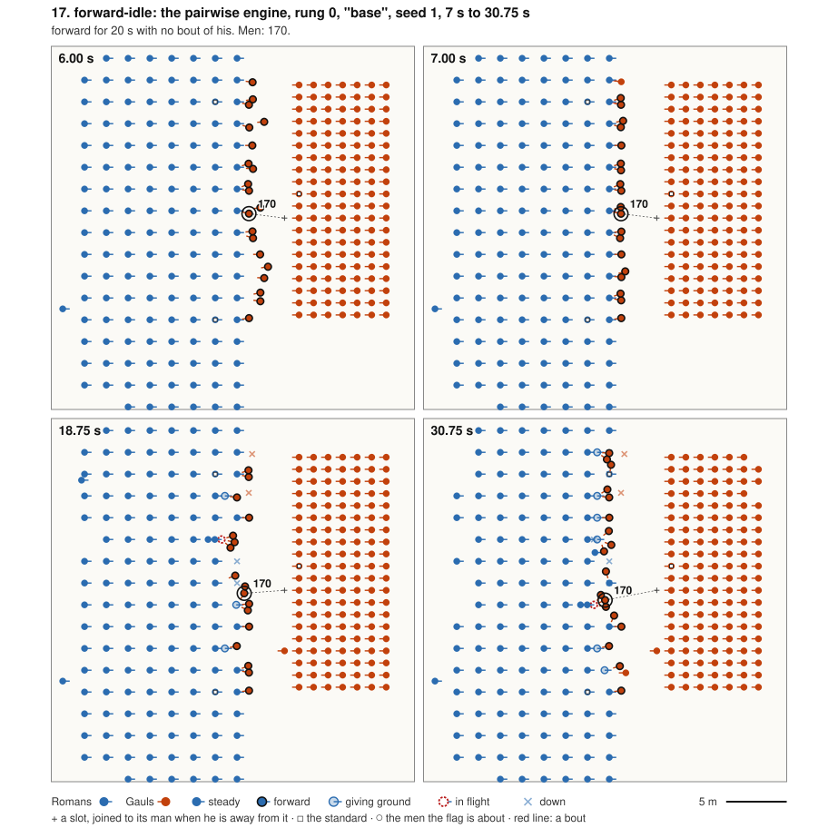

- **Where:** the pairwise engine, rung 0, `base`, seed 1, at 7 s, for 23.75 s.
- **Measured:** forward for 20 s with no bout of his. One of 4622 of this kind on this engine.
- **Bin:** fine. The same.
- **In the viewer:** http://127.0.0.1:8377/?engine=pairwise&rung=0&variant=base&seed=1&t=4&man=170

### 17-forward-idle-pairwise-4

*The same drawing as [`17-forward-idle-pairwise-1`](#17-forward-idle-pairwise-1).*

- **Where:** the pairwise engine, rung 0, `flank`, seed 1, at 3.5 s, for 33 s.
- **Measured:** forward for 20 s with no bout of his. One of 4622 of this kind on this engine.
- **Bin:** fine. = `17` 1.
- **In the viewer:** http://127.0.0.1:8377/?engine=pairwise&rung=0&variant=flank&seed=1&t=0&man=173

### 18-gap-pairwise-left-1

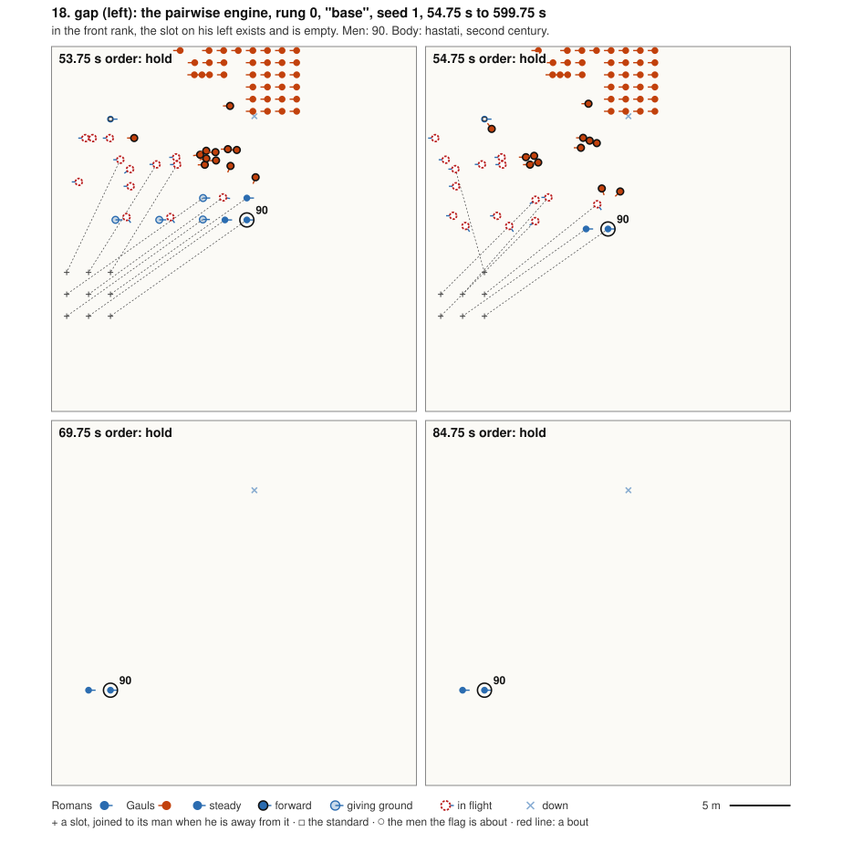

- **Where:** the pairwise engine, rung 0, `base`, seed 1, at 54.75 s, for 545 s.
- **Measured:** in the front rank, the slot on his left exists and is empty. Kind: left. One of 111 of this kind on this engine.
- **Bin:** gap K. Two men walk to the frame of gap A and stand there alone to the end.
- **In the viewer:** http://127.0.0.1:8377/?engine=pairwise&rung=0&variant=base&seed=1&t=51&man=90

### 18-gap-pairwise-left-2

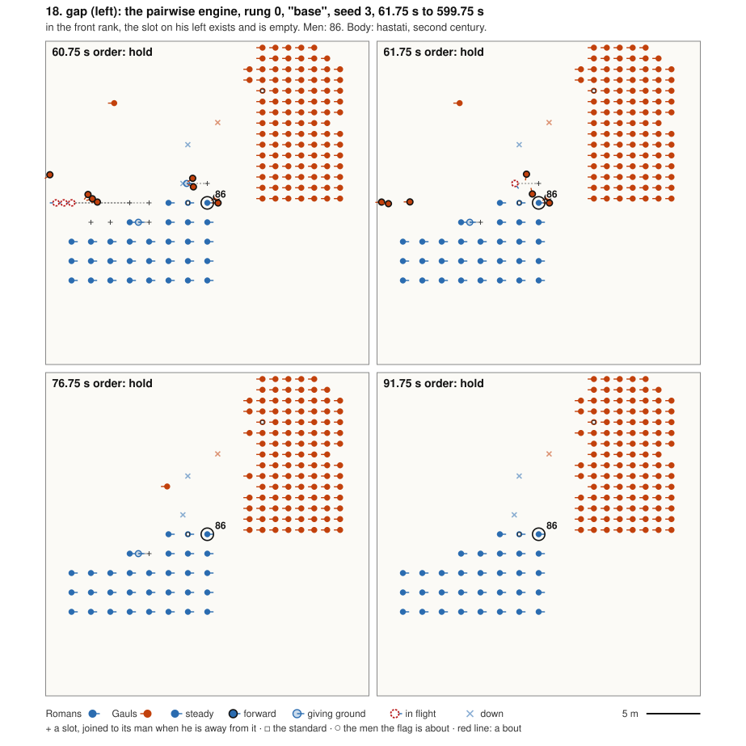

- **Where:** the pairwise engine, rung 0, `base`, seed 3, at 61.75 s, for 538 s.
- **Measured:** in the front rank, the slot on his left exists and is empty. Kind: left. One of 111 of this kind on this engine.
- **Bin:** gap K. The 30 men left stand in a staircase. Beside it: L.
- **In the viewer:** http://127.0.0.1:8377/?engine=pairwise&rung=0&variant=base&seed=3&t=58&man=86

### 18-gap-pairwise-left-3

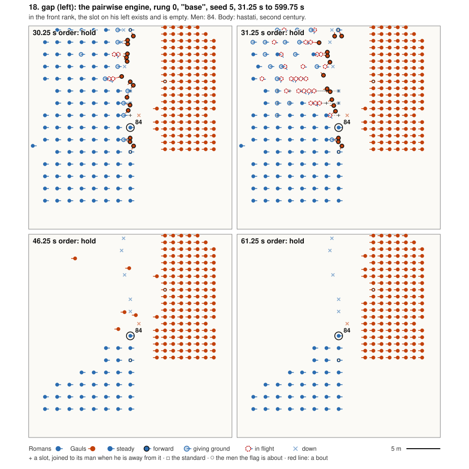

- **Where:** the pairwise engine, rung 0, `base`, seed 5, at 31.25 s, for 568.5 s.
- **Measured:** in the front rank, the slot on his left exists and is empty. Kind: left. One of 111 of this kind on this engine.
- **Bin:** gap K. The same, 25 men.
- **In the viewer:** http://127.0.0.1:8377/?engine=pairwise&rung=0&variant=base&seed=5&t=28&man=84

### 18-gap-pairwise-left-4

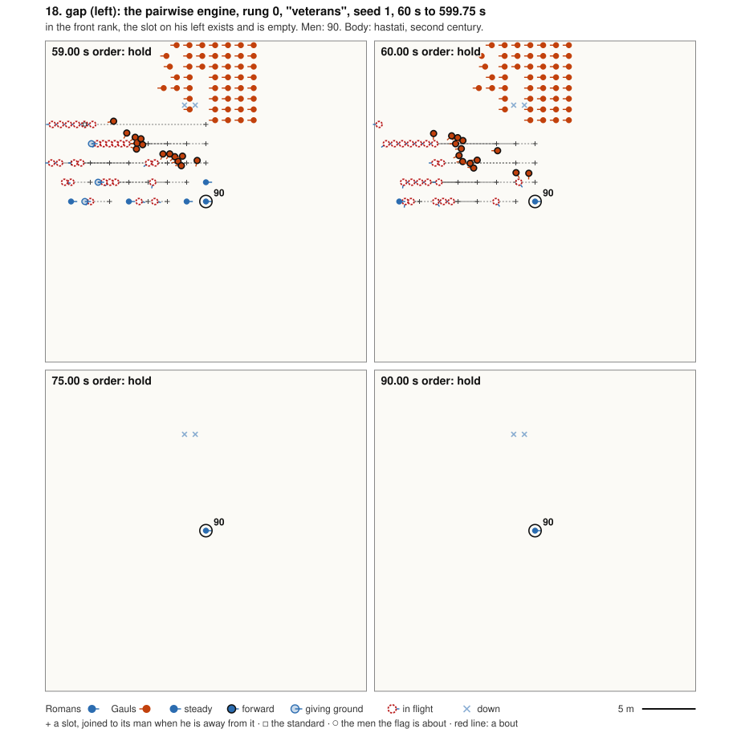

- **Where:** the pairwise engine, rung 0, `veterans`, seed 1, at 60 s, for 539.75 s.
- **Measured:** in the front rank, the slot on his left exists and is empty. Kind: left. One of 111 of this kind on this engine.
- **Bin:** gap K. One man stands alone at his slot for nine minutes.
- **In the viewer:** http://127.0.0.1:8377/?engine=pairwise&rung=0&variant=veterans&seed=1&t=57&man=90

### 18-gap-pairwise-right-1

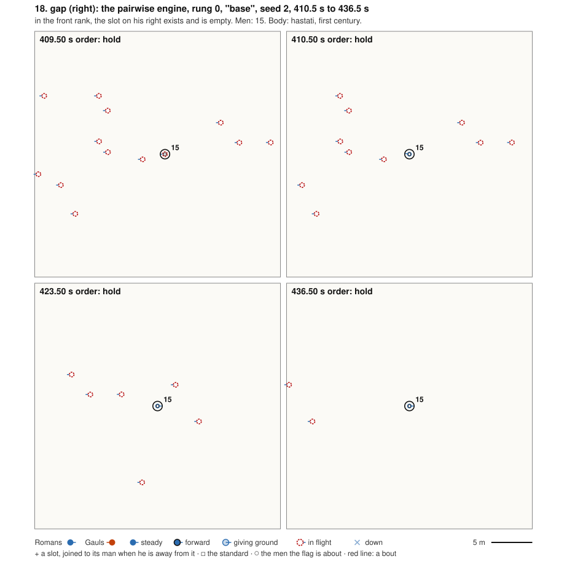

- **Where:** the pairwise engine, rung 0, `base`, seed 2, at 410.5 s, for 26 s.
- **Measured:** in the front rank, the slot on his right exists and is empty. Kind: right. One of 83 of this kind on this engine.
- **Bin:** fine. A runner stands again, alone, for 26 s: a lone man has no file beside him.
- **In the viewer:** http://127.0.0.1:8377/?engine=pairwise&rung=0&variant=base&seed=2&t=407&man=15

### 18-gap-pairwise-right-2

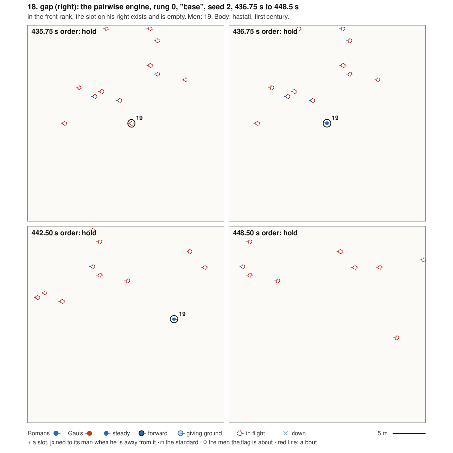

- **Where:** the pairwise engine, rung 0, `base`, seed 2, at 436.75 s, for 11.75 s.
- **Measured:** in the front rank, the slot on his right exists and is empty. Kind: right. One of 83 of this kind on this engine.
- **Bin:** fine. The same, 12 s.
- **In the viewer:** http://127.0.0.1:8377/?engine=pairwise&rung=0&variant=base&seed=2&t=433&man=19

### 18-gap-pairwise-right-3

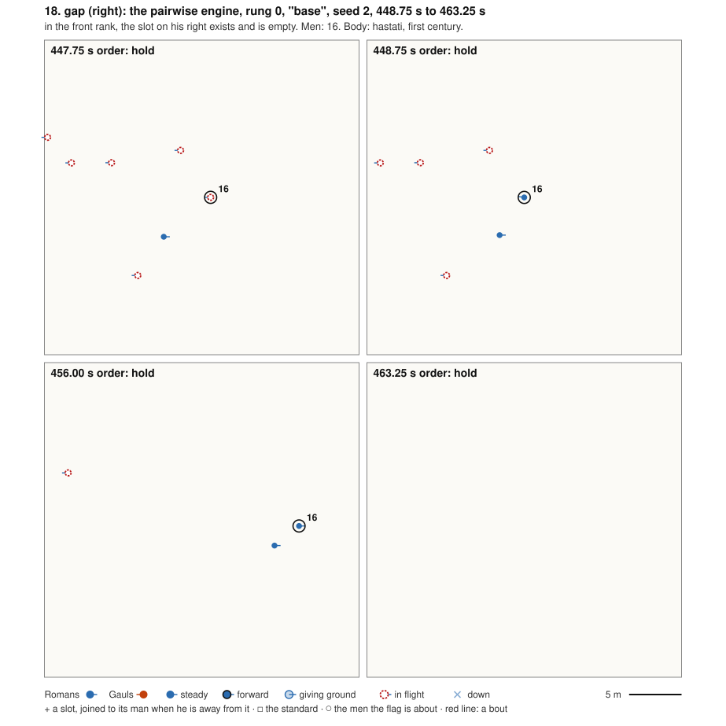

- **Where:** the pairwise engine, rung 0, `base`, seed 2, at 448.75 s, for 14.5 s.
- **Measured:** in the front rank, the slot on his right exists and is empty. Kind: right. One of 83 of this kind on this engine.
- **Bin:** fine. The same, 14.5 s.
- **In the viewer:** http://127.0.0.1:8377/?engine=pairwise&rung=0&variant=base&seed=2&t=445&man=16

### 18-gap-pairwise-right-4

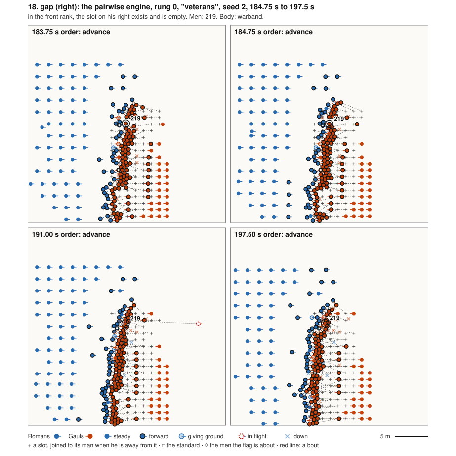

- **Where:** the pairwise engine, rung 0, `veterans`, seed 2, at 184.75 s, for 12.75 s.
- **Measured:** in the front rank, the slot on his right exists and is empty. Kind: right. One of 83 of this kind on this engine.
- **Bin:** fine. A warband file closes after 10 s, and the detector asks for more than 10: 12.75 s.
- **In the viewer:** http://127.0.0.1:8377/?engine=pairwise&rung=0&variant=veterans&seed=2&t=181&man=219

### 19-leaderless-pairwise-closer-standing-1

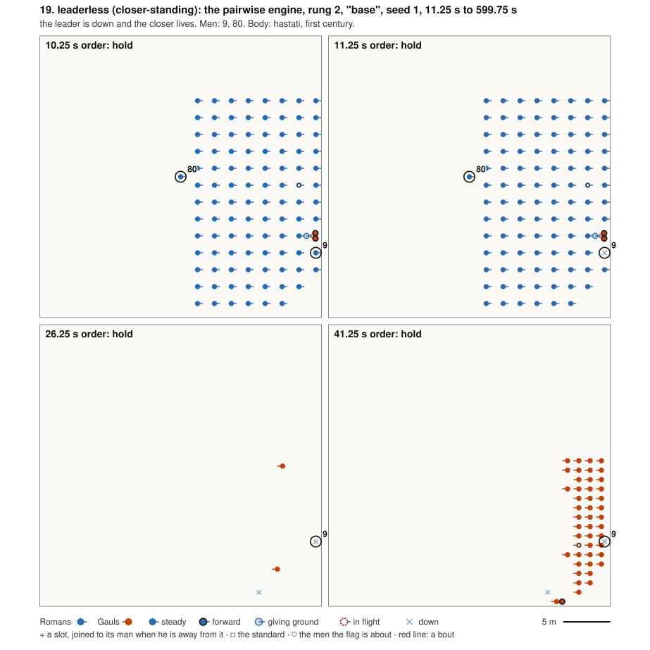

- **Where:** the pairwise engine, rung 2, `base`, seed 1, at 11.25 s, for 588.5 s.
- **Measured:** the leader is down and the closer lives. Kind: closer-standing. One of 11 of this kind on this engine.
- **Bin:** fine. The leader fell at 11.25 s and the closer was in flight by 15.25 s, before the five seconds were up. The century was gone by 26 s.
- **In the viewer:** http://127.0.0.1:8377/?engine=pairwise&rung=2&variant=base&seed=1&t=8&man=9

### 19-leaderless-pairwise-closer-standing-2

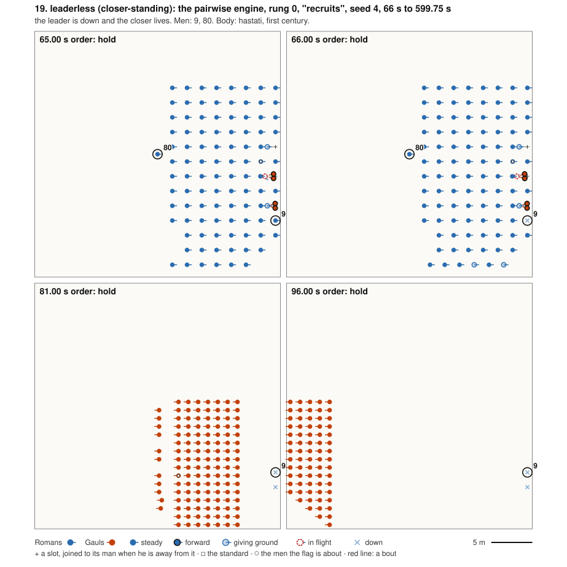

- **Where:** the pairwise engine, rung 0, `recruits`, seed 4, at 66 s, for 533.75 s.
- **Measured:** the leader is down and the closer lives. Kind: closer-standing. One of 11 of this kind on this engine.
- **Bin:** fine. The same: the closer fled 3.5 s after the leader fell.
- **In the viewer:** http://127.0.0.1:8377/?engine=pairwise&rung=0&variant=recruits&seed=4&t=63&man=9

### 19-leaderless-pairwise-closer-standing-3

*The same drawing as [`19-leaderless-pairwise-closer-standing-2`](#19-leaderless-pairwise-closer-standing-2).*

- **Where:** the pairwise engine, rung 1, `recruits`, seed 4, at 66 s, for 533.75 s.
- **Measured:** the leader is down and the closer lives. Kind: closer-standing. One of 11 of this kind on this engine.
- **Bin:** fine. = `19` 2.
- **In the viewer:** http://127.0.0.1:8377/?engine=pairwise&rung=1&variant=recruits&seed=4&t=63&man=9

### 20-far-pairwise-standing-1

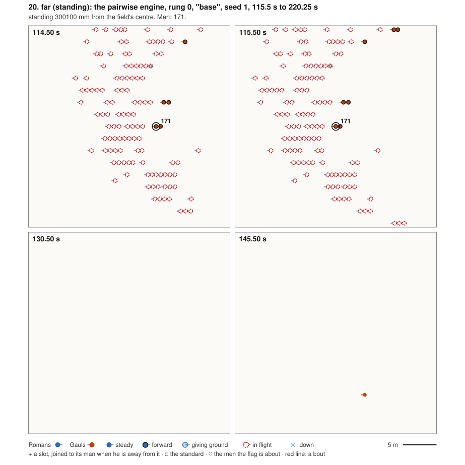

- **Where:** the pairwise engine, rung 0, `base`, seed 1, at 115.5 s, for 104.75 s.
- **Measured:** standing 300100 mm from the field's centre. Kind: standing. One of 16153 of this kind on this engine.
- **Bin:** gap G. A Gaul among the runners 300 m from the field, and still there 105 s later.
- **In the viewer:** http://127.0.0.1:8377/?engine=pairwise&rung=0&variant=base&seed=1&t=112&man=171

### 20-far-pairwise-standing-2

- **Where:** the pairwise engine, rung 0, `base`, seed 1, at 115.75 s, for 99.5 s.
- **Measured:** standing 300437 mm from the field's centre. Kind: standing. One of 16153 of this kind on this engine.
- **Bin:** gap G. The man beside him.
- **In the viewer:** http://127.0.0.1:8377/?engine=pairwise&rung=0&variant=base&seed=1&t=112&man=172

### 20-far-pairwise-standing-3

- **Where:** the pairwise engine, rung 0, `base`, seed 1, at 116 s, for 99.25 s.
- **Measured:** standing 300225 mm from the field's centre. Kind: standing. One of 16153 of this kind on this engine.
- **Bin:** gap G. The next.
- **In the viewer:** http://127.0.0.1:8377/?engine=pairwise&rung=0&variant=base&seed=1&t=113&man=173

### 20-far-pairwise-standing-4

- **Where:** the pairwise engine, rung 0, `flank`, seed 1, at 115.75 s, for 103.75 s.
- **Measured:** standing 300243 mm from the field's centre. Kind: standing. One of 16153 of this kind on this engine.
- **Bin:** gap G. The same scene as `20` 1.
- **In the viewer:** http://127.0.0.1:8377/?engine=pairwise&rung=0&variant=flank&seed=1&t=112&man=171

### 25-slot-back-pairwise-by-the-lead-1

- **Where:** the pairwise engine, rung 0, `shock`, seed 5, at 68.75 s.
- **Measured:** 36 of 36 slots moved -1528 mm ahead and -33 mm left; order Some(Charge) -> Charge; standard Some(Carried(ManId(331))) -> Carried(ManId(331)). Kind: by-the-lead. One of 5 of this kind on this engine.
- **Bin:** fine. The band's lead goes off at contact.
- **In the viewer:** http://127.0.0.1:8377/?engine=pairwise&rung=0&variant=shock&seed=5&t=65

### 25-slot-back-pairwise-by-the-lead-2

*The same drawing as [`25-slot-back-pairwise-by-the-lead-1`](#25-slot-back-pairwise-by-the-lead-1).*

- **Where:** the pairwise engine, rung 1, `shock`, seed 5, at 68.75 s.
- **Measured:** 36 of 36 slots moved -1528 mm ahead and -33 mm left; order Some(Charge) -> Charge; standard Some(Carried(ManId(331))) -> Carried(ManId(331)). Kind: by-the-lead. One of 5 of this kind on this engine.
- **Bin:** fine. = by-the-lead 1.
- **In the viewer:** http://127.0.0.1:8377/?engine=pairwise&rung=1&variant=shock&seed=5&t=65

### 25-slot-back-pairwise-by-the-lead-3

- **Where:** the pairwise engine, rung 2, `shock`, seed 4, at 78.5 s.
- **Measured:** 36 of 36 slots moved -1551 mm ahead and 26 mm left; order Some(Charge) -> Charge; standard Some(Carried(ManId(331))) -> Carried(ManId(331)). Kind: by-the-lead. One of 5 of this kind on this engine.
- **Bin:** fine. The same.
- **In the viewer:** http://127.0.0.1:8377/?engine=pairwise&rung=2&variant=shock&seed=4&t=75

### 25-slot-back-pairwise-other-1

- **Where:** the pairwise engine, rung 0, `base`, seed 1, at 2.75 s.
- **Measured:** 160 of 160 slots moved -1175 mm ahead and 0 mm left; order Some(Advance) -> Advance; standard Some(Carried(ManId(192))) -> Carried(ManId(192)). Kind: other. One of 1602 of this kind on this engine.
- **Bin:** fine. The warband halts at its standoff: the lead goes off (1,500 mm back) while the bearer walks a step (325 mm on).
- **In the viewer:** http://127.0.0.1:8377/?engine=pairwise&rung=0&variant=base&seed=1&t=0

### 25-slot-back-pairwise-other-2

- **Where:** the pairwise engine, rung 0, `base`, seed 1, at 40.75 s.
- **Measured:** 73 of 73 slots moved -650 mm ahead and 0 mm left; order Some(Hold) -> Hold; standard Some(Carried(ManId(15))) -> Carried(ManId(15)). Kind: other. One of 1602 of this kind on this engine.
- **Bin:** gap A. The first century's 73 slots move 0.65 m back at one step; half a second later every man stands on them.
- **In the viewer:** http://127.0.0.1:8377/?engine=pairwise&rung=0&variant=base&seed=1&t=37

### 25-slot-back-pairwise-other-3

- **Where:** the pairwise engine, rung 0, `base`, seed 1, at 41.25 s.
- **Measured:** 158 of 158 slots moved -1175 mm ahead and 0 mm left; order Some(Advance) -> Advance; standard Some(Carried(ManId(192))) -> Carried(ManId(192)). Kind: other. One of 1602 of this kind on this engine.
- **Bin:** fine. The warband's lead goes off three steps after it came on.
- **In the viewer:** http://127.0.0.1:8377/?engine=pairwise&rung=0&variant=base&seed=1&t=38

### 25-slot-back-pairwise-other-4

*The same drawing as [`25-slot-back-pairwise-other-1`](#25-slot-back-pairwise-other-1).*

- **Where:** the pairwise engine, rung 0, `backed`, seed 1, at 2.75 s.
- **Measured:** 160 of 160 slots moved -1175 mm ahead and 0 mm left; order Some(Advance) -> Advance; standard Some(Carried(ManId(192))) -> Carried(ManId(192)). Kind: other. One of 1602 of this kind on this engine.
- **Bin:** fine. = other 1.
- **In the viewer:** http://127.0.0.1:8377/?engine=pairwise&rung=0&variant=backed&seed=1&t=0

### 25-slot-back-pairwise-other-5

*The same drawing as [`25-slot-back-pairwise-other-1`](#25-slot-back-pairwise-other-1).*

- **Where:** the pairwise engine, rung 0, `relief`, seed 1, at 2.75 s.
- **Measured:** 160 of 160 slots moved -1175 mm ahead and 0 mm left; order Some(Advance) -> Advance; standard Some(Carried(ManId(192))) -> Carried(ManId(192)). Kind: other. One of 1602 of this kind on this engine.
- **Bin:** fine. = other 1.
- **In the viewer:** http://127.0.0.1:8377/?engine=pairwise&rung=0&variant=relief&seed=1&t=0

### 25-slot-back-pairwise-other-6

- **Where:** the pairwise engine, rung 0, `shock`, seed 1, at 66.75 s.
- **Measured:** 36 of 36 slots moved -510 mm ahead and -140 mm left; order Some(Charge) -> Charge; standard Some(Carried(ManId(331))) -> Carried(ManId(331)). Kind: other. One of 1602 of this kind on this engine.
- **Bin:** fine. A frame on the march follows its bearer, who is checked at the Roman rear rank.
- **In the viewer:** http://127.0.0.1:8377/?engine=pairwise&rung=0&variant=shock&seed=1&t=63

### 26-stalled-pairwise-1

- **Where:** the pairwise engine, rung 0, `backed`, seed 2, at 1648.75 s, for 10 s.
- **Measured:** under the order Advance for 10 s, 138 of 160 men standing, no enemy up within 10 m, and its slots 0 mm from where they were. One of 2 of this kind on this engine.
- **Bin:** fine. The warband stood at its standoff before one Roman, who fell at the window's end; the detector reads the enemy only then. Beside it: M.
- **In the viewer:** http://127.0.0.1:8377/?engine=pairwise&rung=0&variant=backed&seed=2&t=1645

### 26-stalled-pairwise-2

*The same drawing as [`26-stalled-pairwise-1`](#26-stalled-pairwise-1).*

- **Where:** the pairwise engine, rung 0, `relief`, seed 2, at 1648.75 s, for 10 s.
- **Measured:** under the order Advance for 10 s, 138 of 160 men standing, no enemy up within 10 m, and its slots 0 mm from where they were. One of 2 of this kind on this engine.
- **Bin:** fine. = `26` 1.
- **In the viewer:** http://127.0.0.1:8377/?engine=pairwise&rung=0&variant=relief&seed=2&t=1645

### 28-sudden-flight-pairwise-1

- **Where:** the pairwise engine, rung 0, `base`, seed 1, at 19 s.
- **Measured:** turned to flight 500 ms after he was steady. One of 17674 of this kind on this engine.
- **Bin:** gap D. Steady at 18.5 s, giving ground at 18.75, in flight at 19.
- **In the viewer:** http://127.0.0.1:8377/?engine=pairwise&rung=0&variant=base&seed=1&t=16&man=82

### 28-sudden-flight-pairwise-2

- **Where:** the pairwise engine, rung 0, `base`, seed 1, at 38.75 s.
- **Measured:** turned to flight 500 ms after he was steady. One of 17674 of this kind on this engine.
- **Bin:** gap D. The same.
- **In the viewer:** http://127.0.0.1:8377/?engine=pairwise&rung=0&variant=base&seed=1&t=35&man=28

### 28-sudden-flight-pairwise-3

- **Where:** the pairwise engine, rung 0, `base`, seed 1, at 39.25 s.
- **Measured:** turned to flight 500 ms after he was steady. One of 17674 of this kind on this engine.
- **Bin:** gap D. The same, a man of the third rank.
- **In the viewer:** http://127.0.0.1:8377/?engine=pairwise&rung=0&variant=base&seed=1&t=36&man=38

### 28-sudden-flight-pairwise-4

*The same drawing as [`28-sudden-flight-pairwise-1`](#28-sudden-flight-pairwise-1).*

- **Where:** the pairwise engine, rung 0, `backed`, seed 1, at 19 s.
- **Measured:** turned to flight 500 ms after he was steady. One of 17674 of this kind on this engine.
- **Bin:** gap D. = `28` 1.
- **In the viewer:** http://127.0.0.1:8377/?engine=pairwise&rung=0&variant=backed&seed=1&t=16&man=82
